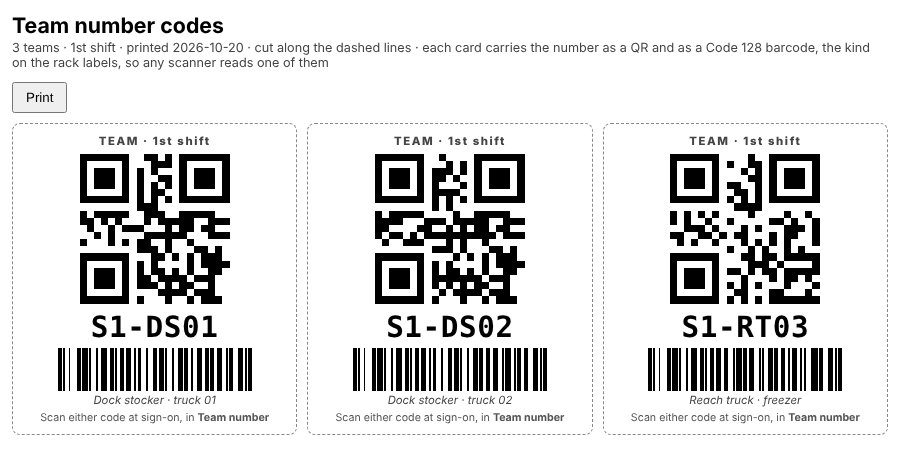

# How to — Employees, teams and gear sizes

**Role:** Count supervisors and whoever keeps the crew list  **Login profile:** any login with *Teams & crew* (Count supervisor, Supervisor, Admin); *Gear sizes* can be given on its own  **Pages:** Teams & crew  **Functions:** adding, editing and removing employees; the crew-list and team-sheet uploads; departments and gear sizes; the gear export

Everyone who counts has to be on the crew list: once it is loaded, a gun will not sign on with a
clock-in number that is not on it. This guide covers keeping that list — adding, editing and
removing people, one at a time or from a file — putting them on teams, and recording each
person's department and jacket, bibs and boot sizes, with the totals to order from.

## Contents

- [1 — The four tabs](#1--the-four-tabs)
- [2 — Add an employee](#2--add-an-employee)
- [3 — Edit or remove an employee](#3--edit-or-remove-an-employee)
- [4 — The whole crew list from a file](#4--the-whole-crew-list-from-a-file)
- [5 — Teams](#5--teams)
- [6 — Gear sizes, and the order](#6--gear-sizes-and-the-order)
- [7 — Who may do what](#7--who-may-do-what)
- [8 — When something is not right](#8--when-something-is-not-right)

## 1 — The four tabs

**Teams & crew** has four tabs:

| Tab | For |
|---|---|
| **Teams** | Who is on which team today: drag people onto teams, upload the team sheet, set each team's shift, the counting plan |
| **Employees** | The crew list itself: add, edit, remove, upload, export |
| **Gear sizes** | Everyone's jacket, bibs and boots, the totals, and the Excel export to order from |
| **Equipment rules** | Which levels need which equipment |

## 2 — Add an employee

**Teams & crew → Employees → Add employees.**

*Add employees: one at a time on the bottom row, or the whole list from a file above it.*

1. **Clock in number** — the number on their badge. Required.
2. **Name** — required.
3. **Department** — optional (*Warehouse*, *Production*, *Freezer*…); **Shift** — 1st or 2nd,
   optional. It shows as a chip on the person's card and a column in the list.
4. **Equipment** — tick what they are certified on. None ticked is on foot.
5. **Jacket**, **Bibs**, **Boots** — optional; they can be added later.
6. **Add employee** (or Enter in the Name box). The form clears for the next person.

A clock-in number that is already on the list is refused, with the name it belongs to — use
**Edit** on that person instead (section 3). The new person can sign on to a gun at once.

## 3 — Edit or remove an employee

**Teams & crew → Employees** lists everyone on the crew list, whatever team they are on.

*The Employees table, with one row open for editing.*

- **Find** — a name, clock-in number or department. **Department**, **Shift** and **Team** narrow
  it (*No department*, *No shift*, *Not on a team*). The chip in the heading counts who is shown.
- **Edit** on a row opens the person under it: **clock-in number, name, department, shift, sizes
  and equipment**. Change what you need and press **Save** (or Enter); **Cancel** closes it.
  - A **new clock-in number** asks first. Their team and their team-sheet seat go with them;
    counts already scanned keep the number they were scanned under.
- **Remove** — on the row, or inside the Edit form. It asks first, takes them off the crew list and
  off their team. Their counts stay as they are. A removed clock-in number can no longer sign on.

The same **Edit** is on each person's card on the **Teams** tab:

*A crew card on the Teams tab with Edit open.*

Searching a person's name in the sidebar's search box lands on their row in Employees. Every add,
edit and removal is in the log (*Settings → Backups & log*) with who made it and what changed.

## 4 — The whole crew list from a file

**Teams & crew → Employees → Add employees → CSV or Excel file → Upload.**

The columns are matched by name, in any order:

| Column | Also read as |
|---|---|
| **Clock In Number** (required) | Badge, Employee ID, Emp ID, Employee number |
| Name | Employee name, Full name |
| Department | Dept, Area |
| Shift | Shift no — 1 or 2, however it is written (*1st*, *first*, *day*; *2nd*, *second*, *night*) |
| Equipment | Certifications, Certified, Can operate — a list, *Scissor lift; High reach* |
| Jacket | Jacket size, Coat |
| Bibs | Overalls, Bib size, Pants |
| Boots | Boot size, Shoe size |

- A person already on the list is **brought up to date**; a new one is added. Nobody is removed
  unless **Replace the whole list** is ticked.
- Sizes are read the way people write them: *xx-large* and *XXL* are **2XL**, *10 1/2* is **10.5**,
  a wide boot keeps its **W**. A file with **no size columns leaves the sizes already entered**.
- **⬇ Sample CSV** downloads a file in the right shape. **Export current list** downloads the
  crew list as it stands, sizes included.

## 5 — Teams

**Teams & crew → Teams.**

- **Drag** a person from *Not on a team* onto a team card, or between teams — or use the menu on
  their card (on a tablet). **— no team —** takes them off.
- Every card shows the person's **department** chip, their equipment, their sizes, **Edit** and
  **Remove**.
- **Add team** makes a team (a number, a shift, notes). **The team sheet** (*Team #, Department,
  Employee, Equipment*, a row per seat) builds every team at once: *S1-DS01* reads as 1st shift,
  dock stocker, truck 01; a blank name is an open seat whose equipment still counts.
- **1st shift / 2nd shift** and **Department** above the board show one at a time.
- **The crew board** (`/crew`) puts the teams and their people on a wall screen by shift — 1st
  shift 6am–2pm, 2nd shift 2pm–10pm, the one on now marked — with each team's aisle, its last
  scan, and **Scanning** or a red **Stopped scanning**. No sign-in, no clock-in numbers. It shows
  **one shift at a time**: the one on now by the clock, or the one fixed under **Settings → Site &
  systems → Crew board**, which also picks what each card shows and whether the list **scrolls by
  itself**, and how fast. Open it from the Dashboard's **Crew board ↗** chip; `?shift=2` pins a
  screen to one shift and `?scroll=0` stops the scrolling on that screen.
- **⬇ Export the teams (CSV)** downloads every team across both shifts, one row a seat, in the
  team sheet's own columns plus the shift, so the shifts compare side by side in Excel and the file
  uploads back after it is reworked.
- **🖨 Print team QR codes** prints a card for each team with its number as a QR code, three
  across a letter page. Pick **Every team**, **1st shift** or **2nd shift** in the box beside
  it first. At sign-on the counter scans the card into **Team number** on the gun instead of
  typing it; the number is printed large under the code for anyone without a scanner. The QR
  holds the team number and nothing else, so a lost card signs nobody in. It needs
  **Downloads** on the login, and the Log records who printed them.

## 6 — Gear sizes, and the order

**Teams & crew → Gear sizes.**

*Gear sizes: the totals above, everyone below.*

1. Everyone on the crew list, a row each. **Pick a size and it is saved** — the cell flashes green.
   The department can be typed here too. Jackets and bibs run XS to 5XL; boots 5 to 16 in half sizes.
2. The three boxes above are the **totals**: how many of each size, the **total** of each item, and
   how many people have **not entered** a size (amber).
3. Narrow it with **Department**, **Find**, or **Only people missing a size** — the list to chase
   before the order goes in.
4. **⬇ Export names and sizes** downloads an Excel workbook:
   - *Names and sizes* — everyone, by department, with their team and three sizes;
   - *Grand totals* — each size of each item, the *not entered* count, a **grand total** per item,
     and the number of people;
   - *By department* — the same totals for each department.

   With a department picked, the export is that department alone.

## 7 — Who may do what

Under **Settings → Logins**, a login's *May use* list has ticks for each tab of Teams & crew:

| Tick | Gives |
|---|---|
| **Teams & crew** (the whole page) | Everything here |
| Teams & employees | The Teams and Employees tabs: add, edit, remove, teams, the counting plan |
| **Gear sizes** | The Gear sizes tab alone — for whoever orders the gear |
| Equipment rules | The level rules |

## 8 — When something is not right

| You see | What it means | What to do |
|---|---|---|
| Gun: *Not signed on — see a supervisor* (*E9999 is not on the crew list*) | That clock-in number is not on the crew list | **Add employee** with that number; they sign on again |
| *E1043 is already Marcus Obi on the crew list* | The number is someone else's | **Edit** that person, or check the badge |
| A size is not in the pick-list | It came in on an upload written another way (*L TALL*, *11W*) | It is kept and shown as written; pick a listed size to change it |
| Sizes vanished after an upload | They did not — a file with no size columns leaves them alone. Check the file had sizes in the wrong column | Re-upload with *Jacket*, *Bibs*, *Boots* headings |
| *Not on the crew list yet* on a team card | A name on the team sheet with no clock-in number on the list | Add them under Employees, then upload the team sheet again |
| The Gear sizes tab only | The login has *Gear sizes* alone | That is on purpose; an admin adds *Teams & employees* if they need more |
