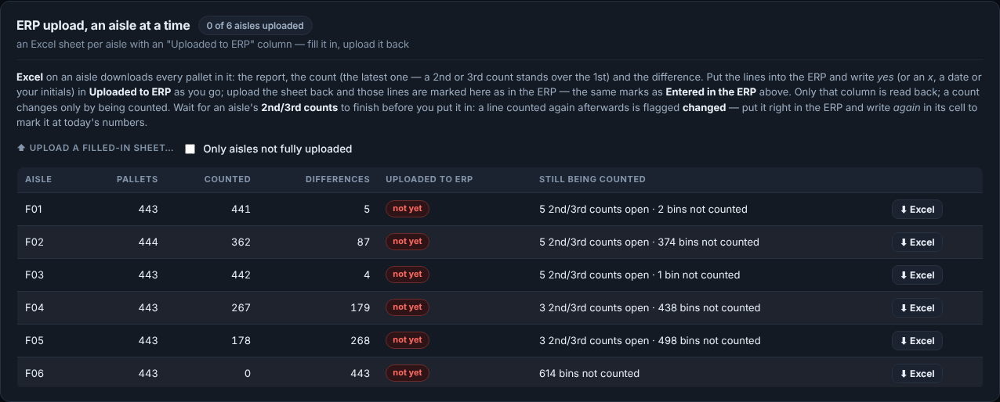
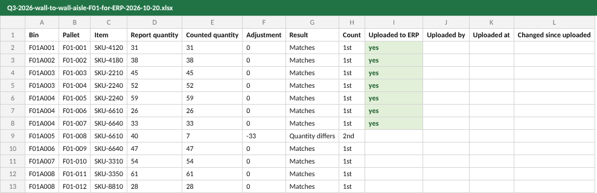
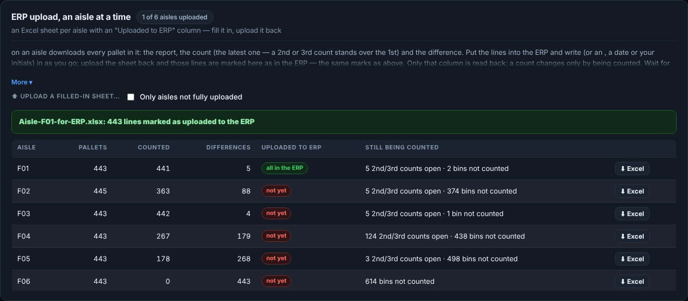

# How to — The ERP upload, an aisle at a time

**Role:** Inventory control  **Login profile:** *Inventory control* (or Supervisor, Admin) — needs *Approve adjustments* and *Downloads*  **Pages:** Dashboard → Adjustments, or Inventory Control → Adjustments  **Functions:** downloading an aisle for the ERP, marking lines as uploaded, the ERP worksheet

A wall-to-wall goes into the ERP aisle by aisle, as the aisles are finished, rather than in one
sitting at the end. This guide is that routine: download an aisle's Excel sheet, put its lines
into the ERP, write *yes* against each line as it goes in, and upload the sheet back so the app
knows what is in the ERP — so nothing is keyed twice, and nothing is missed.

## Contents

- [1 — In one minute](#1--in-one-minute)
- [2 — Before you start an aisle](#2--before-you-start-an-aisle)
- [3 — Download the aisle](#3--download-the-aisle)
- [4 — Put it into the ERP and fill in the sheet](#4--put-it-into-the-erp-and-fill-in-the-sheet)
- [5 — Upload the sheet back](#5--upload-the-sheet-back)
- [6 — A line counted again after it went in](#6--a-line-counted-again-after-it-went-in)
- [7 — The whole-count worksheet, and marking on screen](#7--the-whole-count-worksheet-and-marking-on-screen)
- [8 — When something is not right](#8--when-something-is-not-right)

## 1 — In one minute

1. **Dashboard → Adjustments → ERP upload, an aisle at a time** (the same card is under **Inventory
   Control → Adjustments**). Pick the count at the top.
2. Wait for the aisle's **second and third counts** to finish.
3. **⬇ Excel** on the aisle: every pallet in it, with an **Uploaded to ERP** column.
4. Put the lines into the ERP. Write **yes** in *Uploaded to ERP* as each goes in.
5. **⬆ Upload a filled-in sheet…** — those lines are marked as in the ERP.
6. Next aisle. **Only aisles not fully uploaded** shows what is left.

Uploading the sheet back only marks lines. **It never changes a count** — a count changes only by
being counted.

## 2 — Before you start an aisle

**Dashboard → Adjustments → ERP upload, an aisle at a time** has a row for every aisle on the count:

*Each aisle: how much of it is counted, how much differs, how much is in the ERP, and what is still being counted.*

| Column | What it is |
|---|---|
| Aisle | The aisle |
| Pallets | Every pallet in it: on the report, or found there |
| Counted | How many of those have been counted |
| Differences | How many differ from the report (quantity, bin, not found, not on the report) |
| Uploaded to ERP | *not yet*, *12 of 40*, or *all in the ERP* — and *N changed since* when a line was counted again after it went in |
| Still being counted | Open **2nd/3rd counts** and **bins not counted** in the aisle, or *done* once it is handed back |

**Wait for "Still being counted" to clear** before you put an aisle in. A second or third count
can still change its numbers; a line that changes after it went into the ERP has to be put right
there (section 6).

## 3 — Download the aisle

Press **⬇ Excel** on the aisle's row. An Excel workbook downloads, named for the count and the
aisle — *Q4-wall-to-wall-aisle-F04-for-ERP-2026-10-21.xlsx*. Its first sheet is the aisle:

*An aisle's sheet, part way through: the lines already put into the ERP have yes in Uploaded to ERP (shown green here).*

| Column | What it is |
|---|---|
| Aisle, Bin, Pallet, System, Item, Description, Lot | The line |
| Report bin, Report quantity | What the inventory report said |
| Counted quantity | What the count found — **the latest count**: a 2nd or 3rd count stands over the 1st. Blank when the pallet was not found |
| Adjustment | Counted less report: what the ERP has to move. 0 on a match |
| Result | *Matches*, *Quantity differs*, *In a different bin*, *Not found*, *Not on the report*, *Counted twice* |
| Count | Which count the number is from: *1st*, *2nd* or *3rd* |
| **Uploaded to ERP** | **The one column you fill in** |
| Uploaded by, Uploaded at | Filled in by the app for lines already marked |
| Changed since uploaded | *was 36*: counted again after it went into the ERP (section 6) |

Every pallet is on the sheet, matches included, so an ERP that takes a counted quantity for
every pallet gets them all. A second sheet, *How to use*, repeats the steps.

## 4 — Put it into the ERP and fill in the sheet

Work down the sheet. As each line goes into the ERP, write in its **Uploaded to ERP** cell:

| Write | Means |
|---|---|
| **yes** — or **x**, **✓**, a date (*10/21*), your initials | In the ERP |
| **no** | Take the mark off (it was marked, but it is not in the ERP) |
| *(blank)* | Leave the line as it is in the app |
| **again** — or **updated**, **re-entered**, **corrected** | Counted again after it went in, and put right in the ERP since (section 6) |

Leave every other column as it is. Save the file — Excel's own format (.xlsx) is fine, so is CSV.

You do not have to finish an aisle in one go: upload what you have done, and the next download
of that aisle shows those lines marked, with who and when.

## 5 — Upload the sheet back

1. **⬆ Upload a filled-in sheet…** on the same card, and pick the file.
2. The message says how many lines were marked, how many were taken off, how many were already
   marked, and how many were left blank. A pallet that is not on this count is named and ignored.
3. The aisle's row moves on — *28 of 40*, then *all in the ERP*.

*After the upload: the aisle reads all in the ERP.*

- A workbook with **several aisles' sheets** in it is read sheet by sheet — every sheet that has an
  *Uploaded to ERP* column.
- **Only aisles not fully uploaded** hides the aisles that are done, so the list is what is left.
- Every upload is in the log (*Settings → Backups & log*) with who did it and from which aisle.

## 6 — A line counted again after it went in

A second or third count can land after a line was put into the ERP. Then the ERP holds the old
number. The app flags it:

- the aisle's row says **N changed since**;
- the aisle's sheet says **was 36** in *Changed since uploaded*, with the new *Counted quantity*;
- on the **Positive and negative** list above, the line is tagged **changed**.

To put it right:

1. Download the aisle again (**⬇ Excel**) and find the lines with *Changed since uploaded*.
2. Correct them in the ERP to the new **Counted quantity** / **Adjustment**.
3. Write **again** in their *Uploaded to ERP* cell and upload the sheet. They are marked at today's
   numbers and are no longer *changed*.

A plain *yes* on a line already marked keeps its first mark on purpose: uploading an old sheet
again can never hide a change.

## 7 — The whole-count worksheet, and marking on screen

The aisle sheets and these two are **the same marks** — use whichever suits; they never disagree.

- **Download the ERP worksheet (CSV)** (Adjustments → Positive and negative → *Entered in the
  ERP*): the whole count's adjustment lines only, with an **In ERP** column. Fill it in the same way
  and **Upload the worksheet back…**.
- **On screen:** tick lines on the Positive and negative list and press **Mark as entered** — or
  **Take the mark off**. **Hide lines already in the ERP** leaves only what is still to key.

## 8 — When something is not right

| You see | What it means | What to do |
|---|---|---|
| *the file has no "In ERP" or "Uploaded to ERP" column* | The file is not one of the app's sheets, or the column was renamed or deleted | Download the aisle again with **⬇ Excel** and fill in that column |
| *Not on this count, ignored: …* | Those pallets are not on the count you have picked | Check the count picker at the top — the sheet may be from another count |
| *N left blank* | Lines with nothing in *Uploaded to ERP* | Nothing to do: they are left as they were |
| An aisle stays at *12 of 40* | Only those lines had *yes* | Fill in the rest and upload again |
| **N changed since** | Counted again after it went in | Section 6 |
| The aisle is not on the list | Nothing has been counted or reported in it on this count | Pick the right count; check the bin list |
| *Still being counted* will not clear | A second or third count is open, or a bin has never been counted | Dashboard → Second counts; ask the floor to finish the aisle |
| The card is not there | The login may not approve adjustments | An admin ticks *Approve adjustments* under Settings → Logins |
