# How to — Your first full count, start to finish

**Role:** Whoever sets the site up and runs its first wall-to-wall  **Login profile:** Admin (Settings is for admins only)  **Pages:** Settings, Teams & crew, Full Counts, Dashboard, Inventory Control  **Functions:** everything a full count needs, from the first sign-in to the closed count

This guide is for someone who has never seen the app. Follow it top to bottom and you will have a
full count (a wall-to-wall) set up, counted on the scanners, checked, adjusted, sent to the ERP and
closed. It covers full counts only. Cycle counts, Front bins, Not in Location and the TEST system
are left out, and step 3 switches them off so nobody trips over them.

Every step says **where** to go, **what** to do, and **how you know it worked**. A tick list is at
the end, to print and carry on count day.

## Contents

- [1 — What you are setting up](#1--what-you-are-setting-up)
- [2 — Sign in for the first time](#2--sign-in-for-the-first-time)
- [3 — Switch off everything but full counts](#3--switch-off-everything-but-full-counts)
- [4 — Your site's name and logo](#4--your-sites-name-and-logo)
- [5 — A login for each supervisor](#5--a-login-for-each-supervisor)
- [6 — The crew list](#6--the-crew-list)
- [7 — Teams, and what their equipment reaches](#7--teams-and-what-their-equipment-reaches)
- [8 — Register and set up the scanners](#8--register-and-set-up-the-scanners)
- [9 — What the counting screen asks](#9--what-the-counting-screen-asks)
- [10 — The buttons the scanners offer](#10--the-buttons-the-scanners-offer)
- [11 — Create the count](#11--create-the-count)
- [12 — Upload the bin list and the inventory report](#12--upload-the-bin-list-and-the-inventory-report)
- [13 — Pair the aisles into racking blocks](#13--pair-the-aisles-into-racking-blocks)
- [14 — The count's options](#14--the-counts-options)
- [15 — Give the teams their aisles](#15--give-the-teams-their-aisles)
- [16 — Practice, and a trial run](#16--practice-and-a-trial-run)
- [17 — The day before: Ready for count day](#17--the-day-before-ready-for-count-day)
- [18 — Count day: the morning](#18--count-day-the-morning)
- [19 — Count day: what the counters do](#19--count-day-what-the-counters-do)
- [20 — Count day: what the supervisor watches](#20--count-day-what-the-supervisor-watches)
- [21 — Second counts](#21--second-counts)
- [22 — Read the reports](#22--read-the-reports)
- [23 — Approve the adjustments](#23--approve-the-adjustments)
- [24 — Into the ERP](#24--into-the-erp)
- [25 — Close the count and keep a copy](#25--close-the-count-and-keep-a-copy)
- [26 — When something is not right](#26--when-something-is-not-right)
- [27 — The tick list](#27--the-tick-list)

## 1 — What you are setting up

The app holds two lists for a count: **every bin in the warehouse**, and **what the ERP thinks is
on each pallet** (the inventory report). Counters walk the aisles with Zebra scanners and scan each
pallet, its quantity and its bin. The app compares what was counted with the report, sends people
back to look again where the two disagree, and gives you the adjustments for the ERP.

**The pages you will use.** They are all in the side panel on the left once you are signed in.

| Page | What it is for |
|---|---|
| **Settings** | Setting the site and the count up. Admins only |
| **Teams & crew** | The crew list, the teams, and the equipment each team has |
| **Full Counts** | Every wall-to-wall: make a new one, see how far each got, close it |
| **Dashboard** | The live view of the count while it runs: progress, teams, aisles, alerts |
| **Inventory Control** | Second counts, adjustments and reports, on a page of their own |
| **User guide** | This guide and the others, plus *Ask the guide* for questions in your own words |
| **The scanner app** | What runs on each Zebra. Each scanner has its own link |

**The count picker.** The box at the top of every office page says which count you are looking at.
Everything on Settings → Count setup, Lists & racking and the Dashboard is for the count in that box.
When you have more than one count, check it before you upload or change anything.

**Words you will meet.**

- **Bin** — one location on the racking. A code like `F01A001` is zone **F**, aisle **01**, level
  **A**, position **001**. Odd positions are the front face, even ones the back.
- **Aisle** — one rack run, such as `F01`. Teams are given whole aisles.
- **Racking block** — aisles that back onto each other. Only one team works a block at a time, so
  two crews are never on opposite faces of the same racking.
- **Second count** — a bin a different team goes back to, because the first count disagreed with
  the report.
- **Adjustment** — a difference between the count and the report that will change the ERP.

**Folded cards.** On Settings, cards you set once and leave show only their heading, with a **▸**
in front. Click the heading to open one, and click it again to fold it away.

**More room.** The round **«** on the side panel's right edge hides the panel. Put the mouse on the
thin strip at the left edge to slide it back out.

## 2 — Sign in for the first time

1. Open the site's address in Chrome or Edge on a desk computer. You see a sign-in box.
2. Sign in with the **site admin** username and password you were given.
3. Press **Change my password** at the foot of the side panel and choose one only you know.

**How you know it worked:** the side panel shows Dashboard, Full Counts, Inventory Control, Teams &
crew, Settings and the User guide.

**Five wrong passwords** lock that login out from that computer for 15 minutes. Wait, or ask another
admin to press **Unlock** on your row under Settings → Logins.

## 3 — Switch off everything but full counts

**Settings → Site & systems → What is switched on.**

1. Press **Full counts and second counts only**.
2. Cycle counts, Front bins, Not in Location, the Map, Adjustments and Reports leave the side panel,
   the dashboard and the scanners.
3. **Tick Adjustments and Reports back on and press Save.** A full count needs both to finish
   (steps 22 and 23).

**How you know it worked:** the side panel no longer shows Cycle counts, Front bins or Not in
Location, and the scanners' sign-on screen offers only the full count.

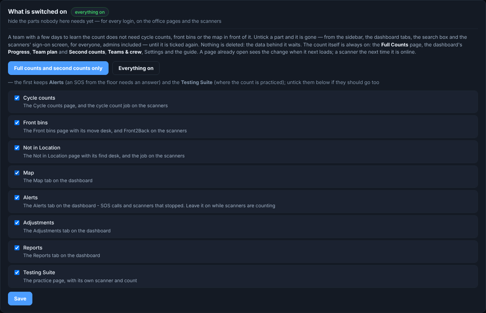

Nothing is deleted. **Everything on** brings every part back, exactly as it was.

## 4 — Your site's name and logo

**Settings → Site & systems.** Optional, but it makes every screen look like yours.

1. **Site name** — the app's name (*Full Harvest Inventory* to start) and the location under it.
   **Save**. It shows at once on every office page, the sign-in, the scanners and the office board.
2. **Logo** — upload your company's mark. Tick the box to show it on the scanners too.
3. **Appearance** — the colors and text size. This is kept per computer, so the office TV can be
   dark and a desk light.

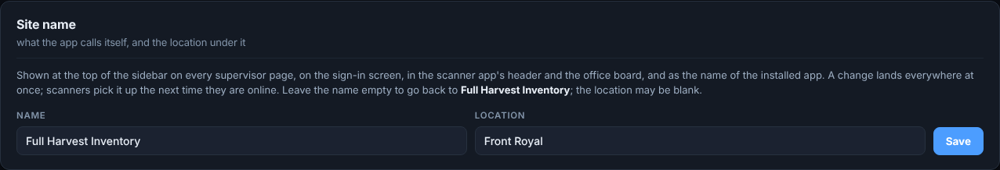

## 5 — A login for each supervisor

**Settings → Logins → Supervisor logins.** Give every person their own login, so the log can say
who did what. Counters on the scanners do **not** need a login: they sign on with a team number and
their clock-in number.

1. Type their **name** and a **username**.
2. Choose a **role**:

   | Role | For |
   |---|---|
   | **Admin** | Everything, Settings included |
   | **Supervisor** | Every page and button except Settings |
   | **Count supervisor** | Runs the floor: Dashboard, Teams & crew, messages, SOS, queueing aisles, downloads |
   | **Inventory control** | The count's numbers: Dashboard, second counts, approving adjustments, downloads |

3. Give them a way in, one of two:
   - **Invite by email.** Type their **Email** and press **Add login**. Press **Email the invite**
     to send a ready-made message from your own email, or **Copy link** to send it by text or
     Teams. The link works once, for three days. They open it, choose a password and are in.
   - **Starter password.** Leave the email blank and press **Add login**. A starter password such
     as `winter-4k2p` is shown **once**. Write it down and hand it to them. They must choose their
     own the first time they sign in.

**How you know it worked:** their row is in the table, marked *invited* until they choose a
password.

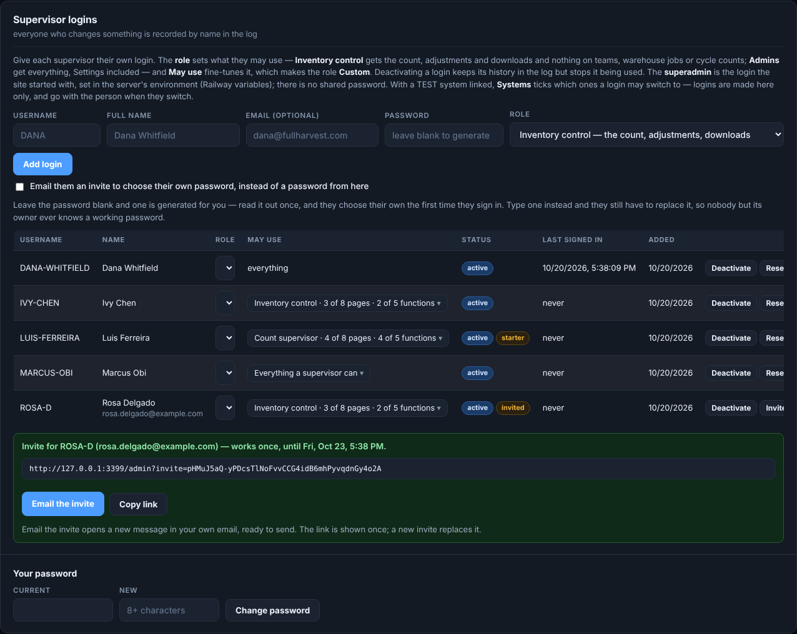

**May use** on each row fine-tunes what one person may open. A change takes effect on their next
click. **Reset password** gives someone who forgot theirs a new starter password.

## 6 — The crew list

**Teams & crew → Employees.** Everyone who will count must be on this list. Once it has anybody on
it, a scanner refuses a clock-in number that is not on it.

**One at a time:** press **Add employees**, type the **clock-in number** and **name**, and pick the
**shift** (1st or 2nd) and their **equipment** if you know them. Press **Add employee**. The form
clears for the next person.

**Everyone at once from a file:** upload a CSV or Excel file with one row per person.

| Column | What goes in it | Needed |
|---|---|---|
| **Clock in number** | The number on their badge (also read as *badge*, *employee id*) | Yes |
| **Name** | Their name | |
| **Department** | Warehouse, Production … | |
| **Shift** | 1 or 2 (*1st*, *first*, *day* and *2nd*, *second*, *night* all work) | |
| **Equipment** | What they may drive, for example `Scissor lift; High reach` | |

Tick **Replace the whole list** to clear the old list first. **Export current list** downloads what
is there.

**How you know it worked:** the table lists everyone, and the count above it matches your file.

## 7 — Teams, and what their equipment reaches

**Teams & crew → Teams.** A team is the crew on one scanner. The team's equipment decides which
levels it can be sent to, so a crew on foot is never given level D.

**Make the teams, one of two ways:**

- **By hand.** **Add team**, give it a number (such as `S1-DS01`), its **shift** and a note. Then
  drag people from *Not on a team* onto its card.
- **From the team sheet.** **Upload the team sheet**: one row per seat, with **Team #**,
  **Department**, **Employee** and **Equipment**.

  | Team # | Department | Employee | Equipment |
  |---|---|---|---|
  | S1-DS01 | Warehouse | Michael Roman Travera | Dock Stocker |
  | S1-DS01 | Production | | On Foot with Dock Stockers |
  | S1-RT05 | Warehouse | Jason Davies | High Reach |
  | S1-RT05 | Warehouse | Donovan Lopez | Scissor Lift - Counting |

  *S1-DS01* reads as 1st shift, dock stocker, truck 01. *S2-…* is 2nd shift. A blank name is an open
  seat whose equipment still counts. A name not on the crew list stays on the card marked *not on
  the crew list*: add them under Employees and upload the sheet again.

**Check the equipment rules.** **Teams & crew → Equipment rules** says which levels need which
equipment. With the rules as shipped, a dock stocker with someone on foot reaches level A only, and a
reach truck with a scissor lift reaches A and C–F. Change a rule here if your site works differently,
**before** you plan the aisles.

**Print the team QR codes.** **🖨 Print team QR codes** prints a card per team with its number as a
QR code and, under it, the same number as a Code 128 barcode like the rack labels. Pick **Every
team**, **1st shift** or **2nd shift** in the box beside it first. Cut the cards out and give one to
each team. At sign-on the counter scans either code instead of typing the number.

**How you know it worked:** each team card shows its people, its shift and its equipment.

## 8 — Register and set up the scanners

**Settings → Scanners → Scanner setup.** Each Zebra gets its own link. Opening that link once on the
device is what signs that scanner in.

**In the office:**

1. Type a **scanner name** — use what is written on the device, such as `SCANNER-05`. Add a note
   (asset tag, *freezer unit*) if it helps.
2. Press **Add scanner**. Repeat for every scanner.
3. Press **Print setup cards**. You get one card per scanner with its own QR code. Tape each card
   inside that scanner's cradle.

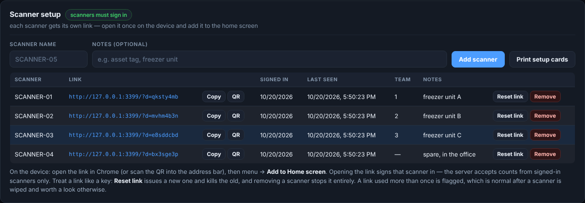

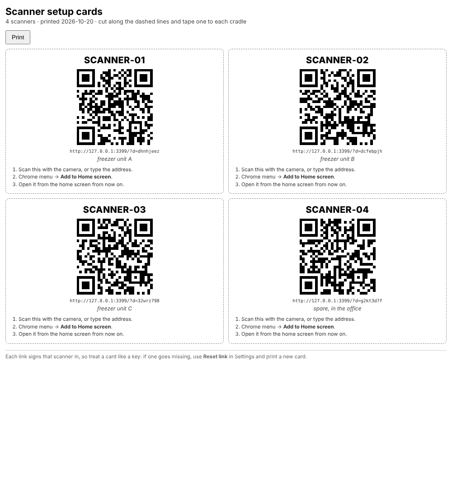

**On each scanner, once:**

1. Open **Chrome** and scan the QR code from its card into the address bar, or type the link.
2. **Install it.** Tap **Install on this scanner** on the app's sign-on screen, or use Chrome's menu
   → **Install app** / **Add to Home screen**. The installed app runs in its own window with no
   address bar and starts even with no signal. Do not leave it as a browser tab: a scan can land in
   the address bar instead of the count.
3. Set up **DataWedge** (the Zebra's scanning settings) so a scan arrives as typing:
   - in the profile for Chrome, **Keystroke output: enabled**;
   - **Basic data formatting** → send **ENTER** (or TAB) after each scan;
   - **Barcode input** → enable the barcode types your labels use: **Code 128** for the rack and
     pallet labels, and **QR Code** too if crews will scan the QR on the team cards. The team cards
     carry a Code 128 as well, so they scan either way.

**How you know it worked:** the scanner shows its own name on the sign-on screen, and its row under
Scanner setup says when it was last seen.

**A scanner link is a key.** If a scanner is lost, press **Reset link** on its row. The old link stops
working at once. Print its card again for the replacement.

**A Zebra that counts nothing but this app** is set up on the device with Zebra's *Enterprise Home
Screen* or your device management. That is a device setting, not one in this app.

## 9 — What the counting screen asks

**Settings → Scanners → How the counting screen is put together.** This is what a counter sees. The
preview on the right is drawn at the real screen size of the scanner.

1. **The questions, in order.** Drag them into the order your site counts in. Set it to **bin**,
   then **pallet**, then **quantity**: the rack label first, which suits a team working a bay at a
   time, and is the order the training film and slides show. Lot code and expiry only appear on
   counts that ask for them (step 14).
2. The switches below it. These are the ones worth knowing on a first count:

   | Switch | What it does | Suggested |
   |---|---|---|
   | **Show the next bin in the aisle** | The scanner says which bin comes next, so none is skipped | On |
   | **Text size: Large** | Easier to read in gloves and a freezer | On |
   | **Re-key a quantity of at least** | A quantity this big must be typed twice. 0 never asks | 0, or a size that is rare |
   | **Buzz on a good or bad scan** | The scanner vibrates, for counters in ear defenders | On |
   | **Keep the screen awake** | Stops the screen sleeping between bays | On |
   | **Update itself after a deploy** | The scanner takes a new version between pallets, never mid-line | On |

3. Press **Save**. Scanners pick it up within about half a minute, between pallets.

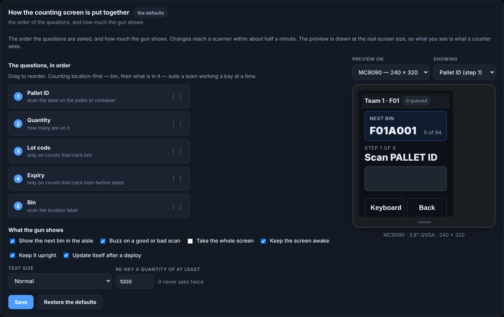

## 10 — The buttons the scanners offer

**Settings → Scanners → What the scanners offer.** Counters in gloves will not type, so these are
the buttons they tap instead. Write them in the words your floor uses. One **Save everything the
scanners offer** button at the bottom saves the lot.

- **Jobs on the sign-on screen** — tick **Full count** alone.
- **Comments** — the reasons offered after the bin is scanned, such as *damaged wrap* or *label
  faded*, and how many seconds the step waits before moving on by itself (2 to start). Tick
  **Comments are required** only if every line must carry one.
- **Override reasons** — offered when the scanner questions a line, such as a bin outside the team's
  aisle. **Other** is always offered as well.
- **SOS** — what a counter can call for help with: an injury, equipment broken down, a supervisor.
- **Report a problem** — damage, a blocked bin, and what the counter must scan to confirm it.

**When a team stops scanning.** On **Settings → Scanners → When a team stops scanning**, set how
many minutes of quiet raises an amber bar on the dashboard. 10 is a good start. **0** turns it off.

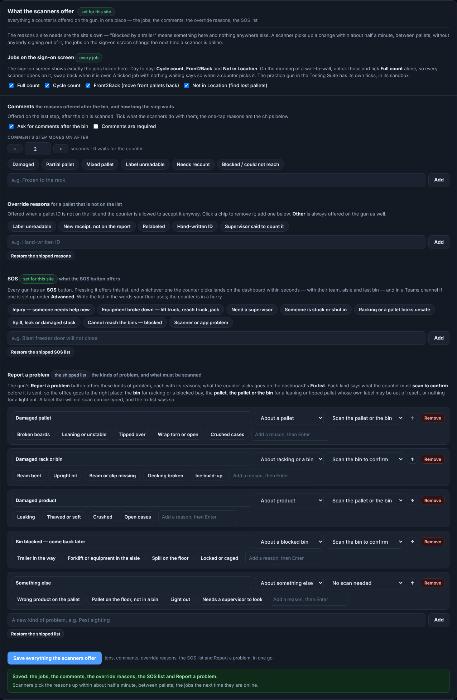

## 11 — Create the count

**Full Counts → New count.** Do steps 11 to 17 the day before, not the morning of the count.

1. Type a **Name** you will recognize later, such as `Q4 2026 wall-to-wall`.
2. Press **Create**.
3. Pick the new count in the **count picker** at the top of the page. Everything from here to step
   17 is for the count in that box.

**How you know it worked:** the count is in the Full Counts table, marked open.

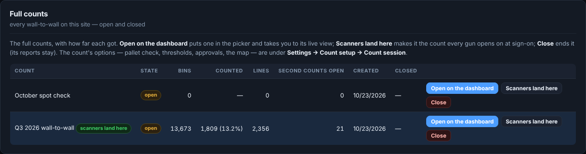

The **Set-up** tab on Full Counts lists what the new count still needs, each with a link to where it
is done. Keep it open in a second tab while you work through the next steps.

## 12 — Upload the bin list and the inventory report

**Settings → Lists & racking**, with the new count in the picker. Each count has its own lists.

**The bin list first.** Every location in the warehouse. It is what each scanned bin is checked
against, and it is what makes the aisles.

1. Under **Bin list**, choose the CSV or Excel file — the ERP's bin export, as it comes. The only
   column it must have is the bin location (*location*, *bin*, *slot* and similar are all read).
2. Tick **Replace what is there** if you are uploading it again.
3. Press **Upload**. (**⬇ Download the loaded list** gives it back as a file at any time.)

**How you know it worked:** the card says how many bins and aisles it read, and lists anything it
skipped.

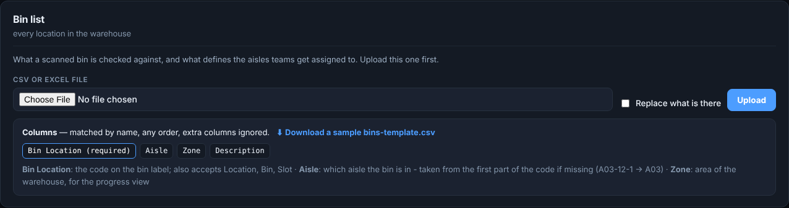

**Then the inventory report.** What the ERP thinks is on hand. Without it the count still records
what is there, but nothing is compared with anything, so there are no second counts and no
adjustments.

1. Under **Inventory report**, choose the file exactly as the ERP exports it.
2. If the warehouse holds stock from more than one system, type the **System** name for this file,
   or include a *System* column.
3. Press **Upload**.

| Column | What it is | Needed |
|---|---|---|
| **Bin Code** | Where the ERP says the pallet is | Yes |
| **Container No.** | The pallet number on its label | Yes |
| **Item No.**, **Description** | The item | |
| **Quantity** | What the ERP says is on the pallet | |
| **Unit of Measure Code** | CS, BAG, BOX … | |
| **Lot No.**, **Expiry** | Only if you count lots or dates | |
| **Entry No.** | The ERP's ledger entry, carried through to the ERP file | |
| **Cost**, **Amount** | The unit cost and quantity × cost. With them, differences show in money too, and second counts and approvals can be raised by value | |

**How you know it worked:** the card says how many pallets it read, how many empty positions, and
any pallet listed twice.

**Uploading it again.** An upload *adds to* the report that is loaded: a pallet already on it is
updated, a new one is added, nothing is removed. So when the ERP moves on, upload the new export
and carry on. **Override** — throwing the loaded report away first — is the site admin's alone (the
login the site started with); other admins do not see the box. **⬇ Download the loaded report**
gives the report back as a file, every column it came with.

## 13 — Pair the aisles into racking blocks

**Settings → Lists & racking → Aisles & racking blocks.** Aisles that back onto each other share a
block, so two teams are never working the same racking from both sides.

1. Set **Aisles per block** to 2 for most back-to-back racking.
2. Set **Skip first** to 1 if your first aisle has a wall behind it.
3. Press **Auto-pair aisles**.
4. Read the table. Type a block name onto any row that is wrong.

**How you know it worked:** each aisle shows a block, and aisles that share racking share a block.

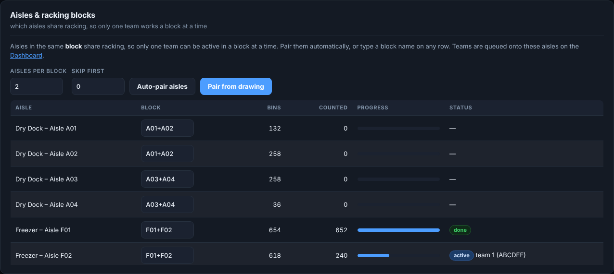

## 14 — The count's options

**Settings → Count setup → Count session**, with the count in the picker.

| Option | What it does | Suggested for a first count |
|---|---|---|
| **Pallet ID check** | *Validate — allow override with reason*: a pallet not on the report asks **Count it anyway?** | Validate — allow override with reason |
| **Guided by the plan, bin by bin** | Sends each team to its aisle, shows the next bin on the gun, and warns when it scans outside it | On |
| **Ask for comments** | The comments step after each pallet | On |
| **Second counts → Raise them automatically** | Sends a team back when a line disagrees with the report | On |
| **Over N units** | A smaller difference raises no second count | 2 to 5 |
| **or over N %** | Or at least this share of the expected quantity | 5 to 10 |
| **Cap open** | Stops raising second counts once this many are open | 50 to 100 |
| **Third count when the second settles nothing** | A third team decides a bin the first two disagree on | On |
| **Ask for the lot code** / **expiry date** | Extra questions, checked against the report | Only if you track them |
| **Adjustments need approval** | Every difference over the thresholds must be signed for | On for an audited count |
| **Approve over N units** / **%** | Smaller differences go through unsigned | 5 to 10 |
| **Show on the scanners** | Untick to keep the count off the scanners while you set it up | On, once the lists are in |
| **Scanners start here** | Every scanner lands on this count at sign-on | On, on count day |

Press **Save** at the foot of the card. A scanner already counting picks a change up between
pallets.

> **Set the thresholds.** With them at 0, a one-unit difference sends someone back, and by
> mid-morning the second-count list is longer than the count.

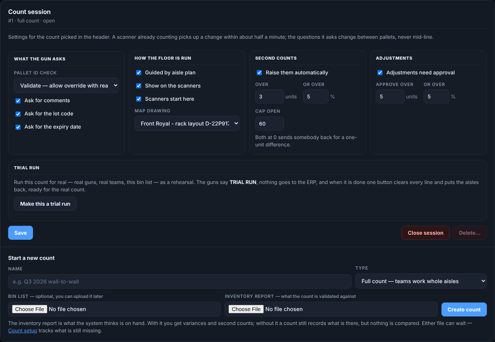

## 15 — Give the teams their aisles

**Dashboard → Team plan**, with the count in the picker. The board has **Aisles not planned** on the
left and a column for every team on Teams & crew on the right. Each team gets a queue of aisles,
worked in order, as cards: **Counting now** with a progress bar, **Next**, **Queued**, **Held** while
another team has that racking, **Done**.

**The easy way: Auto-assign the aisles.**

1. Pick the **teams** (blank is every team, or pick one shift), the **levels** (blank is all), and
   which way to walk the aisles.
2. Press **Preview**. Each team gets one stretch of aisles, about the same racking each, so the teams
   start spread across the building. A team only gets the levels its equipment reaches. What it
   cannot reach goes to the nearest team that can, marked `*`.
3. Read the warnings. Two teams starting in the same block, or a level nobody can reach, need fixing
   first.
4. Press **Queue this plan**.

**Or by dragging:** drag an aisle from the list onto a team. It is queued last with the levels the
team reaches. Drag a queued aisle up or down to reorder it, onto another team to move it, or back
onto the list to take it off the plan.

**Or by hand:** press **Queue aisles for this team** on an empty team, or fill the row above the
board (team, aisles in order, levels, start from), and press **Queue**.

**Or from a file:** press **⇅ Plan file**. **⬇ Sample plan** gives you the layout (Team, Aisle, Levels,
Start). Fill it in and use **Upload a plan**. **⬇ Export the plan (CSV)** downloads the current plan
to rework in Excel.

**How you know it worked:** each team's column lists its aisles in order, the first one *Counting now* and
the rest *queued*.

A team's next aisle starts by itself when it finishes one and that aisle's block is free. **✕** takes
an aisle off the plan. **release** sends the aisle being counted to the back of the queue.

## 16 — Practice, and a trial run

**Practice at a desk.** **Testing Suite** in the side panel has the real scanner app on screen, on a
sheet of practice bins and pallets. Nothing there touches a real count. Have each counter try a few
pallets, an empty bin and a pallet not on the list before count day.

**Print a barcode test book** (Settings → Scanners → Barcode test book) to practice with a real
scanner. Print it at **100%** on plain white paper, or the scanner will refuse the bars.

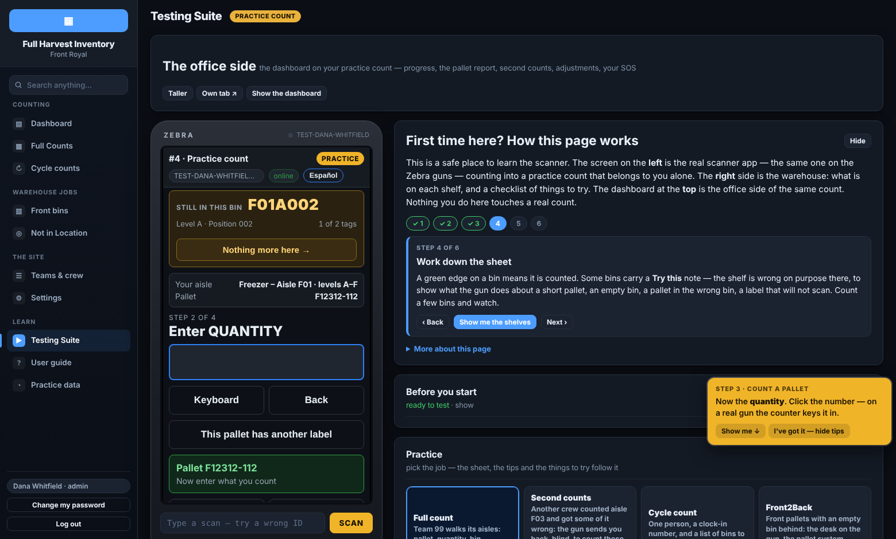

**A trial run on the real floor.** **Settings → Count setup → Count session → Make this a trial
run** turns the count into a rehearsal. The scanners and the dashboard show **TRIAL RUN**, and
nothing can go to the ERP. Count an aisle or two for real to find missing rack labels and crews
unsure of the buttons. When you are done, press **End the trial — clear it for the real count** and
type **CLEAR**. Every counted line goes, while the lists, the plan and the settings stay.

## 17 — The day before: Ready for count day

**Settings → Count setup → Ready for count day.** A check of everything a count day needs, worked out
fresh each time the page opens. Red is something that will stop the count. Amber works, but you would
want to know. Each line has a button to the card that fixes it.

It checks the count the scanners land on, the jobs the scanners offer, that each scanner's link has
been opened and seen lately, the crew list, the stopped-scanning alert, the override reasons and the
backups.

1. Work through every red line, then the amber ones.
2. Press **Check again** after each fix.
3. Run it again first thing on count day.

**How you know it worked:** no red lines.

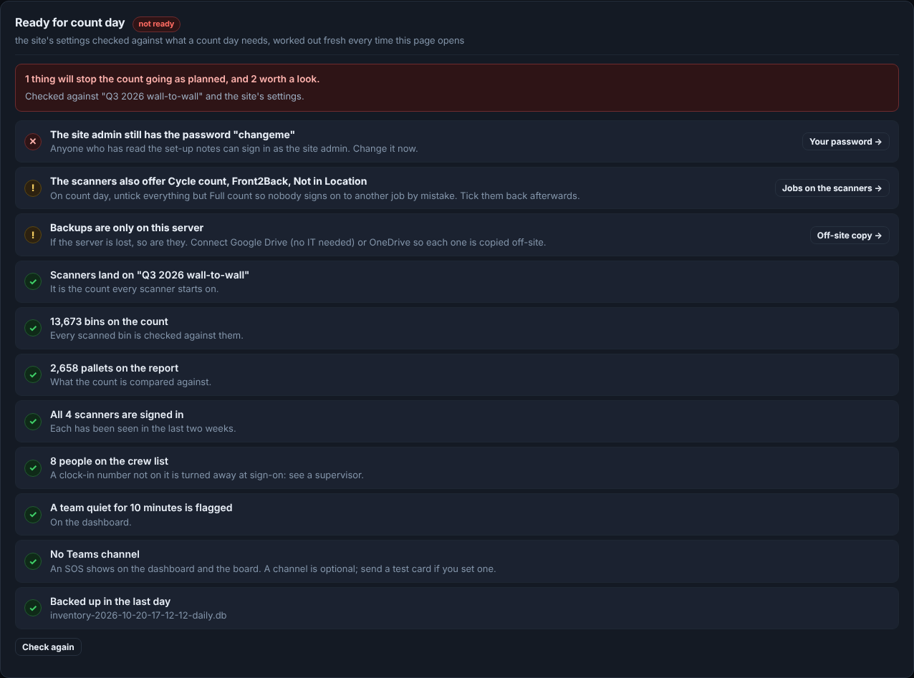

Under it, **Getting a count started** is the checklist for the count itself: the bin list, the report,
the scanners, the counting screen, the racking blocks, the crew and the team plan.

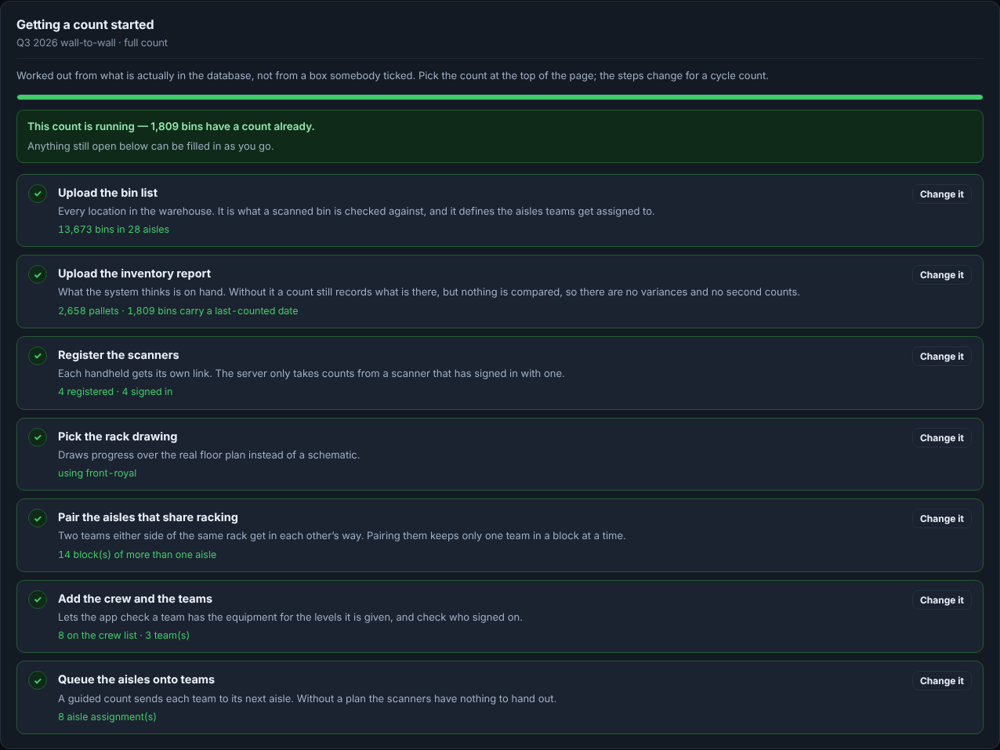

## 18 — Count day: the morning

1. Open **Settings → Count setup → Ready for count day** and clear anything red.
2. On **Count session**, check **Show on the scanners** and **Scanners start here** are both on, and
   that it is not still a trial run.
3. Check **Settings → Scanners → Jobs on the sign-on screen** has **Full count** alone.
4. Charge the scanners and put the team QR cards out.
5. Open the **Dashboard** on the supervisor's computer. Put **`/board`** (the office board, no
   sign-in) or **`/crew`** (the crew board, teams by shift) on a wall screen if you have one.
6. Brief the crews on step 19. Play `docs/training/scanner-training-full-en.mp4` (or `-es.mp4` for a Spanish-speaking crew),
   under ten minutes on the real scanner, then go through the slides in
   `docs/training/scanner-training-full-en.pptx` with scanners in hand.

## 19 — Count day: what the counters do

**Signing on**

1. Open the app from the scanner's home screen. It lands on today's count.
2. Scan the team's QR card into **Team number**, or type it.
3. Scan or type every **clock-in number** on the crew, pressing Enter after each.
4. Press **Sign on & load list**. The scanner downloads the lists and works from then on even with
   no signal.

The scanner shows the team's aisle and what is queued behind it.

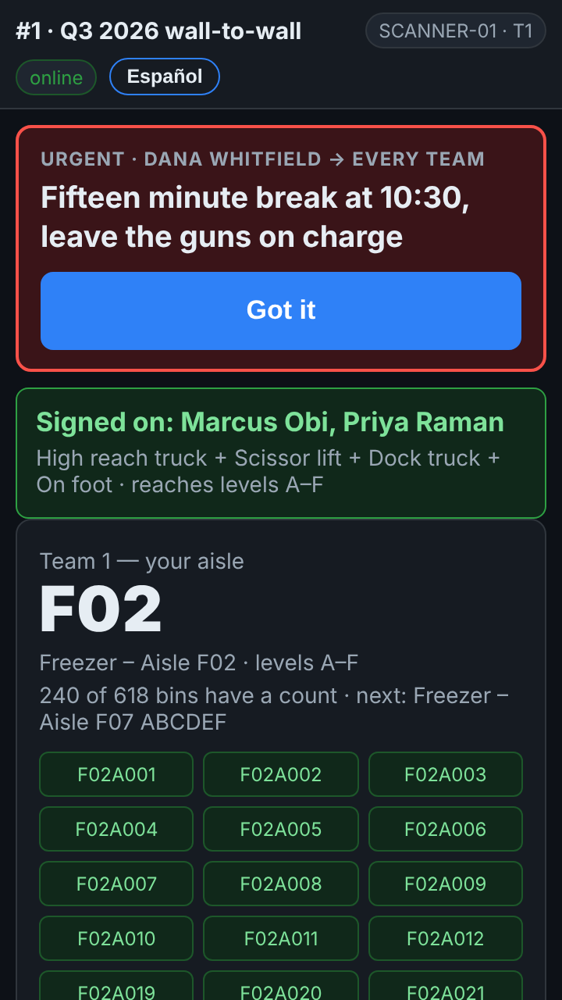

**Counting a pallet** (in the site's order, bin first)

1. **Scan BIN LOCATION.** The yellow rack label under the pallet. The scanner says where that bin
   is and checks it is in your aisle.
2. **Scan PALLET ID.** The scanner names the pallet but not what is on it. It is a blind count:
   count what is in front of you.
3. **Enter QUANTITY.** A big number may need typing twice.
4. **Comments** (optional). Tap a reason, or leave it and it moves on by itself.

The line is saved on the scanner the moment the last question is answered, and sent whenever there
is signal. The top of the screen shows **online** or **OFFLINE** and how many lines are waiting.

**Next bin** at the top says which bin comes next, so none is skipped.

**The buttons a counter needs**

| Button | When |
|---|---|
| **Bin is EMPTY** | Nothing in the bin. It is recorded as counted and empty |
| **Nothing more here →** | The scanner expects more pallets in a bin, and there are none |
| **This pallet has more than one label** | One pallet with two or more labels, each with its own quantity: scan the bin once, then each label and its quantity, then **Done** |
| **Another label on the pallet just counted** | The second label was only spotted after the line was saved |
| **Label will not scan** | Type what is printed, or count it without a label. It goes on the office's list of labels to replace |
| **Back** | Wrong entry: one question back |
| **Keyboard** | Brings up the keys to type by hand |
| **History** | Your team's lines in the last 20 bins. **Void** removes a wrong one and sends you back to that bin |
| **Report a problem** | Damage, or a bin blocked by a truck. Not an emergency |
| **SOS — I need help** | An emergency. It tells the office the team, the aisle and the last bin |
| **Start second counts** | When the scanner says bins are waiting to be counted again (step 21) |

**When the scanner stops and asks.** A pallet not on the report asks **Count it anyway?** Press
**YES** to count it, or **NO** if it was the wrong barcode. A bin outside the team's aisle, or a
pallet already counted, asks for a reason. Pick one and press **Accept and continue**, or **Cancel —
rescan**.

**English or Spanish.** The button at the top right switches the scanner's language. The office
always reads English.

## 20 — Count day: what the supervisor watches

**Dashboard**, with the count in the picker. It refreshes itself every 30 seconds.

- **Progress** — bins counted, lines, pallets and exceptions, then a row per team: who is on its
  scanner (first name and last initial), what it is counting, its clock, its last scan and its lines an hour. *1st shift* and *2nd shift* narrow it.
- **An amber bar** above every tab — a team has stopped scanning. **On break** or **Lunch** quiets
  it for that long. **Seen — I am on it** quiets it until the team scans again.
- **A red bar with a chime** — an SOS. Press **I am on it** so the counter's scanner says help is
  coming.
- **Team plan** — queue more aisles, hand an aisle back, or **Message the floor**: a line on one
  team's scanners or everyone's. The table shows who has read it.

**Watch for** exceptions climbing on one team (usually a training problem), a team stopped a long
time (a dead battery, or stuck behind a trailer), and an aisle nobody has started by mid-afternoon.

## 21 — Second counts

**Inventory Control → Second counts** (the same as Dashboard → Second counts). A second count is a
bin another team goes back to, because the first count disagreed with the report by more than the
thresholds in step 14.

1. They are raised by themselves as lines arrive. **Raise from all variances now** goes through
   everything that disagrees so far. It leaves aisles nobody has counted yet alone.
2. On the scanner, a team taps **Start second counts** and counts the bin again blind. Once every
   pallet expected there is counted the gun moves on by itself; **Bin done — nothing more here** is
   for a bin with fewer. The nearest bins come first.
3. The second count replaces the first:
   - **it agrees with the first count** — the difference is real, and goes to adjustments;
   - **it agrees with the report** — the first count was wrong, and the line now matches;
   - **it agrees with neither** — with the third-count option on, a third team counts it and its
     number stands.

**Work every second count before you close the count.** A count closed with second counts open has
numbers in it known to be wrong.

## 22 — Read the reports

**Inventory Control → Reports.**

- **Pallet report** — one row per pallet: what was expected, the 1st and 2nd counts, what stands,
  where it was found, the team and the status. **Hide matching pallets** leaves the list to work down.

  | Status | Means |
  |---|---|
  | `MATCH` | Counted as the report says |
  | `QTY VARIANCE` | The quantity differs |
  | `WRONG BIN` | Found somewhere other than the report's bin |
  | `MISSING` | The report has it and nobody found it |
  | `NOT IN MASTER` | Found on the floor and not on the report |
  | `COUNTED TWICE` | The same label scanned in two places |

- **Fix list** — labels that would not scan, damage and blocked bins, for somebody to put right.
- **Export everything (Excel)** — one workbook with every table for the count: summary, lines,
  pallets, adjustments, pallets not on the report, bins not counted, teams, second counts and the
  log. It is the file for a manager or an auditor.
- **Filed as the count goes** — each aisle is saved to disk as it is handed back. **Final report**
  files everything once every bin has a count and no second count is open.

The guide **Reports and exports** in the User guide explains every export button, column by column.

## 23 — Approve the adjustments

**Inventory Control → Adjustments.** **Positive and negative** at the top shows the stock to add and
the stock to take off, with the net. With **Adjustments need approval** on (step 14):

1. The list is every pallet that differs from the report by more than the threshold, biggest first.
2. Tick the ones you are satisfied with. **Select all shown** takes the screenful.
3. Pick a **reason** and add a note if it helps. The reasons are set under **Settings →
   Integrations → Adjustment reasons**.
4. Press **Approve selected**, or **Reject selected** if the system should keep its number.

Nothing unsigned reaches the ERP file. A pallet counted again after it was approved comes back to
the list unsigned.

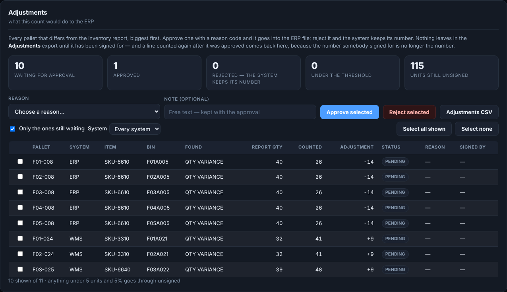

**A pallet the report expected and nobody found** becomes an adjustment only once the count is
closed, because until then it may simply not have been reached.

## 24 — Into the ERP

Two ways, depending on how your site enters adjustments.

**A file the ERP imports: Settings → Integrations → Send to the ERP.**

1. Choose the **layout** that matches your ERP. Pick the **System** if the warehouse holds more than
   one.
2. Press **Preview** and read the first rows. It says how many unsigned adjustments it left out.
3. Press **Download CSV** and import it into the ERP.

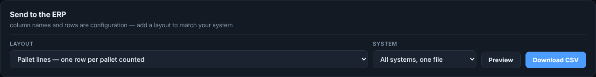

**Keyed in by hand, an aisle at a time: Inventory Control → Adjustments → ERP upload, an aisle at a
time.**

1. Wait until an aisle has no second or third counts open.
2. Press **⬇ Excel** on that aisle. Its sheet lists every pallet with the counted quantity, the
   adjustment and an **Uploaded to ERP** column.
3. Key the lines into the ERP. Write *yes* in **Uploaded to ERP** for each one as it goes in.
4. Press **⬆ Upload a filled-in sheet…** to bring it back. Those lines are marked with your name
   and the time.

Only the **Uploaded to ERP** column is read back. A quantity changed in the sheet by mistake changes
nothing in the app. A line counted again after it was uploaded is flagged **changed since
uploaded**. The guide **The ERP upload, an aisle at a time** has the whole routine.

## 25 — Close the count and keep a copy

1. **Settings → Backups & log → Back up now.**
2. On **Inventory Control → Reports**, press **Final report** once it is on.
3. Press **Export everything (Excel)** and keep the workbook on the shared drive.
4. **Settings → Count setup → Count session → Close session.** A closed count is read-only: the
   scanners can no longer send lines to it, and its reports stay for good.
5. Untick **Scanners start here** if another count is coming, and set it on that count instead.

**Delete** is separate and deliberately hard: the count must be closed, you type its name, and a
backup is taken first. Delete only a count created by mistake.

**Off-site copies.** The app backs itself up every day and keeps the last 14, and **Download** on
any row saves one to your computer. Set up an off-site copy before the first count, so a lost
server never loses the count. Three cards on the same tab do it:

- **Off-site copy: a Teams channel** — each backup goes into a channel's Files tab, through a
  Workflow you build in Teams. Nothing for IT to do. The card lists the steps.
- **Off-site copy: Google Drive** — a folder in a Google account, through a short script you
  paste in. Nothing for IT to do.
- **Off-site copy: OneDrive** — needs an app registered in Microsoft, which is usually IT's.

After setting one up, press its test or send button and check the file arrived.

## 26 — When something is not right

| What you see | What it means | What to do |
|---|---|---|
| Scanner: *…is not on the crew list — see a supervisor* | That clock-in number is not on Teams & crew → Employees | Add the person, then they sign on again |
| Scanner shows no count to pick | The count's **Show on the scanners** is off, or the count is closed | Turn it on in Count session (step 14) |
| Scanner offers cycle counts or other jobs | Other jobs are ticked | Tick **Full count** alone (step 10) |
| A scan lands in the address bar | The app is running as a browser tab | Install it on the scanner (step 8) |
| Nothing happens on a scan | DataWedge is not sending the scan as typing | Check Keystroke output and the ENTER suffix (step 8) |
| Scanner says **OFFLINE** | No signal | Keep counting. Lines wait on the scanner and send by themselves |
| A team is not sent to an aisle | Its equipment does not reach those levels, or the block is in use | Check Equipment rules (step 7) and the plan (step 15) |
| Two teams in back-to-back racking | The aisles are not paired | Pair them into blocks (step 13) |
| The second-count list is huge | The thresholds are 0 | Set **Over N units**, **or over N %** or **or worth over $N** under Second counts (step 14) |
| No adjustments or second counts at all | No inventory report on the count | Upload it (step 12) |
| **Final report** is grayed out | Bins not counted yet, or second counts open | The card says which. Finish them |

For anything else, type the question or paste the message into **User guide → Ask the guide**.

## 27 — The tick list

**Once, for the site**

- ☐ Signed in and changed the admin password (step 2)
- ☐ Switched off all but full counts, with Adjustments and Reports back on (step 3)
- ☐ Site name and logo (step 4)
- ☐ A login for each supervisor (step 5)
- ☐ Crew list loaded (step 6)
- ☐ Teams made, equipment rules checked, team QR codes printed (step 7)
- ☐ Every scanner registered, installed, DataWedge set (step 8)
- ☐ Counting screen and scanner buttons set (steps 9 and 10)
- ☐ An off-site backup copy set up (step 25)

**For each count, the day before**

- ☐ Count created and picked in the count picker (step 11)
- ☐ Bin list and inventory report uploaded (step 12)
- ☐ Aisles paired into racking blocks (step 13)
- ☐ Options and thresholds set (step 14)
- ☐ Team plan queued (step 15)
- ☐ Trial run done and cleared (step 16)
- ☐ Ready for count day has no red lines (step 17)

**Count day**

- ☐ Ready for count day checked again; **Show on the scanners** and **Scanners start here** on (step 18)
- ☐ Crews briefed, scanners charged, QR cards out (steps 18 and 19)
- ☐ Dashboard open; alerts answered (step 20)
- ☐ Second counts worked down to none open (step 21)

**Finishing**

- ☐ Reports read, exceptions worked (step 22)
- ☐ Adjustments approved (step 23)
- ☐ Into the ERP (step 24)
- ☐ Backed up, final report filed, count closed (step 25)
