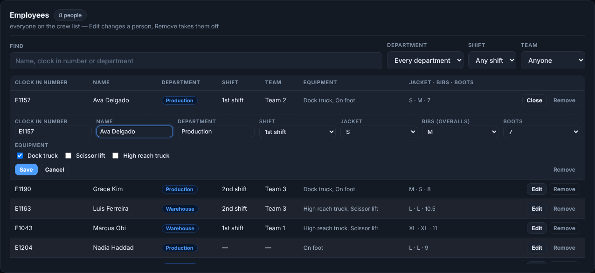
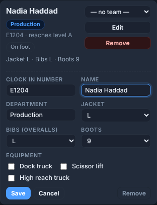
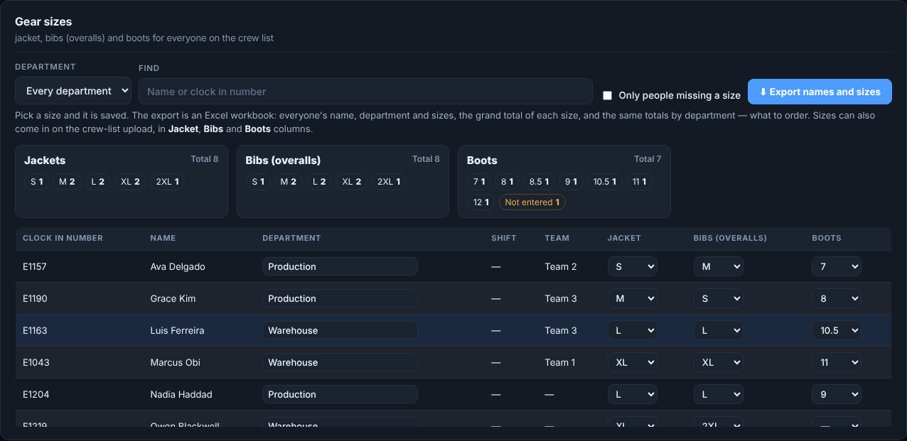

# Employees, teams and gear sizes — how it works

**Role:** Count supervisors and whoever keeps the crew list  **Login profile:** your own login  **Pages:** Teams & crew  **Functions:** adding, editing and removing employees; teams; gear sizes and the order

Everyone who counts has to be on the crew list: a gun will not sign on with a clock-in number
that is not on it. This guide is keeping that list, putting people on teams, and recording each
person's department and jacket, bibs and boot sizes.

## Contents

- [1 — The tabs](#1--the-tabs)
- [2 — Add an employee](#2--add-an-employee)
- [3 — Edit or remove an employee](#3--edit-or-remove-an-employee)
- [4 — The crew list from a file](#4--the-crew-list-from-a-file)
- [5 — Teams](#5--teams)
- [6 — Gear sizes, and the order](#6--gear-sizes-and-the-order)
- [7 — When something is not right](#7--when-something-is-not-right)

## 1 — The tabs

| Tab | For |
|---|---|
| **Teams** | Who is on which team today |
| **Employees** | The crew list: add, edit, remove, upload, export |
| **Gear sizes** | Everyone's jacket, bibs and boots, the totals, and the export to order from |
| **Equipment rules** | Which levels need which equipment |

You see the tabs your login has.

## 2 — Add an employee

**Teams & crew → Employees → Add employees**, the bottom row:

*Add employees: one at a time on the bottom row, or the whole list from a file above it.*

1. **Clock in number** (from their badge) and **Name** — both needed.
2. **Department**, the **Equipment** they are certified on, and **Jacket**, **Bibs**, **Boots** —
   all optional, and can be added later.
3. **Add employee**, or Enter in the Name box. The form clears for the next person.

They can sign on to a gun straight away. A clock-in number already on the list is refused, with
the name it belongs to — **Edit** that person instead.

## 3 — Edit or remove an employee

**Teams & crew → Employees** lists everyone, whatever team they are on.

*The Employees table, with one row open for editing.*

- **Find** a name, clock-in number or department; **Department** and **Team** narrow the list.
- **Edit** opens the person under their row: clock-in number, name, department, sizes and
  equipment. Change what you need and press **Save**. A new clock-in number asks first; their team
  goes with them, and counts already scanned keep the old number.
- **Remove** (on the row, or in the Edit form) asks first, then takes them off the crew list and
  off their team. Their counts stay as they are. A removed number can no longer sign on.

Each person's card on the **Teams** tab has the same **Edit** and **Remove**:

*A card on the Teams tab with Edit open.*

## 4 — The crew list from a file

**Employees → Add employees → CSV or Excel file → Upload** brings in the whole list at once. Its
columns: **Clock In Number** (required), **Name**, **Department**, **Equipment**, and if you have
them **Jacket**, **Bibs**, **Boots**. **⬇ Sample CSV** downloads one in the right shape.

- Someone already on the list is brought up to date; someone new is added. Nobody is taken off
  unless **Replace the whole list** is ticked.
- Sizes are read however they are written — *xx-large* is **2XL**, *10 1/2* is **10.5**. A file
  without size columns leaves the sizes already there.
- **Export current list** downloads the list as it stands.

## 5 — Teams

**Teams & crew → Teams.**

- **Drag** a person from *Not on a team* onto a team card, or between teams — or use the menu on
  their card. **— no team —** takes them off.
- Each card shows the person's **department**, equipment and sizes.
- **Upload the team sheet** (*Team #, Department, Employee, Equipment*, a row per seat) builds the
  teams in one go: *S1-DS01* is 1st shift, dock stocker, truck 01.
- **1st shift / 2nd shift** and **Department** show one at a time.

## 6 — Gear sizes, and the order

**Teams & crew → Gear sizes.**

*The totals above, everyone below.*

1. **Pick a size and it is saved** — the cell flashes green.
2. The boxes above are the **totals**: each size, the total per item, and how many people have
   **not entered** a size yet.
3. **Only people missing a size**, **Department** and **Find** narrow the list — the people to ask
   before the order goes in.
4. **⬇ Export names and sizes** downloads an Excel workbook: *Names and sizes* (everyone, by
   department), *Grand totals* (each size and a grand total per item), and *By department*. Pick a
   department first for that department alone.

## 7 — When something is not right

| You see | What it means | What to do |
|---|---|---|
| Gun: *Not signed on — see a supervisor* (*E9999 is not on the crew list*) | That clock-in number is not on the list | **Add employee** with it; they sign on again |
| *E1043 is already Marcus Obi on the crew list* | The number is someone else's | **Edit** that person, or check the badge |
| *Not on the crew list yet* on a team card | A name on the team sheet with no clock-in number on the list | Add them under Employees, then upload the team sheet again |
| A size reads oddly (*L TALL*, *11W*) | It came in on a file written that way | It is kept as written; pick a size to change it |
| A tab is missing | Your login does not have it | Ask an admin |
