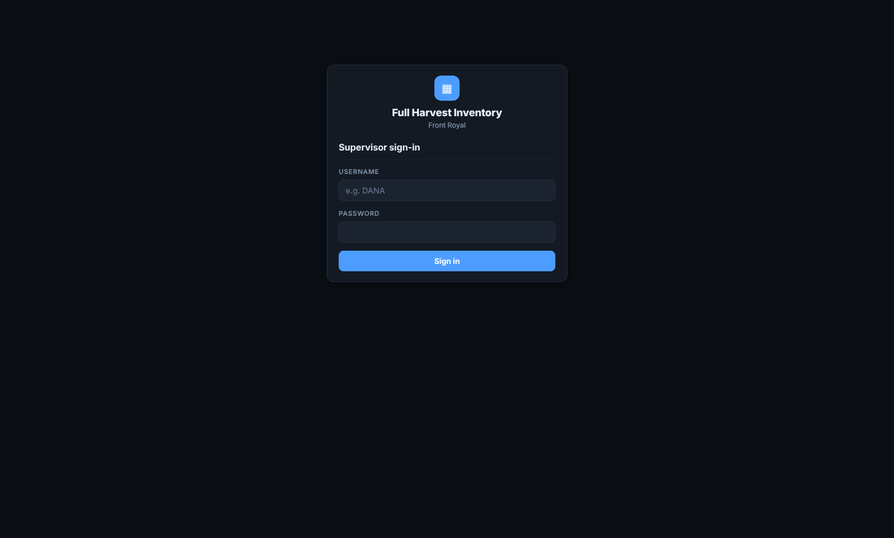
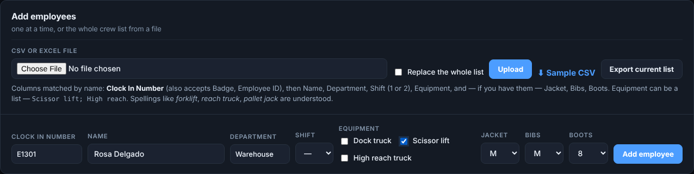
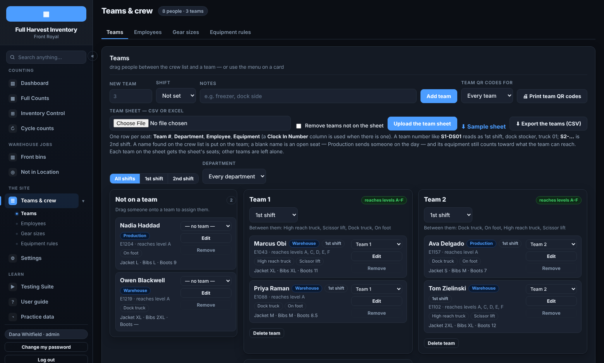
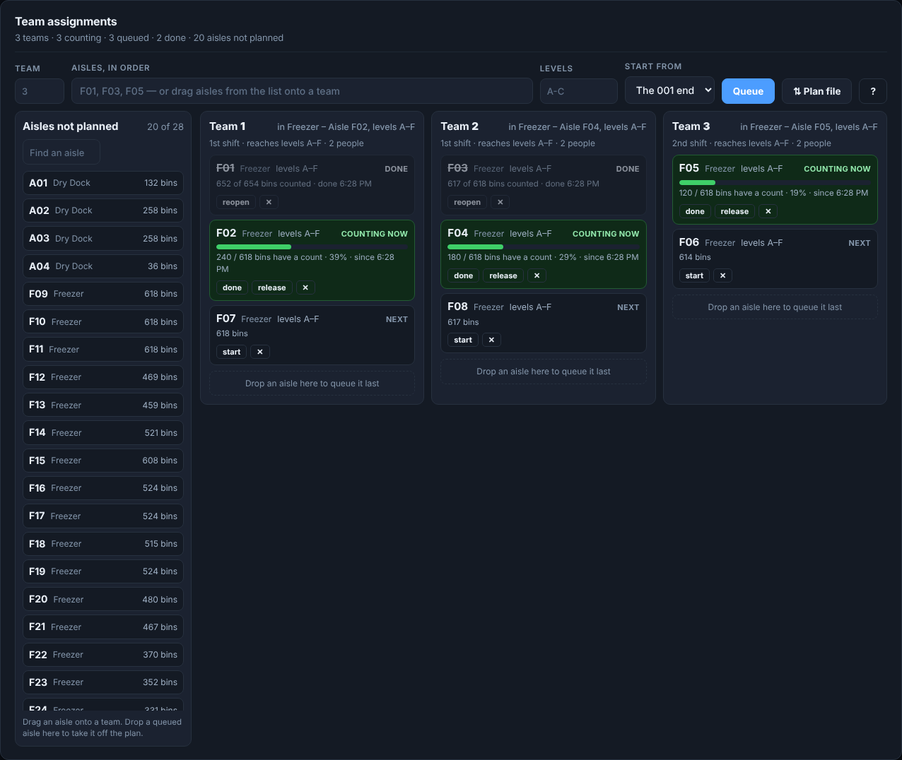
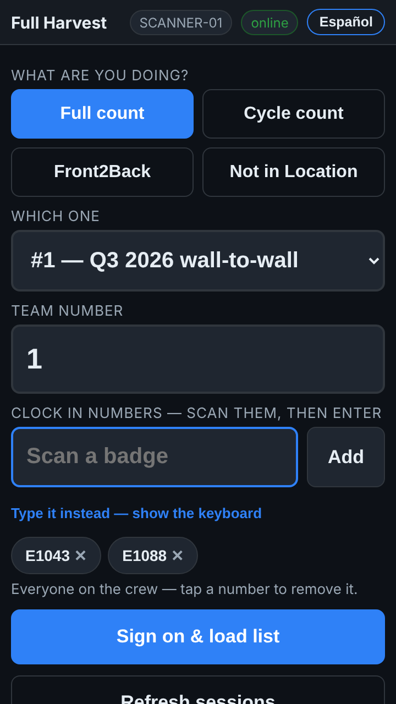
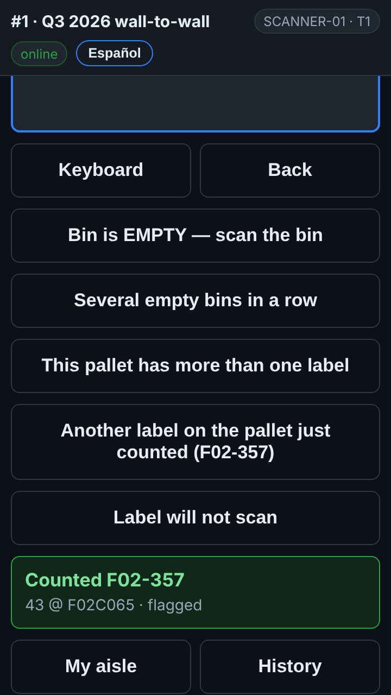
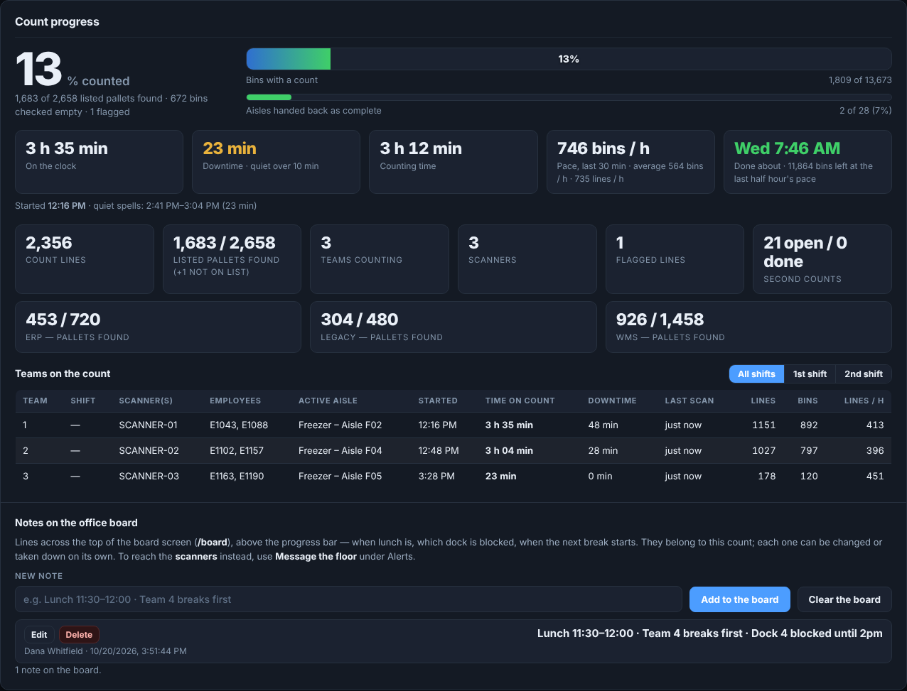
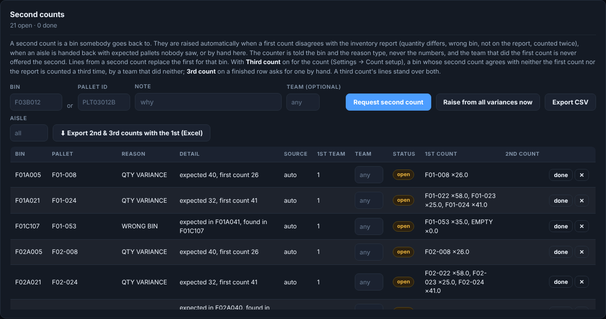
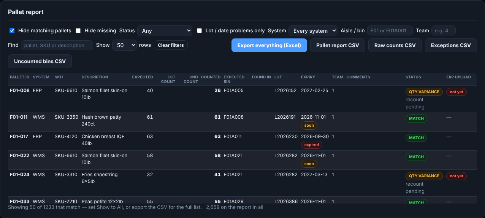

# Your first full count — how it works

**Role:** Count supervisors, inventory control and counters new to the app  **Login profile:** your own login (counters need none)  **Pages:** Teams & crew, Full Counts, Dashboard, Inventory Control, the scanner app  **Functions:** signing in, the crew and teams, the team plan, counting on the scanner, running the floor, second counts, reports and adjustments

This guide is for someone who has never used the app. It walks through a full count (a
wall-to-wall) from your first sign-in to the last adjustment, for the people who run it and the
people who count. An admin sets the site up first: the scanners, the count itself and its lists.
Where you need something from Settings, this guide says to ask an admin.

## Contents

- [1 — What the app does](#1--what-the-app-does)
- [2 — Your first sign-in](#2--your-first-sign-in)
- [3 — Find your way around](#3--find-your-way-around)
- [4 — The crew list](#4--the-crew-list)
- [5 — Teams and their QR cards](#5--teams-and-their-qr-cards)
- [6 — Give the teams their aisles](#6--give-the-teams-their-aisles)
- [7 — Practice before the day](#7--practice-before-the-day)
- [8 — On the scanner: signing on](#8--on-the-scanner-signing-on)
- [9 — On the scanner: counting](#9--on-the-scanner-counting)
- [10 — Running the floor](#10--running-the-floor)
- [11 — Second counts](#11--second-counts)
- [12 — Reports, adjustments and the ERP](#12--reports-adjustments-and-the-erp)
- [13 — When something is not right](#13--when-something-is-not-right)

## 1 — What the app does

For each count the app holds **every bin in the warehouse** and **what the ERP thinks is on each
pallet**. Counters walk the aisles with Zebra scanners and scan each pallet, its quantity and its
bin. The app compares the count with the ERP's numbers, sends a different team back to look again
where they disagree, and lists the adjustments for the ERP.

**Words you will meet.**

- **Bin** — one location on the racking. `F01A001` is zone **F**, aisle **01**, level **A**,
  position **001**.
- **Aisle** — one rack run, such as `F01`. Teams are given whole aisles.
- **Racking block** — aisles that back onto each other. Only one team works a block at a time.
- **Second count** — a bin another team counts again, because the first count disagreed with the
  ERP.
- **Adjustment** — a difference that will change the ERP's stock.

## 2 — Your first sign-in

An admin makes your login and sends you one of two things.

- **An invite link.** Open it, choose a password, and you are signed in. It works once, for three
  days. Ask for a new one if it has run out.
- **A starter password**, such as `winter-4k2p`. Sign in with your username and it, then choose your
  own password when asked.

After that, sign in at the site's address with your username and password. One sign-in covers every
office page in that browser.

**Five wrong passwords** lock your login out from that computer for 15 minutes. Wait, or ask an
admin to unlock it. **Change my password** at the foot of the side panel changes yours any time.

**Counters do not need a login.** They sign on at the scanner with a team number and their clock-in
number.

## 3 — Find your way around

The side panel on the left lists the pages your login may open.

| Page | What it is for |
|---|---|
| **Dashboard** | The live view of the count: progress, teams, aisles, alerts, the team plan |
| **Full Counts** | Every wall-to-wall, how far each got, and which one the scanners land on |
| **Inventory Control** | Second counts, adjustments and reports |
| **Teams & crew** | The crew list and the teams |
| **User guide** | This guide and the others, and *Ask the guide* for questions in your own words |

**The count picker.** The box at the top of every page says which count you are looking at. Check
it before you change anything.

**More room.** The round **«** on the side panel's right edge hides it. Put the mouse on the thin
strip at the left edge to slide it back.

**On a phone.** Open the site in the phone's browser, sign in, and choose **Add to Home Screen**. It
then opens like an app.

## 4 — The crew list

**Teams & crew → Employees.** Everyone who counts must be on it. A scanner refuses a clock-in number
that is not.

1. Press **Add employees**.
2. Type the **clock-in number** and **name**. Pick the **shift** and **equipment** if you know them.
3. Press **Add employee**. The form clears for the next person.

**Edit** on a row changes someone. **Remove** takes them off. A whole list can be uploaded from a
CSV or Excel file, with one row per person and a *Clock in number* column.

## 5 — Teams and their QR cards

**Teams & crew → Teams.** A team is the crew on one scanner.

- **Add team** makes one: its number (such as `S1-DS01`), its shift and a note.
- **Drag** a person from *Not on a team* onto a team's card.
- **Upload the team sheet** builds every team at once, from a sheet with *Team #, Department,
  Employee, Equipment*. *S1-DS01* reads as 1st shift, dock stocker, truck 01.
- **1st shift / 2nd shift** above the board shows one shift at a time.

**The equipment matters.** A team is only sent to the levels its equipment reaches, so a crew on foot
is never given level D.

**🖨 Print team QR codes** prints a card per team with its number as a QR code. Pick a shift in the
box beside it first. Give each team its card: at sign-on they scan it instead of typing the number.

## 6 — Give the teams their aisles

**Dashboard → Team plan.** A board: the aisles nobody has planned on the left, a column per team on
the right with its aisles in counting order — **Counting now** with a progress bar, **Next**,
**Queued**, **Held** while another team has that racking, **Done**.

**The easy way:** under **Auto-assign the aisles**, pick the teams (blank is every team), press
**Preview**, read the warnings, and press **Queue this plan**. Each team gets its own stretch of the
building and only the levels it can reach.

**By dragging:** drag an aisle from the list onto a team; it is queued with the levels the team
reaches. Drag a queued aisle up or down to reorder it, onto another team to move it, or back onto
the list to take it off the plan.

**By hand:** **Queue aisles for this team** on an empty team, or the row above the board: team,
aisles in order, levels, then **Queue**.

**From a file:** **⇅ Plan file**, then **⬇ Sample plan** for the layout. Fill it in and press
**Upload a plan**.

On each aisle, **done** finishes it, **release** sends it to the back of the queue, and **✕** takes
it off the plan. A team's next aisle starts by itself when its block is free.

**Finishing an aisle is yours, not the scanner's.** The scanner has no "aisle complete" button.
When a team says its aisle is done, press **done** on that aisle here: that raises the second
counts for pallets nobody saw, files the aisle, and the team's next aisle shows on its scanner.

## 7 — Practice before the day

**Testing Suite** in the side panel has the real scanner app on screen, with practice bins and
pallets. Nothing there touches a real count. Count a few pallets, an empty bin, and a pallet not on
the list, so the buttons are familiar before count day.

The training film `docs/training/scanner-training-full-en.mp4` (in Spanish, `-es.mp4`) shows a counter's
whole routine on a real scanner, slowly, in under ten minutes. The slides beside it are the same lesson. For
cycle counts there is `scanner-training-cycle-en.mp4` (and `-es.mp4`).

## 8 — On the scanner: signing on

1. Open the app from the scanner's home screen. It lands on today's count.
2. Scan the team's QR card into **Team number**, or type the number.
3. Scan or type every **clock-in number** on the crew, pressing Enter after each. Tap a number to
   remove it.
4. Press **Sign on & load list**. The scanner downloads what it needs and keeps working with no
   signal.

The next screen shows the team's aisle and what is queued after it.

## 9 — On the scanner: counting

**One pallet** (bin first)

1. **Scan BIN LOCATION.** The yellow rack label under the pallet. The scanner says where that bin
   is.
2. **Scan PALLET ID.** The scanner names the pallet but not what is on it. Count what is in front of
   you.
3. **Enter QUANTITY.** A big number may need typing twice.
4. **Comments.** Tap a reason if one fits, or leave it and it moves on by itself.

The line is saved on the scanner at once and sent whenever there is signal. **Next bin** at the top
says which bin is next.

**The buttons**

| Button | When |
|---|---|
| **Bin is EMPTY** | Nothing in the bin |
| **Nothing more here →** | The scanner expects more pallets in the bin, and there are none |
| **This pallet has more than one label** | One pallet, two or more labels with their own quantities. Scan the bin once, then each label and its quantity, then **Done** |
| **Another label on the pallet just counted** | You spotted the second label after the line was saved |
| **Label will not scan** | Type what is printed, or count it without a label |
| **Back** | Wrong entry: go back one question |
| **Keyboard** | Type something by hand |
| **History** | Your team's lines in the last 20 bins. **Void** removes a wrong one and sends you back to that bin |
| **Report a problem** | Damage, or a bin blocked by a truck |
| **SOS — I need help** | An emergency. The office sees the team, the aisle and the last bin |
| **Start second counts** | When the scanner says bins are waiting to be counted again |

**When the scanner asks a question.** A pallet not on the ERP's list asks **Count it anyway?** Say
**YES** to count it, or **NO** if it was the wrong barcode. A bin outside your aisle, or a pallet
already counted, asks why: pick a reason and press **Accept and continue**, or **Cancel — rescan**.

**OFFLINE** at the top means no signal. Keep counting. The lines wait on the scanner and send by
themselves.

**English or Spanish:** the button at the top right switches the scanner's language.

## 10 — Running the floor

**Dashboard**, with the count in the picker. It refreshes itself every 30 seconds.

- **Progress** — bins counted, lines and exceptions, then a row per team: who is on its scanner
  (first name and last initial), what it is counting, its clock, its last scan and its pace.
- **An amber bar** — a team has stopped scanning. **On break** or **Lunch** quiets it. **Seen — I am
  on it** quiets it until the team scans again.
- **A red bar with a chime** — an SOS. Press **I am on it**, and the counter's scanner says help is
  coming. Then go.
- **Message the floor** — a line on one team's scanners or everyone's. The table shows who has read
  it.

**Watch for** one team with climbing exceptions (often a training problem), a team stopped for a
long time, and an aisle nobody has started by mid-afternoon.

The **crew board** at `/crew` shows the teams and who is on them by shift, with where each is
counting, for a screen by the time clock.

## 11 — Second counts

**Inventory Control → Second counts.** When a count disagrees with the ERP by more than the site's
limits, the bin goes on this list for a different team to count again.

1. **Raise from all variances now** adds everything that disagrees so far. Aisles nobody has
   reached are left alone.
2. On the scanner, a team taps **Start second counts** and counts the bin again without seeing the
   first count. Once every pallet expected there is counted the gun moves on by itself; **Bin done —
   nothing more here** is for a bin with fewer.
3. The second count replaces the first:
   - **it agrees with the first count** — the difference is real;
   - **it agrees with the ERP** — the first count was wrong;
   - **it agrees with neither** — a third team may be sent, and its count stands.

Work the list down to none open before the count is closed.

## 12 — Reports, adjustments and the ERP

**Inventory Control → Reports.**

- **Pallet report** — a row per pallet: expected, the 1st and 2nd counts, what stands, where it was
  found, the team and the status (`MATCH`, `QTY VARIANCE`, `WRONG BIN`, `MISSING`, `NOT IN MASTER`,
  `COUNTED TWICE`). **Hide matching pallets** leaves the list to work down.
- **Fix list** — labels to replace, damage and blocked bins. Once a label is printed and on the
  pallet, press **Label printed & on the pallet** on its row and it leaves the list.
- **Export everything (Excel)** — every table for the count in one workbook.

**Inventory Control → Adjustments.** *Positive and negative* shows the stock to add and to take off.
Where the count needs approval, tick the lines you are satisfied with, pick a **reason**, and press
**Approve selected**. Nothing unsigned goes to the ERP.

**Into the ERP, an aisle at a time.** Under **ERP upload, an aisle at a time**, wait until an aisle
has no second counts open, press **⬇ Excel**, key its lines into the ERP, write *yes* in **Uploaded
to ERP** for each one, and bring the sheet back with **⬆ Upload a filled-in sheet…**. Only that
column is read back, so a quantity changed in the sheet by mistake changes nothing.

The guides **Reports and exports** and **The ERP upload, an aisle at a time** go through these in
full.

## 13 — When something is not right

| What you see | What to do |
|---|---|
| Scanner: *…is not on the crew list — see a supervisor* | Add the person under Teams & crew → Employees, then they sign on again |
| The scanner offers no count | Ask an admin to put the count on the scanners |
| The scanner says **OFFLINE** | Keep counting. Lines send by themselves when signal comes back |
| A scan does nothing | Check the cursor is in the box, then ask an admin to check the scanner's setup |
| A team is not given an aisle | Its equipment may not reach those levels, or another team is in that racking block |
| A wrong line was counted | **History** on that scanner, then **Void** |
| You cannot open a page or press a button | Your login does not include it. Ask an admin |

For anything else, type the question or paste the message into **User guide → Ask the guide**.
