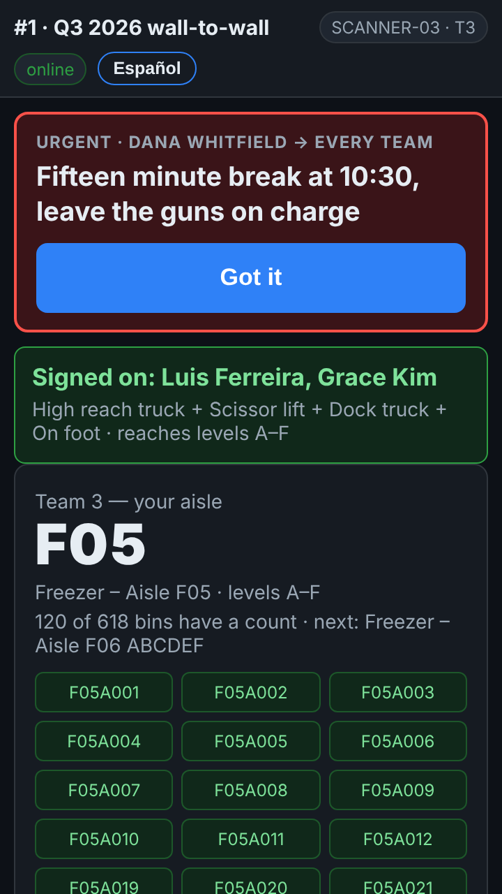
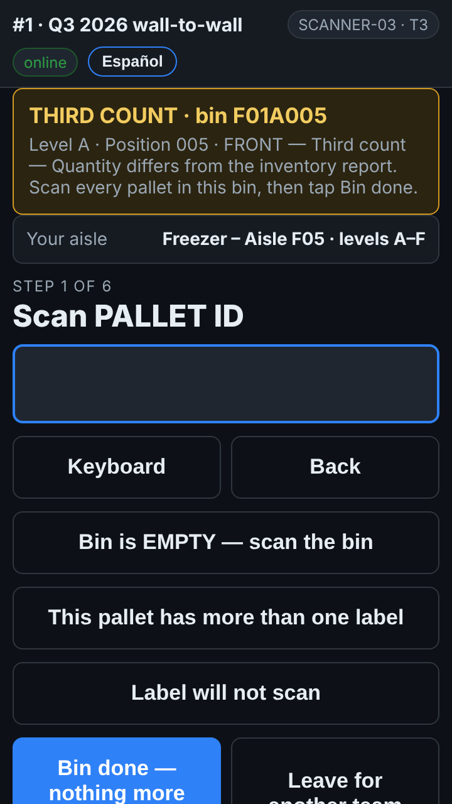
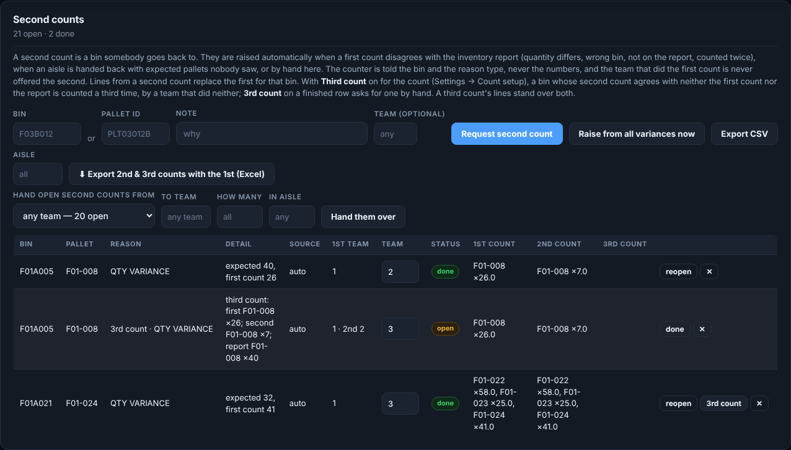
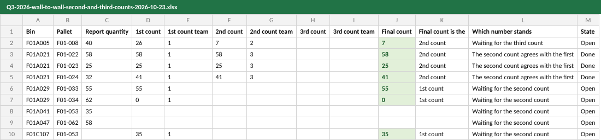

# Second and third counts — how they work

**Role:** Counters, count supervisors and inventory control  **Login profile:** your own login, or a scanner  **Pages:** the scanner, Dashboard → Second counts  **Functions:** doing a second or third count, following them, exporting them

When a first count disagrees with the inventory report, a different team goes back and counts
the bin again: a **second count**. When the second count does not settle it, a third team counts
it once more: a **third count**. This guide is how that works on the gun and on the dashboard.

## Contents

- [1 — In one minute](#1--in-one-minute)
- [2 — Why a bin comes back](#2--why-a-bin-comes-back)
- [3 — On the gun](#3--on-the-gun)
- [4 — What the second count decides](#4--what-the-second-count-decides)
- [5 — Third counts](#5--third-counts)
- [6 — On the dashboard](#6--on-the-dashboard)
- [6a — When one team does the second counts](#6a--when-one-team-does-the-second-counts)
- [7 — The 1st, 2nd and 3rd counts side by side](#7--the-1st-2nd-and-3rd-counts-side-by-side)
- [8 — When something is not right](#8--when-something-is-not-right)

## 1 — In one minute

- A second count is **blind**: you are told the bin and the kind of problem, never the numbers.
- It is never given to the team that did the first count; a third count goes to a team that did
  **neither**.
- **Count the whole bin** — every pallet in it — then tap **Bin done**.
- The latest count of a bin is the one that stands: a second count replaces the first, a third
  count replaces both.

## 2 — Why a bin comes back

A bin is sent back for a second count when its first count:

- found a **different quantity** from the report;
- found a pallet in a **different bin** from the report's — that bin comes back, and so does the
  report's own bin, to check for a second pallet with the same label;
- found a pallet that is **not on the report**;
- found a pallet that was also **counted in another bin**;
- or, when an aisle was finished, a pallet on the report was **never seen**.

A supervisor can also send any bin back by hand.

## 3 — On the gun

| | | |
|:--:|:--:|:--:|
|  **My aisle** says *Second counts available*, with how many |  **THIRD COUNT · bin …** — the bin and the reason, never the numbers | |

1. On the **My aisle** screen, **Second counts available** shows how many are waiting. Tap
   **Start second counts**.
2. The gun gives you the **nearest** first — in the aisle you are in, then nearby. The banner
   says **SECOND COUNT · bin …** or **THIRD COUNT · bin …**, and why.
3. Go to that bin and **scan every pallet in it**, the normal way: pallet, quantity, bin. Count
   everything in the bin, not only the pallet that brought you there.
4. Nothing in the bin: **Bin is EMPTY**.
5. When the bin is finished, tap **Bin done — nothing more here**. The gun moves to the next one.
6. **My aisle** takes you back to your own aisle at any time; the second counts wait for you.

No signal? Keep counting. The lines and the *Bin done* wait on the gun and send when it is back
in Wi-Fi.

## 4 — What the second count decides

Once a bin's second count is in, the second count's numbers are the bin's numbers on every
report. Then:

| The second count agrees with… | It means | Then |
|---|---|---|
| **the first count** | The difference is real: two teams found the same thing | It goes to inventory control as an adjustment |
| **the report** | The first count was wrong | The line now matches — nothing to adjust |
| **neither** | Nobody knows which number is right | A **third count** (section 5) |

*Agrees* means the same pallets in the bin, with the same quantities.

## 5 — Third counts

When a second count agrees with neither the first count nor the report, the bin goes back a
**third** time:

- to a team that did **neither** the first nor the second count;
- on the gun it reads **THIRD COUNT · bin …** and is counted exactly like a second count;
- its numbers **stand over both** earlier counts.

On sites that raise them automatically this happens on its own. A supervisor can also ask for a
third count on any finished second count, with the **3rd count** button on the dashboard.

## 6 — On the dashboard

**Dashboard → Second counts** lists every second and third count; the tab shows how many are
open from anywhere on the dashboard. The same tab is under **Inventory Control** in the sidebar,
beside Adjustments and Reports, with an overview of where the count stands in front of it.

*A second count that settled nothing, the third count it raised (3rd count · …, with both earlier teams), and a second count that agreed with the first.*

| Column | What it is |
|---|---|
| Bin, Pallet | Where to go back to, and the pallet that raised it |
| Reason | Why — *3rd count · …* for a third count |
| Detail | The numbers, for the office only |
| 1st team | Who did the first count (on a third count, also who did the second) |
| Team | Who has it; blank is any team allowed. A supervisor types a team and presses Enter to give it to them |
| Status | *open*, *taken* (a gun has started it), *done* |
| 1st count, 2nd count, 3rd count | What each count found in the bin |

Supervisors: **Request second count** sends a bin back by hand (type a bin or a pallet);
**done**, **reopen** and **✕** on each row; **3rd count** on a finished second count. Work the
list to zero before the count is closed — a count closed with open second counts has known-wrong
numbers in it.

## 6a — When one team does the second counts

On many counts one team does all the second counts — inventory control's, say. Then:

- **Every new second count is given to that team.** Its guns have them all; other teams' guns
  show *Second counts available* only for bins left open for them.
- The Second counts card says **new second counts go to team …**.
- A bin that team counted **first** never goes to it — another team does that one. A third count
  goes to it only if it did neither earlier count.

**When that team is swamped**, a supervisor hands some to another team with the bar above the
table: **Hand open second counts from** *team 90* **to team** *4*, **How many** (blank for all), **In
aisle** (optional), **Hand them over**. Bins a team has already started stay with it. On the gun,
the handed-over ones simply appear under *Second counts available*.

## 7 — The 1st, 2nd and 3rd counts side by side

**Dashboard → Second counts → ⬇ Export 2nd & 3rd counts with the 1st (Excel).** Leave **Aisle**
blank for every aisle, or type one for that aisle alone.

*The Side by side sheet (some of its columns): a row a pallet, for every bin counted again.*

Each row has the report's quantity, the **1st, 2nd and 3rd counts** with the team that did each,
the **final count** and which count it is, the final against the report, and **which number
stands**: *the second count agrees with the first*, *…with the report*, *the third count stands*,
or *waiting for…*. A 0 means that count was done and the pallet was not there; a blank means that
count has not been done. A *Summary* sheet says how every bin was settled.

## 8 — When something is not right

| You see | What it means | What to do |
|---|---|---|
| *Second counts available* never shows | Nothing is waiting for your team — or the gun signed on before they were raised | Tap **Refresh** on My aisle |
| *This second count is for bin …* | You scanned a different bin | Scan the bin in the banner, or tap **Bin done** if it is finished |
| *a different team must do the second count* | Your team did the first count of that bin | Leave it; another team takes it |
| *a third team must do the third count* | Your team did the first or second count of that bin | Leave it; another team takes it |
| A bin you finished still shows *taken* | *Bin done* has not reached the office yet | Get the gun into Wi-Fi; it sends by itself |
| Nobody can take a third count | Every team on the count did one of the earlier counts | A supervisor gives it to a team by name |
| Your team has no second counts, but there are plenty open | They are given to the second-count team | A supervisor hands some to your team (section 6a) |
