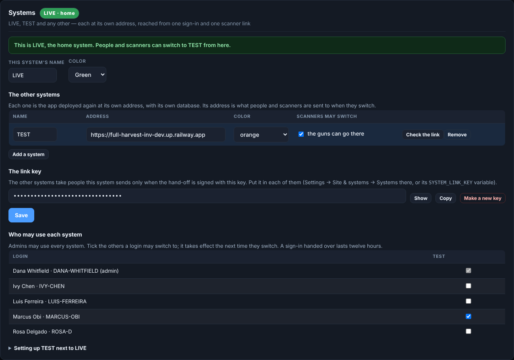
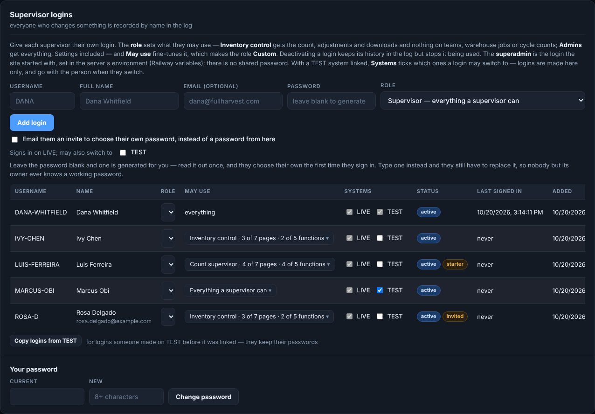
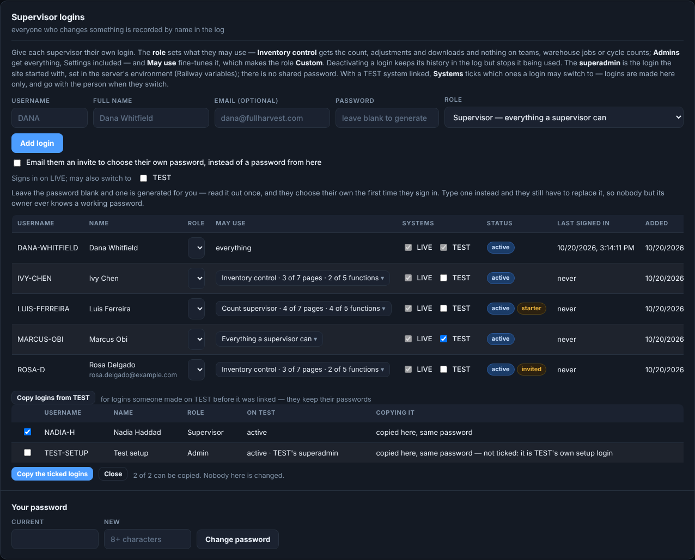
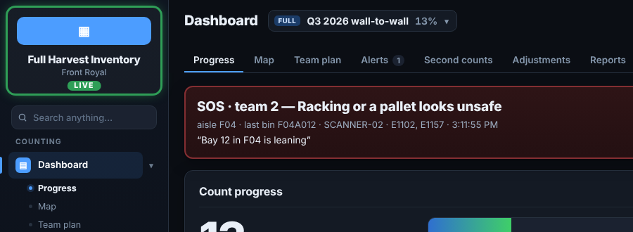
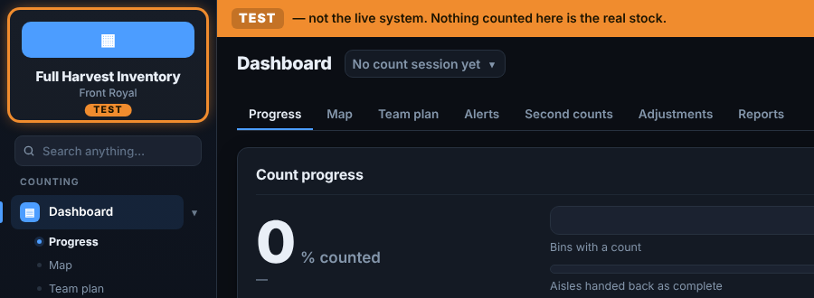
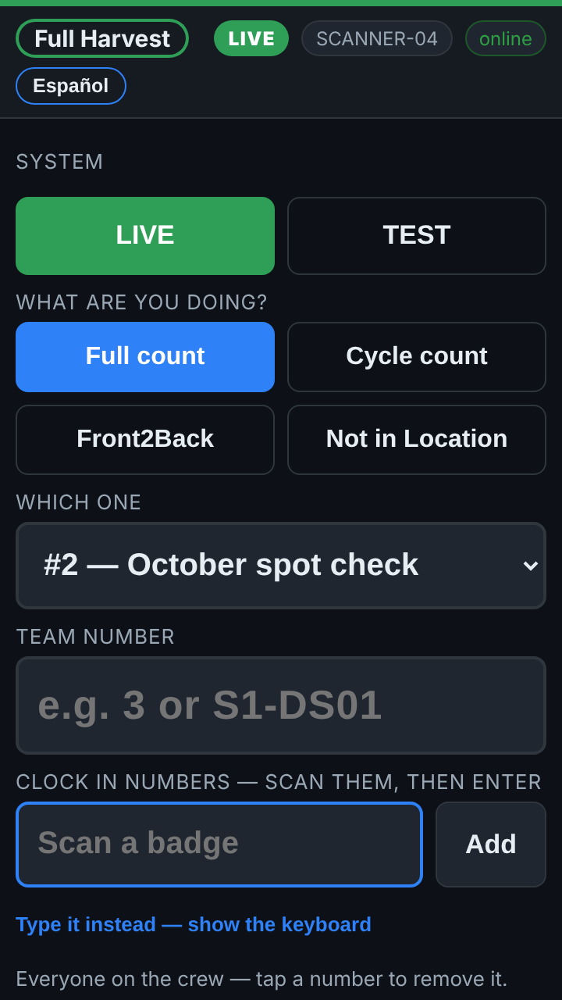
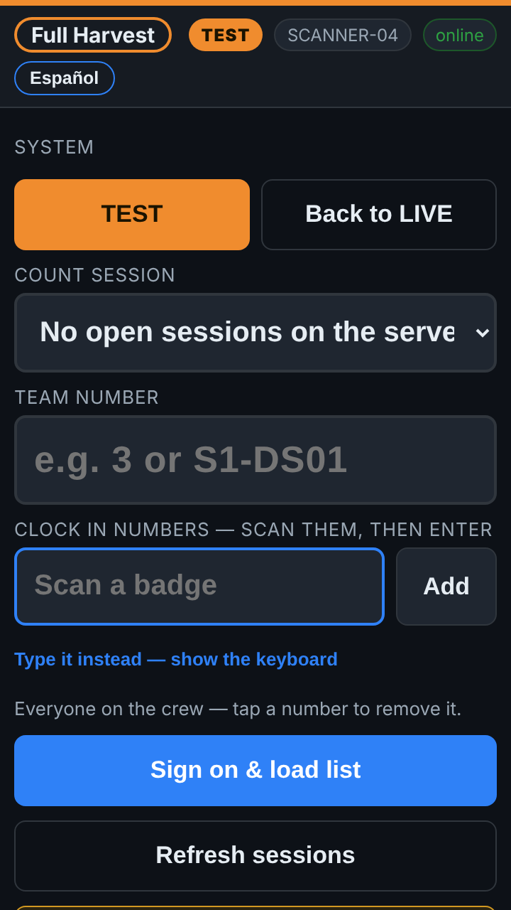
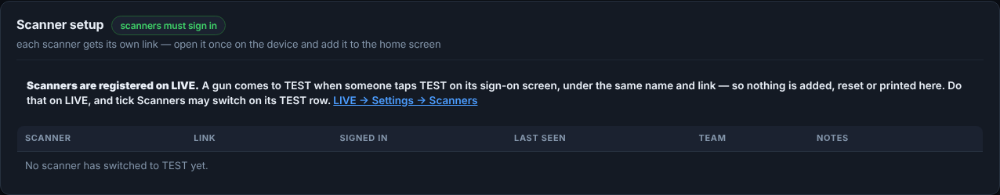

# How to — LIVE and TEST: switching, logins and scanners

**Role:** Admins, and anyone who uses the TEST system  **Login profile:** *Admin* to set it up; any login with TEST ticked to use it  **Pages:** Settings → Site & systems, Settings → Logins, the sidebar, the scanner  **Functions:** linking TEST to LIVE, who may use each, copying logins from TEST, switching on the office pages and on the guns

**TEST** is the app deployed a second time with its own database: the place to try new code, new
settings or a practice count on real guns without touching the live stock. **LIVE** is the home:
it keeps the logins, decides who may use which system, and registers the scanners. People and
scanners switch between the two from inside the app — one sign-in, one scanner link.

## Contents

- [1 — In one minute](#1--in-one-minute)
- [2 — Set TEST up (once)](#2--set-test-up-once)
- [3 — Who may use TEST](#3--who-may-use-test)
- [4 — Logins someone made on TEST: copy them to LIVE](#4--logins-someone-made-on-test-copy-them-to-live)
- [5 — Switching in the office](#5--switching-in-the-office)
- [6 — Scanners](#6--scanners)
- [7 — When something is not right](#7--when-something-is-not-right)

## 1 — In one minute

- **Logins are made on LIVE only.** Nobody needs a login on TEST: switching takes the person over
  with their role and pages.
- **Scanners are registered on LIVE only.** A gun switches to TEST under its own name and link.
- **Which one am I on?** The logo and site name sit in a ring of the system's color with its name
  — green **LIVE**, orange **TEST** — on the office pages and on the gun. Every TEST page also has
  an orange *TEST — not the live system* bar with **Back to LIVE**.
- **Nothing mixes.** TEST has its own counts, lists, crew, settings and backups.

## 2 — Set TEST up (once)

**In Railway**, on the TEST service (deployed from the same branch as LIVE, with its **own volume**),
set three variables and redeploy:

| Variable | Value |
|---|---|
| `SYSTEM_NAME` | `TEST` |
| `SYSTEM_HOME_URL` | LIVE's address, nothing after it — `https://full-harvest-inv-prod.up.railway.app` |
| `SYSTEM_LINK_KEY` | LIVE's link key: on LIVE, **Settings → Site & systems → Systems → The link key → Copy**. Paste it with no spaces or quotes |

LIVE has **no** `SYSTEM_HOME_URL` — that is what makes it the home.

**On LIVE**, *Settings → Site & systems → Systems*:

1. **Add a system**: name **TEST**, TEST's Railway address, a color (orange).
2. Tick **Scanners may switch** if the guns should be able to go to TEST.
3. **Save**.
4. Press **Check the link** on the TEST row. It asks TEST, server to server, and says what to fix
   if anything is wrong: TEST cannot be reached, runs an older version, thinks it is a home, has
   the wrong home address, is called something else, or holds another key. All green, and it works.

*LIVE's Systems card: TEST, its address, its color, whether the scanners may switch, and Check the link.*

## 3 — Who may use TEST

**Settings → Logins → Supervisor logins**, the **Systems** column:

*LIVE is ticked for everyone; tick TEST for each login that should have it. Admins always have both.*

- Tick **TEST** for a login and it may switch; untick it and it may not (within twelve hours —
  a switched sign-in lasts a shift).
- **Add login** has *may also switch to TEST*, to give it as the login is made.
- The same ticks are on the Systems card as *Who may use each system*; the two are one list.

## 4 — Logins someone made on TEST: copy them to LIVE

If people were set up on TEST before it was linked, bring them over instead of making them again.

1. On LIVE: **Settings → Logins → Copy logins from TEST**.
2. LIVE asks TEST (signed with the link key) for its logins and lists them first — nothing is
   copied by looking:

*Copy logins from TEST: what would happen to each.*

| It says | It means |
|---|---|
| *copied here, same password* (ticked) | New to LIVE. Comes over with its name, email, role, pages and password, and TEST ticked |
| *already a login here — left as it is* | LIVE has that username; the LIVE login is never changed |
| *never chose a password* | An invite nobody took up on TEST: add them on LIVE and invite them |
| TEST's superadmin (not ticked) | TEST's own setup login. Tick it only if it should be on LIVE too |

3. Untick anyone who should not come over and press **Copy the ticked logins**. They sign in on
   LIVE with the password they use on TEST. The log records who was copied.

People who only ever switched over from LIVE are not listed — they are LIVE's already.

## 5 — Switching in the office

| | |
|:--:|:--:|
|  **LIVE** — the green ring, and *Switch to…* at the bottom of the sidebar |  **TEST** — the orange ring, and the *TEST — not the live system* bar with **Back to LIVE** |

- **Sign in on LIVE.** Its sign-in box has **Sign in to: LIVE / TEST** — pick TEST to land there.
- **Switch to… TEST** at the bottom of the sidebar opens TEST on the same page, signed in as you,
  with the same role and pages.
- **Back to LIVE** on TEST's bar (or *Switch to… LIVE*) goes home, still signed in.
- On TEST, *Settings → Scanners* registers nothing, and TEST's own sign-in box says to sign in on LIVE.

## 6 — Scanners

| | |
|:--:|:--:|
|  **On LIVE**: green band and ring, *System: LIVE · TEST* |  **On TEST**: orange band and ring, *Back to LIVE* |

1. **Register every gun on LIVE** — *Settings → Scanners → Scanner setup*, print its setup card,
   open its link on the gun — as always.
2. With *Scanners may switch* ticked on LIVE's TEST row, the gun's sign-on screen shows
   **System: LIVE | TEST**. One tap takes it to TEST under its own name and link.
3. **Back to LIVE** on TEST's sign-on screen brings it home.
4. A gun with **counts still waiting to send** may not switch until they have gone — they belong
   to the system they were counted in.

On TEST, **Scanner setup** has no *Add scanner*, setup cards, *Copy* or *Reset link* — just the
guns that have come over, and a note pointing to LIVE:

*TEST's Scanner setup: the guns that came over from LIVE.*

Reset or remove a gun on LIVE. Removing one from TEST is harmless: it comes back the next time it
switches.

## 7 — When something is not right

| You see | What it means | What to do |
|---|---|---|
| **Back to LIVE** does nothing, or says *this system's own address* | TEST's `SYSTEM_HOME_URL` holds TEST's address | Set it to LIVE's address on the TEST service and redeploy TEST |
| Switching to TEST fails | The link is not set up right | On LIVE, **Check the link** on the TEST row and do what it says |
| *…refuses a hand-off… link key* | The two hold different keys | Copy LIVE's key into TEST's `SYSTEM_LINK_KEY` (no spaces, no quotes), redeploy |
| *calls itself DEV, but it is listed here as TEST* | The names differ | Set `SYSTEM_NAME=TEST` on TEST, or rename the row on LIVE |
| *this login may not use TEST* | TEST is not ticked for that login | Settings → Logins → Systems column |
| No *Switch to…* in the sidebar | No other system is listed, or this login has none ticked | Settings → Site & systems → Systems; Settings → Logins |
| The gun shows no *System* row | *Scanners may switch* is off for TEST | Tick it on LIVE's TEST row and save |
| *N counts are still on this scanner* | Counts waiting to send | Let them send (Wi-Fi), then switch |
| *scanners are registered on LIVE* | Someone tried to add a gun on TEST | Add it on LIVE, then switch it to TEST from the gun |
