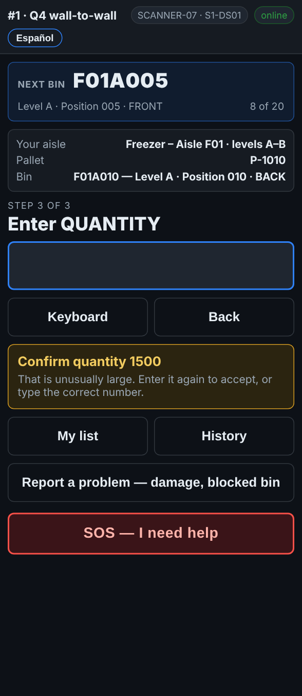

# On the scanner — A very large quantity

**Role:** Everyone counting on a full count  **When:** you type a quantity at or over the site’s limit, usually 1,000

A big number is easy to mistype. The scanner asks you to type it again before it keeps it.

## What you see

*Confirm quantity 1500: type it again to accept, or type the right number.*

## What to do

1. The yellow message says **Confirm quantity …**.
2. Count again if you are not sure.
3. The number is right: type it again and press Enter.
4. It was a typo: type the right number and press Enter.

## What the office sees

The quantity you confirmed. The limit is set by the office under Settings.

## Do not

- Do not type the same wrong number twice to get past the message.
