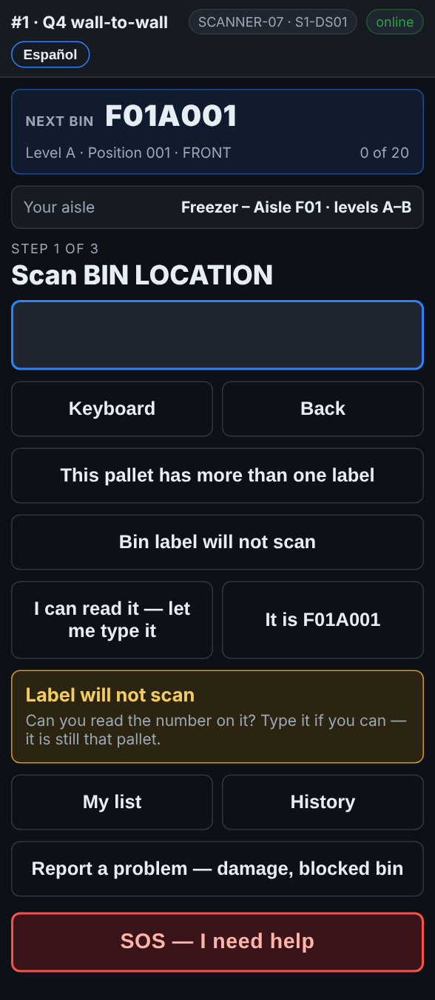
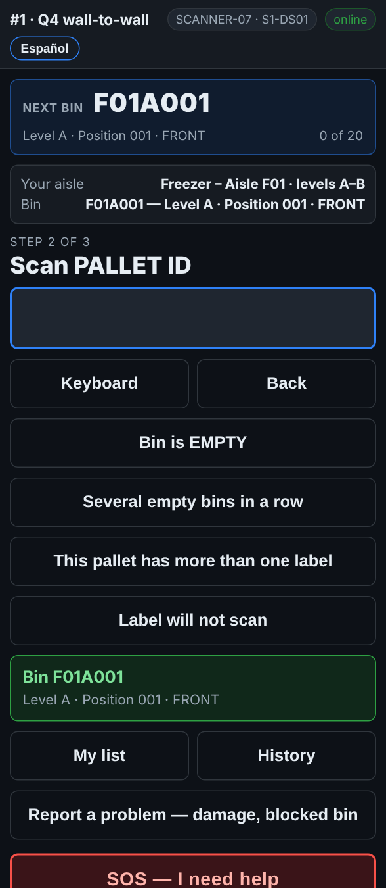

# On the scanner — A rack label that will not scan

**Role:** Everyone counting on a full count  **When:** the rack label under the spot is torn, missing, iced or faded

Every team after you walks up to the same spot, so a rack label that will not scan always goes on the relabel list. Most of the time the scanner already knows which bin you are at, and one tap tells it.

## What you see

*Bin label will not scan: type it, or tap It is … for the bin the guide is on.*

*It is F01A001: the bin is taken as if scanned, and the scanner asks for the pallet.*

## What to do

1. When the screen says *Scan BIN LOCATION* and the rack label will not read, tap **Bin label will not scan**.
2. Look at the button on the right:
   - **It is F01A001** (the bin *Next bin* is pointing at): tap it if that is where you are standing.
   - **I can read it — let me type it**: type the bin code on the scanner’s keys and press Enter.
   - **No readable bin label** shows when the scanner has no idea which bin it is. Tap it only if you cannot tell from the labels either side.
3. Carry on with the pallet and the quantity as usual.

## What the office sees

The line is marked, and the bin goes on **Reports → Fix list** under *Labels to replace*, whichever button you used. A bin recorded with **No readable bin label** is saved as *NO-LABEL-BIN-* and the aisle, for a supervisor to sort out. When the new label is up, the office taps **Label printed & on the rack**.

## Do not

- Do not scan the rack label of the spot next door instead.
- Do not tap **It is …** if that is not the spot in front of you.
