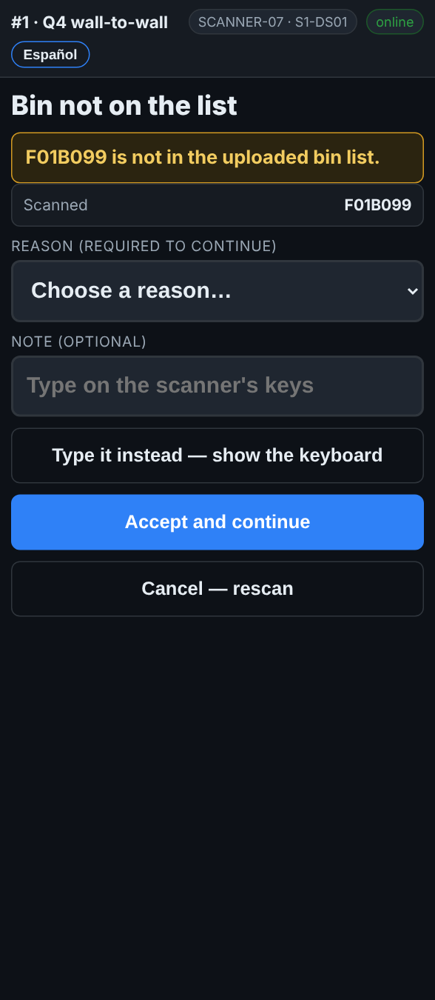

# On the scanner — A bin that is not on the list

**Role:** Everyone counting on a full count  **When:** you scan a rack label the bin list does not have

Usually this is a misread or a label from another area. The scanner stops and asks before it counts anything against a bin it does not know.

## What you see

*Bin not on the list: a reason is needed to go on.*

## What to do

1. The screen says **Bin not on the list**.
2. Check the rack label. Is it the label for the spot in front of you, or a label from a different area or an old layout?
3. A misread or the wrong label: tap **Cancel — rescan** and scan the right one.
4. It really is the spot, and there is a pallet in it: pick a reason, add a note if it helps, and tap **Accept and continue**.
5. Not sure: tap **Cancel — rescan** and ask your supervisor.

## What the office sees

The line is flagged with your reason and the unknown bin, for a supervisor to sort out. A bin that should be on the list gets added.

## Do not

- Do not accept a bin you are not sure about.
- Do not use **Accept and continue** to get past a label you misread.
