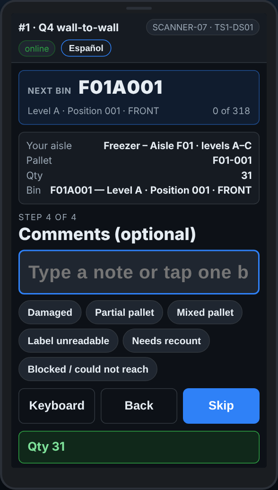

# On the scanner — A comment on a pallet

**Role:** Everyone counting on a full count  **When:** the scanner asks for a comment after the quantity

Most pallets need no comment. When something is wrong with the pallet itself, one tap on a quick reason tells the office.

## What you see

*Comments: tap a quick reason, or Skip.*

## What to do

1. After the quantity the screen says **Comments (optional)**.
2. Something is wrong with the pallet: tap the reason that fits, such as *Damaged* or *Partial pallet*.
3. Nothing to say: tap **Skip**. On count day it also moves on by itself after a few seconds.
4. If the screen says **Comments (required)**, pick a reason before going on.

## What the office sees

The comment on the line, on the pallet report.

## Do not

- Do not stop to type long notes. Tap a reason, or use Report a problem for something that needs fixing.
