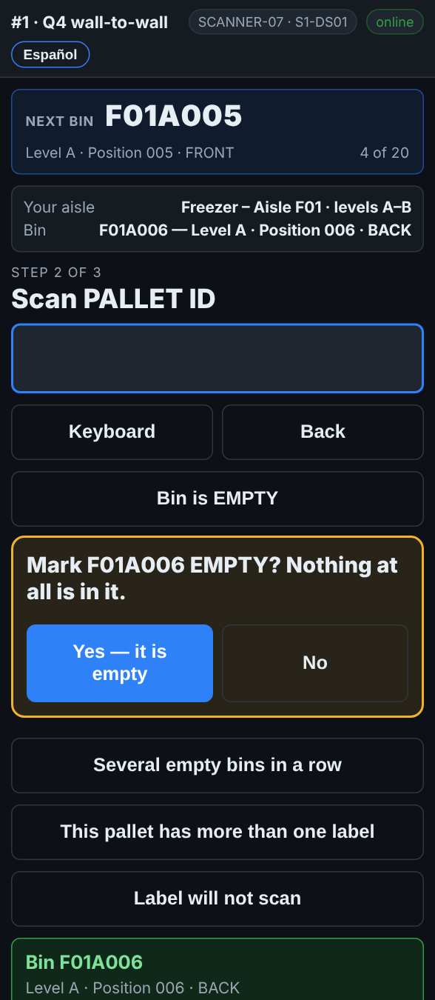

# On the scanner — An empty bin

**Role:** Everyone counting on a full count  **When:** there is nothing at all in the spot

An empty spot counts too. If it is not recorded, it looks like a spot nobody reached, and somebody is sent back to it.

## What you see

*With the rack label in: Bin is EMPTY, then Yes — it is empty.*

## What to do

1. Scan the rack label as usual.
2. Tap **Bin is EMPTY**.
3. The scanner asks *Mark F01A006 EMPTY? Nothing at all is in it.* Tap **Yes — it is empty**. **No** takes you back.
4. *Next bin* moves on.

If you tap **Bin is EMPTY — scan the bin** before scanning anything, scan the rack label next and the bin is saved as empty.

## What the office sees

The bin is recorded as checked and empty. If the report expected a pallet there, that pallet shows as **MISSING** on the pallet report, and a second count may be sent.

## Do not

- Do not walk past an empty spot without recording it.
- Do not mark a spot empty if a pallet is there but has no label. See *A pallet with no label*.
