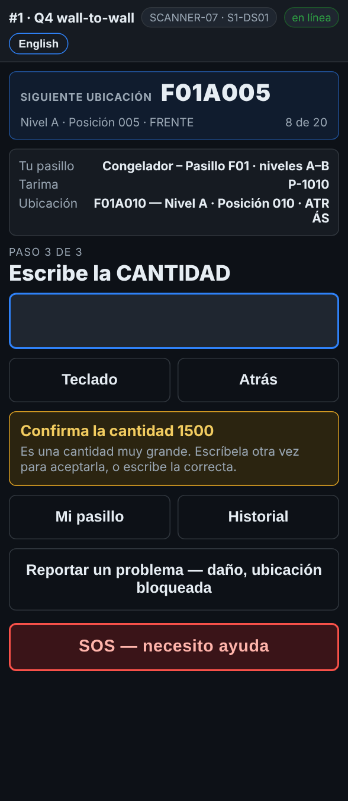

# En el escáner — Una cantidad muy grande

**Rol:** Todos los que cuentan en un conteo completo  **Cuándo:** escribes una cantidad igual o mayor al límite del sitio, casi siempre 1,000

Un número grande es fácil de escribir mal. El escáner te pide escribirlo otra vez antes de guardarlo.

## Lo que ves

*Confirma la cantidad 1500: escríbela otra vez para aceptarla, o escribe el número correcto.*

## Qué hacer

1. El mensaje amarillo dice **Confirma la cantidad …**.
2. Vuelve a contar si no estás seguro.
3. El número está bien: escríbelo otra vez y oprime Enter.
4. Fue un error: escribe el número correcto y oprime Enter.

## Lo que ve la oficina

La cantidad que confirmaste. El límite lo pone la oficina en Configuración.

## No hagas esto

- No escribas dos veces el mismo número equivocado para pasar el mensaje.
