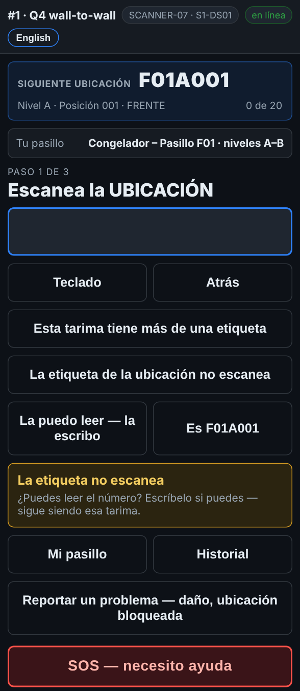
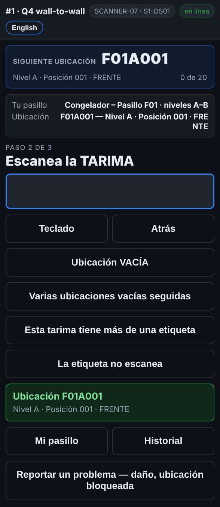

# En el escáner — Una etiqueta de rack que no escanea

**Rol:** Todos los que cuentan en un conteo completo  **Cuándo:** la etiqueta del rack debajo del lugar está rota, falta, tiene hielo o está borrosa

Cada equipo después de ti llega al mismo lugar, así que una etiqueta de rack que no escanea siempre va a la lista para cambiar. Casi siempre el escáner ya sabe en qué ubicación estás, y un toque se lo confirma.

## Lo que ves

*La etiqueta de la ubicación no escanea: escribirla, o tocar Es … para la ubicación que marca la guía.*

*Es F01A001: la ubicación se toma como escaneada, y el escáner pide la tarima.*

## Qué hacer

1. Cuando la pantalla dice *Escanea la UBICACIÓN* y el rack no lee, toca **La etiqueta de la ubicación no escanea**.
2. Mira el botón de la derecha:
   - **Es F01A001** (la que marca *Siguiente ubicación*): tócalo si es donde estás parado.
   - **La puedo leer — la escribo**: escribe el código de la ubicación con las teclas del escáner y oprime Enter.
   - **La ubicación no tiene etiqueta legible** sale cuando el escáner no sabe cuál es. Tócalo solo si tampoco lo sabes por las etiquetas de los lados.
3. Sigue con la tarima y la cantidad como siempre.

## Lo que ve la oficina

La línea queda marcada, y la ubicación va a **Reports → Fix list** (la lista de arreglos) en *Labels to replace* (etiquetas por cambiar), uses el botón que uses. Cuando la etiqueta nueva está puesta, la oficina toca **Label printed & on the rack**.

## No hagas esto

- No escanees la etiqueta del rack de al lado.
- No toques **Es …** si no es el lugar que tienes enfrente.
