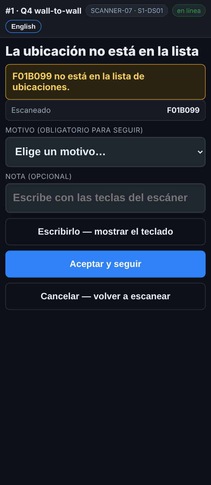

# En el escáner — Una ubicación que no está en la lista

**Rol:** Todos los que cuentan en un conteo completo  **Cuándo:** escaneas una etiqueta de rack que la lista de ubicaciones no tiene

Casi siempre es una mala lectura o una etiqueta de otra área. El escáner para y pregunta antes de contar nada en una ubicación que no conoce.

## Lo que ves

*La ubicación no está en la lista: se necesita un motivo para seguir.*

## Qué hacer

1. La pantalla dice **La ubicación no está en la lista**.
2. Revisa la etiqueta del rack. ¿Es la del lugar que tienes enfrente, o de otra área?
3. Mala lectura o etiqueta equivocada: toca **Cancelar — volver a escanear** y escanea la correcta.
4. Sí es el lugar, y hay una tarima: escoge un motivo, agrega una nota si ayuda, y toca **Aceptar y seguir**.
5. Si no estás seguro: toca **Cancelar — volver a escanear** y pregunta a tu supervisor.

## Lo que ve la oficina

La línea queda marcada con tu motivo y la ubicación desconocida, para que un supervisor la arregle.

## No hagas esto

- No aceptes una ubicación de la que no estás seguro.
- No uses **Aceptar y seguir** para pasar una etiqueta mal leída.
