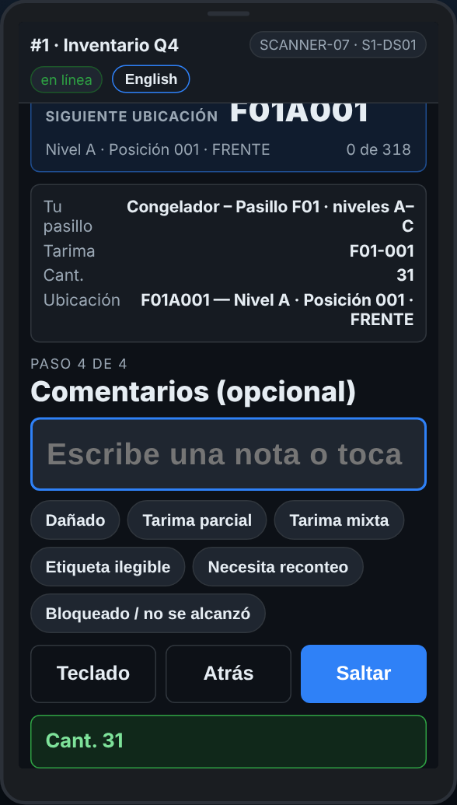

# En el escáner — Un comentario en una tarima

**Rol:** Todos los que cuentan en un conteo completo  **Cuándo:** el escáner pide un comentario después de la cantidad

La mayoría de las tarimas no necesita comentario. Cuando algo está mal con la tarima, un toque en un motivo rápido le avisa a la oficina.

## Lo que ves

*Comentarios: toca un motivo, o Saltar.*

## Qué hacer

1. Después de la cantidad la pantalla dice **Comentarios (opcional)**.
2. Algo está mal con la tarima: toca el motivo que aplica, como *Dañada* o *Tarima incompleta*.
3. Nada que decir: toca **Saltar**. El día del conteo también sigue solo después de unos segundos.
4. Si dice **Comentarios (obligatorio)**, escoge un motivo antes de seguir.

## Lo que ve la oficina

El comentario en la línea, en el reporte de tarimas.

## No hagas esto

- No te detengas a escribir notas largas. Toca un motivo, o usa Reportar un problema.
