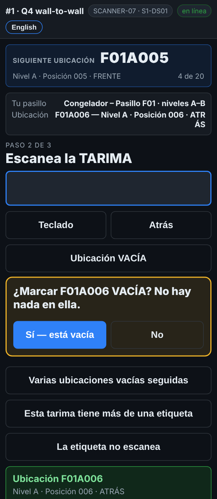

# En el escáner — Una ubicación vacía

**Rol:** Todos los que cuentan en un conteo completo  **Cuándo:** no hay nada en el lugar

Un lugar vacío también cuenta. Si no se registra, parece un lugar al que nadie llegó, y mandan a alguien a revisarlo.

## Lo que ves

*Con el rack escaneado: Ubicación VACÍA, luego Sí — está vacía.*

## Qué hacer

1. Escanea la etiqueta del rack como siempre.
2. Toca **Ubicación VACÍA**.
3. El escáner pregunta *¿Marcar F01A006 VACÍA? No hay nada en ella.* Toca **Sí — está vacía**. **No** te regresa.
4. *Siguiente ubicación* avanza.

Si tocas **Ubicación VACÍA — escanea la ubicación** antes de escanear nada, escanea el rack y la ubicación se guarda vacía.

## Lo que ve la oficina

La ubicación queda revisada y vacía. Si el reporte esperaba una tarima ahí, esa tarima sale como **MISSING**, y puede salir un segundo conteo.

## No hagas esto

- No pases un lugar vacío sin registrarlo.
- No marques vacío un lugar que tiene una tarima sin etiqueta. Mira *Una tarima sin etiqueta*.
