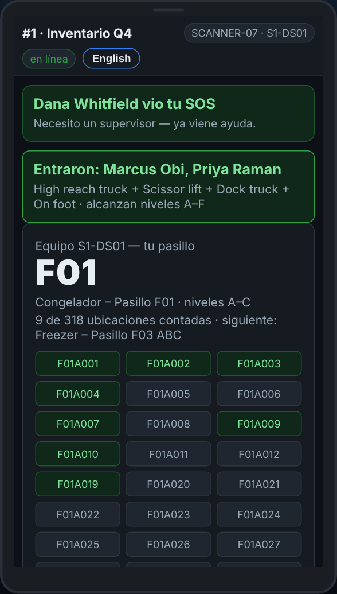
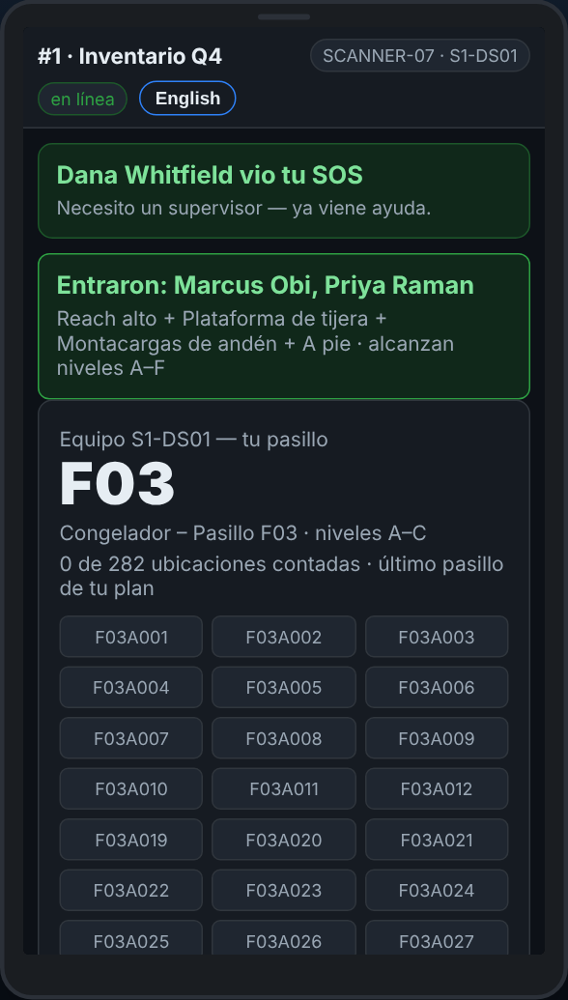

# En el escáner — Terminar el pasillo, y salir

**Rol:** Todos los que cuentan en un conteo completo  **Cuándo:** cada lugar de tus niveles tiene un conteo, o empieza tu descanso o tu salida

El escáner te dice cuando cada ubicación de tu pasillo tiene un conteo. Tu supervisor marca el pasillo terminado en la oficina, y tu siguiente pasillo sale solo.

## Lo que ves

*Cada ubicación tiene un conteo: avisa a tu supervisor.*

*Cuando el supervisor lo marca terminado, el siguiente pasillo sale en Mi pasillo.*

## Qué hacer

1. El cuadro de arriba dice que cada ubicación del pasillo tiene un conteo y que avises a tu supervisor.
2. Avisa a tu supervisor. No hay botón para esto en el escáner: él marca el pasillo terminado en el plan de equipos.
3. Tu siguiente pasillo sale en **Mi pasillo**. Toca **Actualizar** si todavía no sale.
4. Descanso o fin de turno: toca **Salir de este escáner** en Mi pasillo. Si quedan líneas por mandar, te pregunta primero.
5. Pon el escáner en su cargador. El siguiente equipo entra con su propia tarjeta y gafetes.

## Lo que ve la oficina

El pasillo terminado en el plan de equipos, y el siguiente pasillo de tu equipo contando.

## No hagas esto

- No le pases el escáner al siguiente equipo con la sesión de tu equipo.
- No salgas con líneas en espera: camina primero a donde haya señal.
