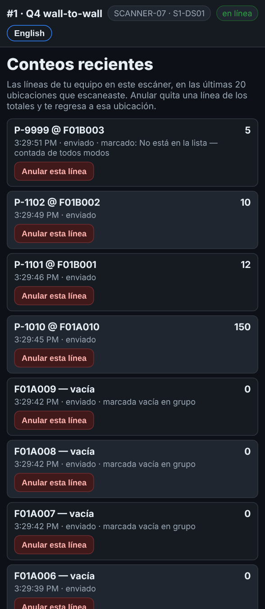
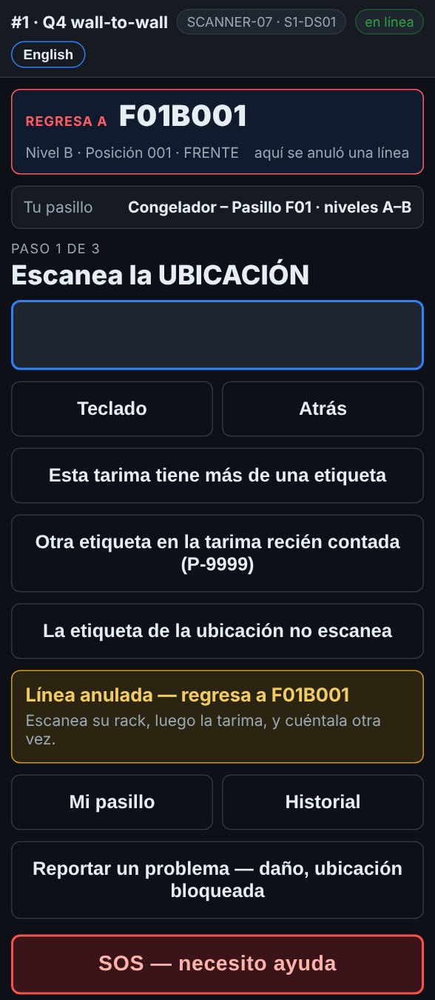

# En el escáner — Corregir un error

**Rol:** Todos los que cuentan en un conteo completo  **Cuándo:** escribiste o escaneaste algo mal

Antes de guardar la línea, Atrás regresa un paso. Después de guardarla, el Historial deja a tu equipo quitar una línea mal hecha, y el escáner te regresa a esa ubicación para contarla otra vez.

## Lo que ves

*Historial: las líneas de tu equipo en este escáner, en las últimas 20 ubicaciones.*

*Después de anular: Regresa a F01B001, escanea su rack y cuéntala otra vez.*

## Qué hacer

**Todavía no se guarda**

1. Toca **Atrás**. Cada toque regresa un paso: de la cantidad a la tarima, de la tarima a la ubicación.

**Ya se guardó**

1. Toca **Historial**. Muestra las líneas de tu equipo en este escáner, en las últimas 20 ubicaciones. Las del otro equipo no salen.
2. Busca la línea mal hecha y toca **Anular esta línea**.
3. El escáner regresa a la pantalla de escaneo. El cuadro de arriba dice **Regresa a** y la ubicación, en rojo.
4. Ve a esa ubicación. Escanea su rack, luego la tarima, y cuéntala otra vez.
5. Cuando cae un conteo en esa ubicación, el cuadro regresa a **Siguiente ubicación**.

## Lo que ve la oficina

Una línea anulada sale de los totales, pero nunca se borra: la oficina todavía ve que se anuló.

## No hagas esto

- No anules la línea de otro equipo: no está en tu Historial.
- No anules una línea y sigas de largo: el escáner te regresa por algo.
