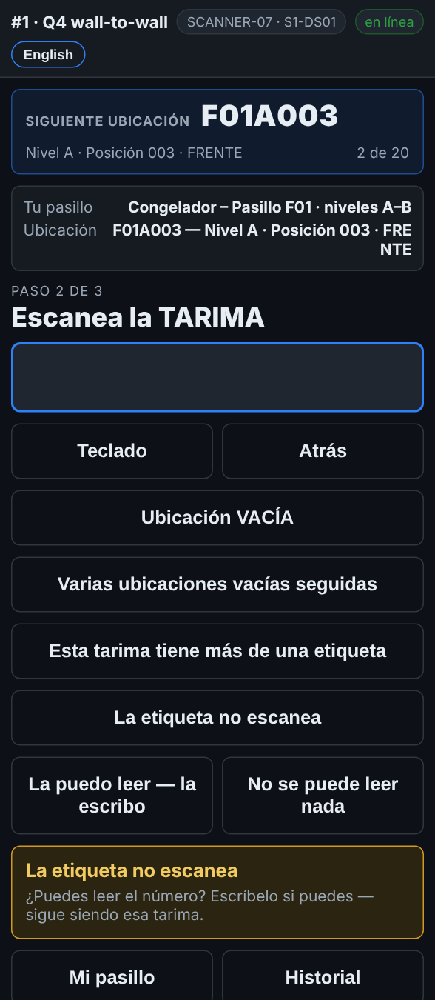
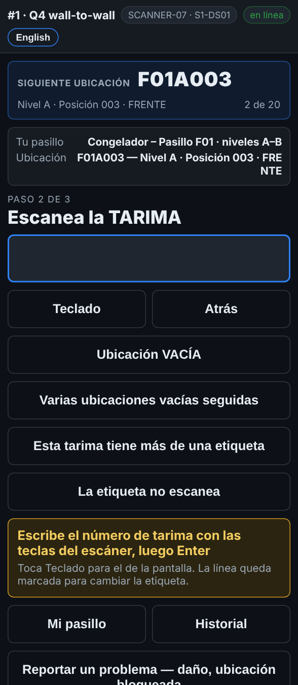

# En el escáner — Una etiqueta de tarima que no escanea

**Rol:** Todos los que cuentan en un conteo completo  **Cuándo:** la etiqueta está rota, con hielo o borrosa, pero todavía se puede leer el número

La tarima sigue ahí y se tiene que contar. Si puedes leer el número de la etiqueta, lo escribes y sigues. La línea queda marcada para que la oficina imprima una etiqueta nueva.

## Lo que ves

*La etiqueta no escanea abre dos opciones: escribirla, o no se puede leer nada.*

*La puedo leer — la escribo: escribe el número con las teclas del escáner y luego Enter.*

## Qué hacer

1. Escanea la etiqueta del rack como siempre. La pantalla pide la tarima.
2. Intenta otra vez con el gatillo, un poco más lejos. El hielo y los reflejos a veces se quitan a otra distancia.
3. Si no lee: toca **La etiqueta no escanea**.
4. Toca **La puedo leer — la escribo**.
5. Escribe el número de tarima con las teclas del escáner y oprime Enter. Toca **Teclado** solo si quieres el teclado de la pantalla.
6. Cuenta las cajas y escribe la cantidad como siempre.

## Lo que ve la oficina

La tarima se cuenta con el número que escribiste. La línea queda marcada como *escrita*, y la tarima va a **Reports → Fix list** (la lista de arreglos), en *Labels to replace* (etiquetas por cambiar). Cuando la etiqueta nueva está impresa y puesta, la oficina toca **Label printed & on the pallet**.

## No hagas esto

- No te saltes la tarima.
- No adivines un número que no puedes leer. Si no se lee, mira *Una tarima sin etiqueta*.
- No escribas el número de la tarima de al lado.
