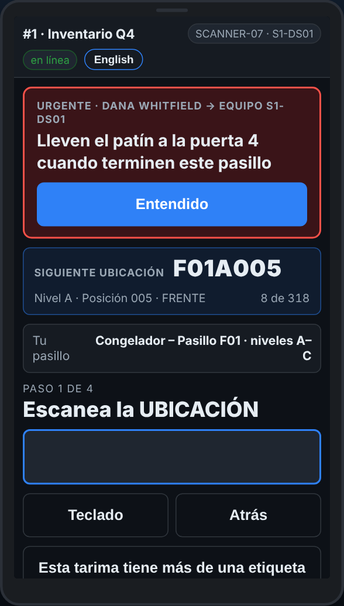

# En el escáner — Un mensaje de la oficina

**Rol:** Todos los que cuentan en un conteo completo  **Cuándo:** el escáner vibra y aparece un mensaje arriba

Tu líder puede mandar un mensaje a tu escáner: ven al andén, sáltate un pasillo, toma un descanso. Se queda en la pantalla hasta que dices que lo leíste.

## Lo que ves

*Un mensaje arriba: léelo, luego Entendido.*

## Qué hacer

1. Lee el mensaje de arriba. Uno rojo es urgente.
2. Toca **Entendido**.
3. Haz lo que dice. Puedes seguir escaneando mientras está en la pantalla.

## Lo que ve la oficina

Que tu escáner lo leyó, y a qué hora.

## No hagas esto

- No toques **Entendido** sin leer el mensaje.
