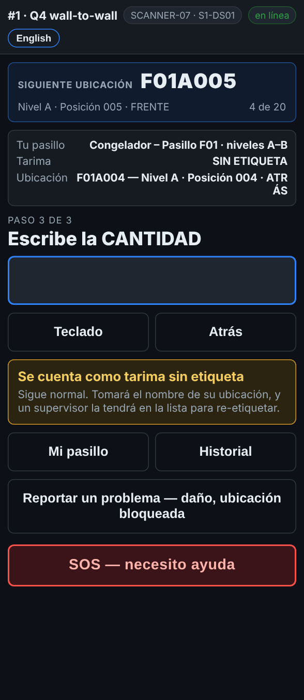

# En el escáner — Una tarima sin etiqueta

**Rol:** Todos los que cuentan en un conteo completo  **Cuándo:** la tarima no tiene etiqueta, o no se puede leer nada en ella

Una tarima sin etiqueta legible sigue siendo mercancía. La cuentas de todos modos, y el escáner le pone un nombre con la ubicación donde está, para que alguien pueda llegar directo a ella después.

## Lo que ves

*No se puede leer nada: la tarima se cuenta SIN ETIQUETA, con el nombre de su ubicación al guardarla.*

## Qué hacer

1. Escanea la etiqueta del rack como siempre. La pantalla pide la tarima.
2. Toca **La etiqueta no escanea**.
3. Toca **No se puede leer nada**. El escáner dice *Se cuenta como tarima sin etiqueta*.
4. Cuenta las cajas y escribe la cantidad como siempre.
5. Si algo está mal con la tarima, escoge el motivo en el comentario, o usa **Reportar un problema**.

## Lo que ve la oficina

La tarima se guarda como **NO-LABEL-** y la ubicación, por ejemplo *NO-LABEL-F01A004-1*. Una segunda tarima sin etiqueta en la misma ubicación es *-2*. La ubicación va a **Reports → Fix list** (la lista de arreglos) en *Labels to replace* (etiquetas por cambiar), y la oficina la compara con lo que el reporte esperaba ahí.

## No hagas esto

- No te saltes la tarima porque no tiene etiqueta.
- No uses el número de etiqueta de otra tarima.
- No escribas en la tarima para inventar un número.
