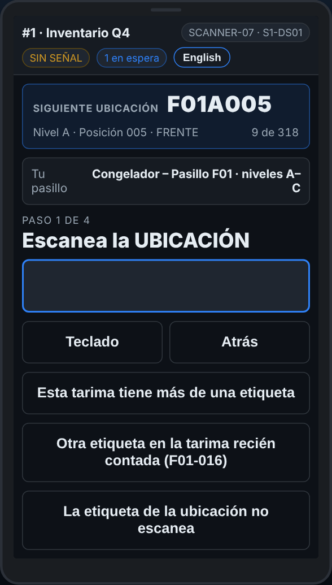

# En el escáner — Sin Wi-Fi

**Rol:** Todos los que cuentan en un conteo completo  **Cuándo:** arriba de la pantalla dice SIN SEÑAL

El Wi-Fi se cae en el congelador y al fondo del andén. El escáner guarda cada línea y la manda cuando regresa la señal. Sigue contando.

## Lo que ves

*SIN SEÑAL, con el número de líneas que esperan.*

## Qué hacer

1. Sigue contando como siempre. Cada línea se guarda en el escáner.
2. El aviso junto a *SIN SEÑAL* dice cuántas líneas esperan, por ejemplo *3 en espera*.
3. Cuando regresa la señal, las líneas se mandan solas. Dice *en línea* y el número se quita.
4. Antes de salir, camina a donde haya señal para que se vacíe la cola. El escáner avisa si quedan líneas sin llegar.

## Lo que ve la oficina

Las líneas llegan cuando el escáner tiene señal otra vez, con la hora en que se escanearon.

## No hagas esto

- No vuelvas a contar las mismas tarimas porque se cayó el Wi-Fi.
- No borres el navegador ni desinstales la app con líneas en espera.
- Un SOS sin señal **no** se manda: el escáner te lo dice. Ve a buscar a alguien.
