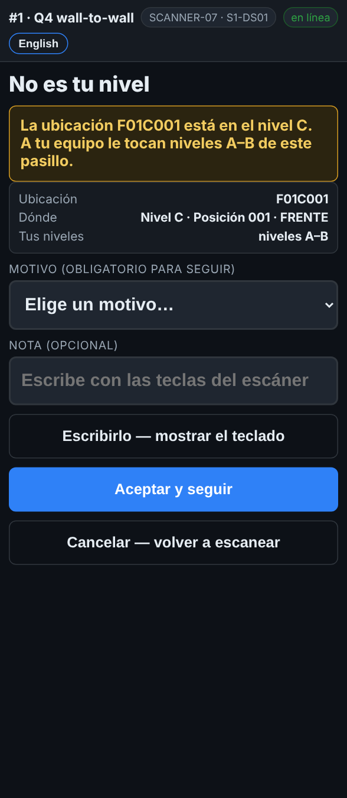
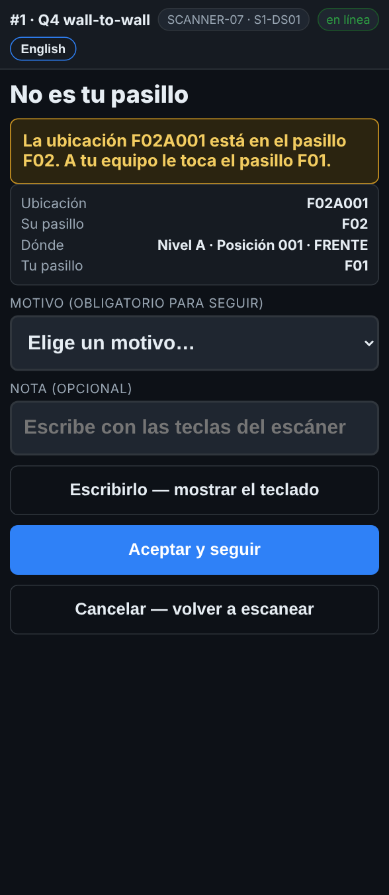

# En el escáner — No es tu pasillo, no es tu nivel, o no es tu lado

**Rol:** Todos los que cuentan en un conteo completo  **Cuándo:** escaneas una etiqueta de rack fuera del pasillo, los niveles o el lado del rack de tu equipo

Tu equipo cuenta el pasillo y los niveles que dice *Mi pasillo*. Una etiqueta de rack de otro lado casi siempre es la de arriba, la de abajo o la del otro lado del pasillo.

## Lo que ves

*No es tu nivel: la ubicación está en el nivel C, tu equipo cuenta A–B.*

*No es tu pasillo: la ubicación está en F02, tu equipo está en F01.*

**No es tu lado** funciona igual. Cuando dos equipos se reparten un pasillo, uno tiene las posiciones impares (*Frente*: 001, 003, 005 …) y el otro las pares (*Atrás*: 002, 004 …). *Mi pasillo* dice *solo el lado Frente* o *solo el lado Atrás*, y muestra solo las ubicaciones de tu lado.

## Qué hacer

1. La pantalla dice **No es tu nivel**, **No es tu pasillo** o **No es tu lado**, con la ubicación y dónde deberías estar.
2. Revisa la etiqueta: ¿escaneaste la de arriba o la de abajo, o la del otro lado?
3. Toca **Cancelar — volver a escanear** y escanea la etiqueta de tu lugar.
4. Solo si tu supervisor te mandó ahí: escoge un motivo y toca **Aceptar y seguir**.

## Lo que ve la oficina

Una línea aceptada queda marcada como contada fuera del plan, con tu motivo.

## No hagas esto

- No cuentes el pasillo de otro equipo, ni el otro lado de un pasillo compartido, a menos que tu supervisor lo pida.
- No alcances un nivel que tu equipo no alcanza.
