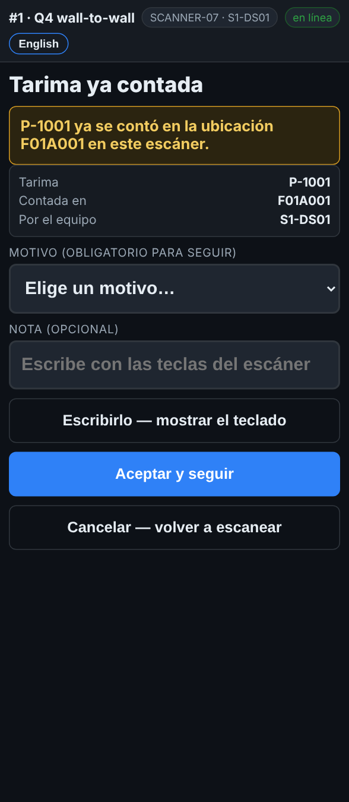

# En el escáner — Una tarima ya contada

**Rol:** Todos los que cuentan en un conteo completo  **Cuándo:** escaneas una etiqueta de tarima que ya se contó en este conteo

El escáner te dice dónde se contó la tarima y quién la contó. Casi siempre es la misma etiqueta escaneada dos veces.

## Lo que ves

*Tarima ya contada: dónde, y qué equipo.*

## Qué hacer

1. Lee el cuadro amarillo: dice la ubicación donde se contó, y *en este escáner* o qué equipo.
2. Escaneaste dos veces la misma etiqueta: toca **Cancelar — volver a escanear** y escanea la siguiente tarima.
3. Es una segunda etiqueta de una tarima: cancela, y usa **Otra etiqueta en la tarima recién contada**.
4. La tarima de verdad está aquí, y se contó en otro lugar antes de moverla: escoge un motivo, agrega una nota y toca **Aceptar y seguir**.

## Lo que ve la oficina

Un duplicado aceptado queda marcado. La oficina ve la tarima contada en dos ubicaciones y decide cuál vale, muchas veces con un segundo conteo.

## No hagas esto

- No aceptes un duplicado si no estás seguro. Cancela y pregunta.
- No cuentes una tarima dos veces por si acaso.
