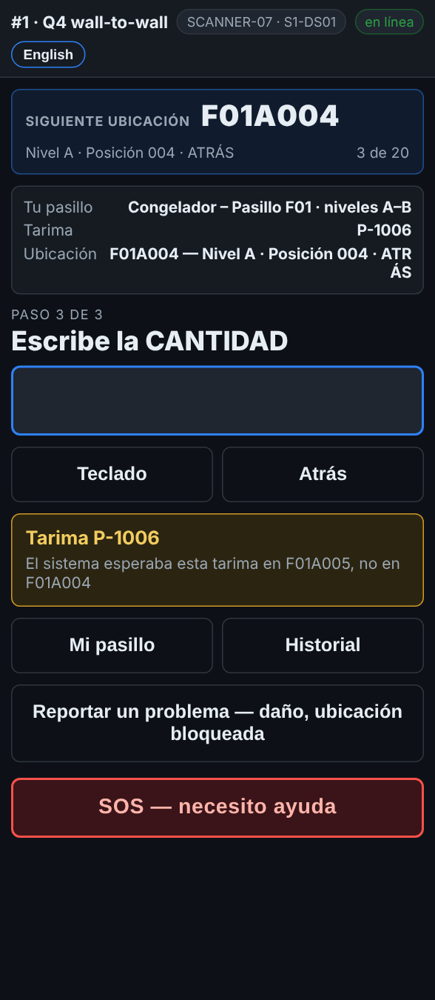

# En el escáner — Una tarima en otra ubicación que la del reporte

**Rol:** Todos los que cuentan en un conteo completo  **Cuándo:** la tarima que escaneas está en otra ubicación en el reporte

Las tarimas se mueven. El escáner te dice dónde la esperaba el reporte, y tú la cuentas donde de verdad está. No hay nada que escoger.

## Lo que ves

*El sistema esperaba esta tarima en F01A005, no en F01A004.*

## Qué hacer

1. El mensaje amarillo dice dónde la esperaba el sistema.
2. Cuéntala aquí, donde está: escribe la cantidad como siempre.
3. Sigue. No muevas la tarima.

## Lo que ve la oficina

La tarima sale como **WRONG BIN** en el reporte, con la ubicación donde se encontró. Si no se encontró nada en la ubicación que esperaba el reporte, esa ubicación sale con su tarima **MISSING**.

## No hagas esto

- No regreses la tarima durante el conteo.
- No escanees el rack de la ubicación que esperaba el reporte.
