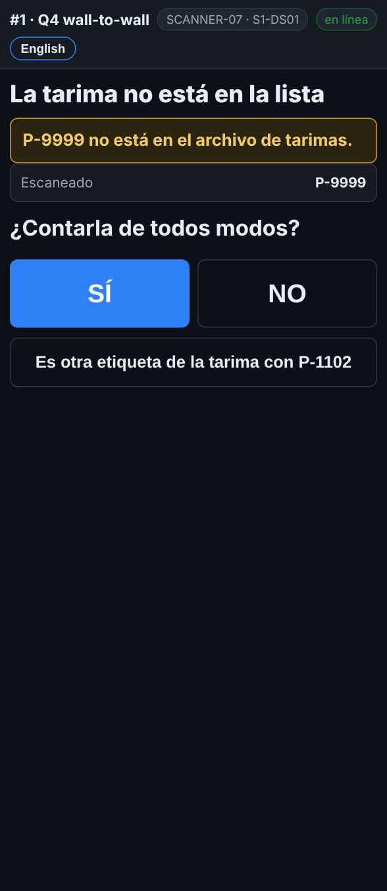

# En el escáner — Una tarima que no está en la lista

**Rol:** Todos los que cuentan en un conteo completo  **Cuándo:** escaneas una etiqueta de tarima que el reporte de inventario no tiene

Una tarima que el reporte no conoce sigue siendo una tarima en el rack. La cuentas, y la oficina la agrega al sistema.

## Lo que ves

*La tarima no está en la lista: ¿Contarla de todos modos? SÍ o NO.*

## Qué hacer

1. La pantalla dice **La tarima no está en la lista** y pregunta **¿Contarla de todos modos?**
2. Revisa la etiqueta: ¿es una etiqueta de tarima, y es de esta tarima?
3. Toca **SÍ** y cuéntala como cualquier otra.
4. Fue un código equivocado, una etiqueta de caja o una calcomanía: toca **NO** y escanea la etiqueta correcta.
5. Es una segunda etiqueta de la tarima que acabas de contar: toca **Es otra etiqueta de la tarima recién contada**.

## Lo que ve la oficina

La tarima sale como **NOT IN MASTER** en el reporte de tarimas. Un supervisor la agrega al sistema como mercancía encontrada.

## No hagas esto

- No toques **NO** solo para quitar la pregunta. Encontrar mercancía nunca es un problema.
- No escanees etiquetas de caja como etiqueta de tarima.
