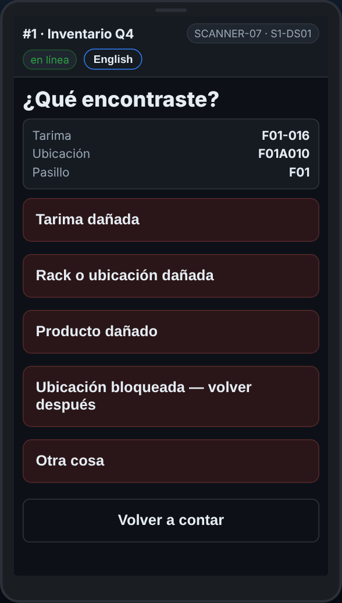

# En el escáner — Reportar un problema

**Rol:** Todos los que cuentan en un conteo completo  **Cuándo:** algo necesita arreglo pero nadie está lastimado: daño, un lugar bloqueado, rack roto

Reportar un problema lo pone en la lista de arreglos de la oficina, con la ubicación o la tarima exacta. No es un botón de emergencia: para ayuda ya, usa SOS.

## Lo que ves

*¿Qué encontraste? Escoge qué es, y luego escanea la ubicación o la tarima para confirmar.*

## Qué hacer

1. Toca **Reportar un problema — daño, ubicación bloqueada**.
2. Escoge qué encontraste, y luego qué está mal.
3. Agrega una nota si ayuda. Toca **Escribirlo — mostrar el teclado** para escribirla.
4. Escanea la ubicación o la tarima que pide el escáner, para que la oficina vaya a la correcta. ¿No escanea? Toca **La etiqueta no escanea — escríbela**.
5. Toca **Volver a contar** y sigue.

## Lo que ve la oficina

Tu reporte en **Reports → Fix list** (la lista de arreglos), con la ubicación, la tarima, tu equipo y la hora. Alguien lo arregla y lo marca.

## No hagas esto

- No uses Reportar un problema para alguien lastimado o algo peligroso. Usa SOS.
