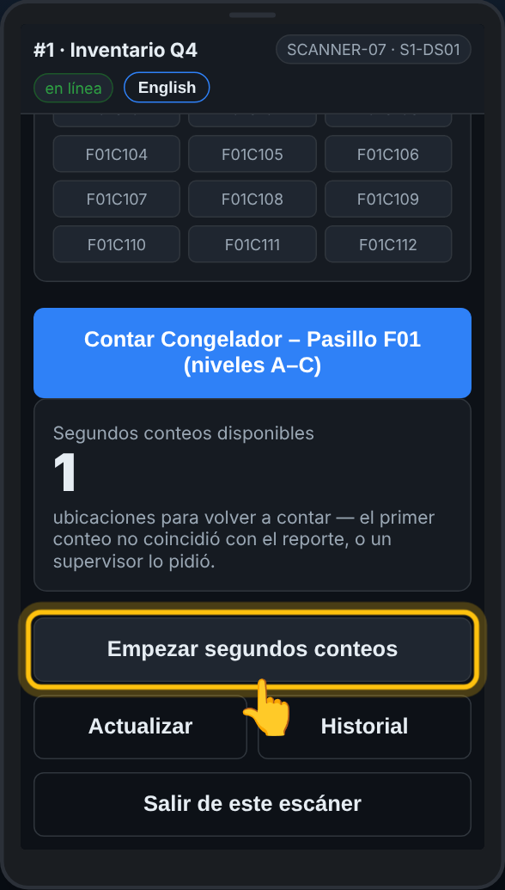
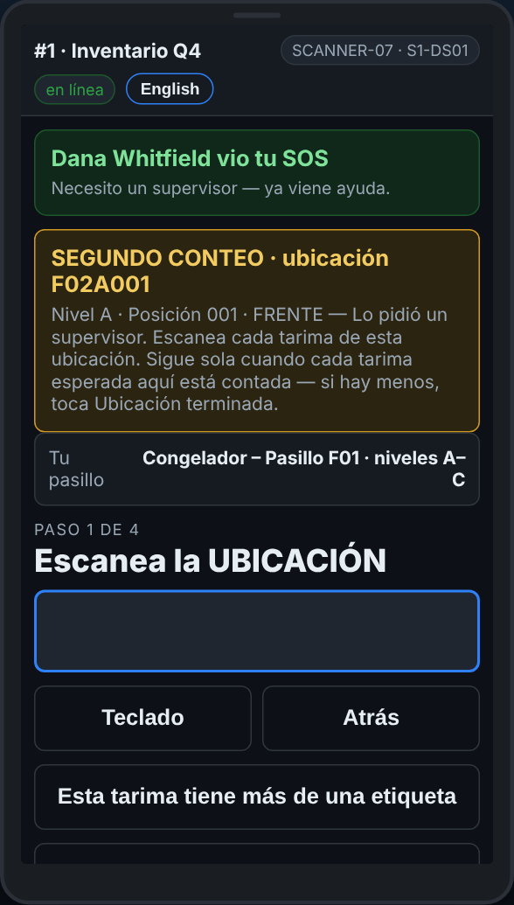

# En el escáner — Segundos conteos

**Rol:** Todos los que cuentan en un conteo completo  **Cuándo:** Mi pasillo muestra Empezar segundos conteos

Cuando un primer conteo no coincide con el reporte, la oficina manda a otro equipo a volver a contar ese lugar, a ciegas. No te dicen el primer conteo.

## Lo que ves

*Mi pasillo: Segundos conteos disponibles, y Empezar segundos conteos.*

*Un segundo conteo: ve a la ubicación y cuenta todo lo que hay. Sigue solo cuando cada tarima esperada está contada.*

## Qué hacer

1. En **Mi pasillo**, toca **Empezar segundos conteos**.
2. El aviso de arriba dice a qué ubicación ir.
3. Cuenta todo en ese lugar: rack, tarima, cantidad, para cada tarima.
4. Cuando cada tarima que espera el reporte en ese lugar está contada, el escáner termina el segundo conteo solo y sale el siguiente.
5. Hay menos tarimas de las esperadas, o ninguna: toca **Ubicación terminada — no hay más aquí** cuando contaste lo que hay. Un lugar vacío: **Ubicación VACÍA**.
6. No puedes llegar ahora: toca **Dejarla para otro equipo**.
7. ¿Escaneaste otra ubicación por error? El escáner dice que este segundo conteo es para otra ubicación. Escanea la correcta.

## Lo que ve la oficina

Tu segundo conteo junto al primero en **Second counts**. Cuando el tuyo no coincide ni con el primero ni con el reporte, puede ir un tercer equipo.

## No hagas esto

- No preguntes cuál fue el primer conteo.
- No cuentes solo la tarima que salió mal: cuenta todo en el lugar.
