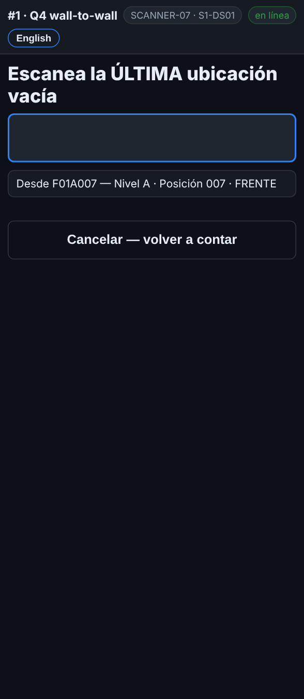
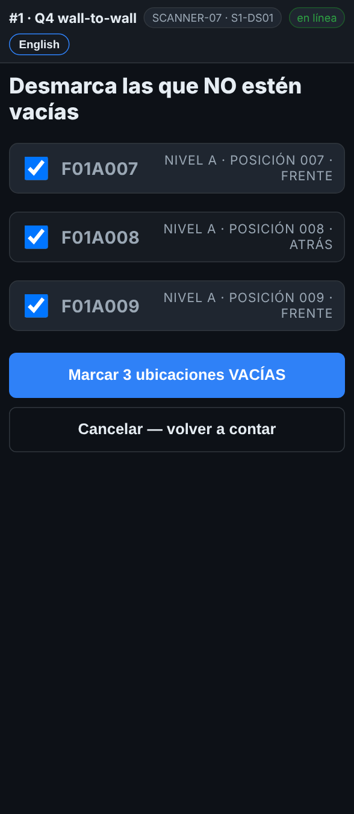

# En el escáner — Varias ubicaciones vacías seguidas

**Rol:** Todos los que cuentan en un conteo completo  **Cuándo:** varios lugares seguidos están vacíos

Una fila de lugares vacíos se registra de una vez: el primero y el último, y el escáner muestra cada ubicación de en medio para que la revises.

## Lo que ves

*Escanea la PRIMERA ubicación vacía, luego la ÚLTIMA.*

*Desmarca las que NO estén vacías, luego Marcar 3 ubicaciones VACÍAS.*

## Qué hacer

1. Escanea el rack del primer lugar vacío como siempre. La pantalla pide la tarima.
2. Toca **Varias ubicaciones vacías seguidas**.
3. Escanea la **primera** ubicación vacía.
4. Escanea la **última** ubicación vacía. Las dos tienen que ser del mismo pasillo.
5. El escáner muestra cada ubicación de en medio de tus niveles. Las ya contadas salen en gris, *ya contada*.
6. Recorre la fila y desmarca cada lugar que **no** esté vacío.
7. Toca **Marcar N ubicaciones VACÍAS**. **Cancelar — volver a contar** sale sin guardar.

## Lo que ve la oficina

Cada ubicación de la fila queda revisada y vacía, igual que una por una. Una fila de más de 60 ubicaciones pide revisar la primera y la última antes de guardar.

## No hagas esto

- No marques una fila que no recorriste.
- No dejes marcado un lugar con una tarima.
