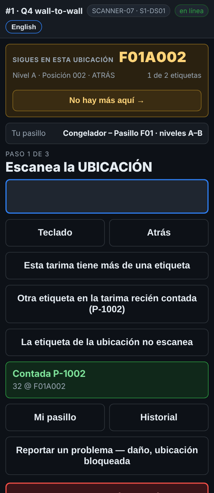

# En el escáner — Varias tarimas en una ubicación

**Rol:** Todos los que cuentan en un conteo completo  **Cuándo:** hay más de una tarima en un lugar

Dos, tres o cuatro tarimas en un lugar es normal. El escáner te mantiene en ese lugar hasta contar cada tarima, para que no quede ninguna.

## Lo que ves

*Sigues en esta ubicación, 1 de 2: el reporte espera dos tarimas aquí.*

## Qué hacer

1. Cuenta la primera tarima como siempre: rack, tarima, cantidad.
2. El cuadro de arriba se pone naranja: **Sigues en esta ubicación**, con un contador como *1 de 2*.
3. Cuenta la siguiente tarima igual: rack, tarima, cantidad.
4. Cuando están contadas todas las que espera el reporte, el cuadro regresa solo a **Siguiente ubicación**.
5. ¿El escáner espera más pero no hay? Toca **No hay más aquí →**.
6. Un lugar donde el reporte no tiene nada se queda abierto después de una tarima, porque puede haber más. Toca **No hay más aquí →** cuando termines.

## Lo que ve la oficina

Cada tarima es su propia línea en esa ubicación. Una tarima que el reporte esperaba ahí y nadie contó sale como **MISSING** en el reporte de tarimas.

## No hagas esto

- No dejes un lugar a medias.
- No cuentes de memoria las tarimas de atrás: jálalas o pide un montacargas.
