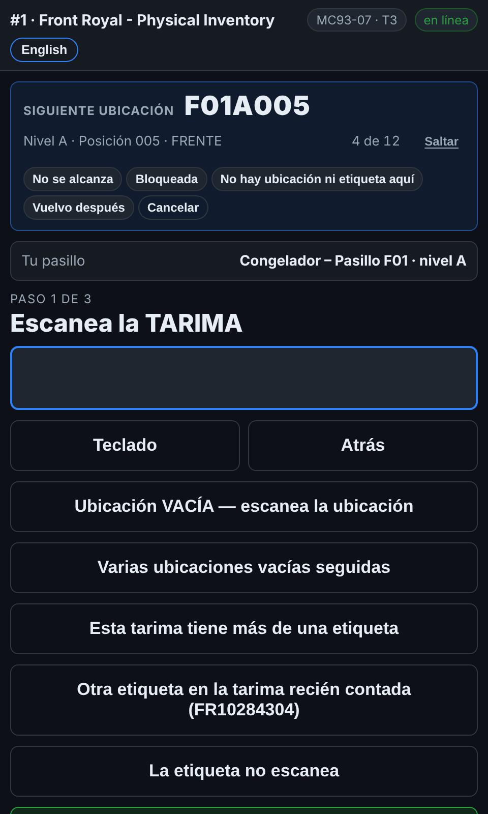

# En el escáner — Saltar una ubicación que no puedes contar ahora

**Rol:** Todos los que cuentan en un conteo completo  **Cuándo:** la guía señala una ubicación a la que no llegas — fuera de alcance, bloqueada, o no hay ubicación donde dice la lista

La guía arriba de la pantalla de conteo recorre el pasillo contigo. Una ubicación que no puedes contar ahora no debe detenerte, y tampoco debe olvidarse.

## Lo que ves

*Saltar, en la línea de avance de la guía: escoge por qué, y la guía sigue.*

## Qué hacer

1. Toca el pequeño **Saltar** junto al contador de avance de la guía.
2. Escoge por qué: **No la alcanzo**, **Bloqueada** (un tráiler, un montacargas, producto que estorba), **No hay ubicación ni etiqueta aquí**, o **Vuelvo después**.
3. La guía pasa a la siguiente ubicación. El escáner dice *F01A005 saltada*.
4. Al final del pasillo la guía dice cuáles saltaste. Regresa si puedes — contar la ubicación la quita de la lista.
5. Si pasaste una ubicación sin terminarla, la guía te la muestra al final como **Regresa a**.

## Lo que ve la oficina

Cada salto queda en la **lista de pendientes** como ubicación bloqueada, con tu motivo, tu equipo y la hora, para que un supervisor mande a alguien con el equipo adecuado o quite lo que estorba. Contarla después la cierra.

## No hagas esto

- No saltes una ubicación que simplemente está vacía: toca **Ubicación VACÍA** y escanéala. Eso sí es un conteo.
- No saltes una ubicación para pasar una tarima con etiqueta mala: usa **La etiqueta no escanea**.
