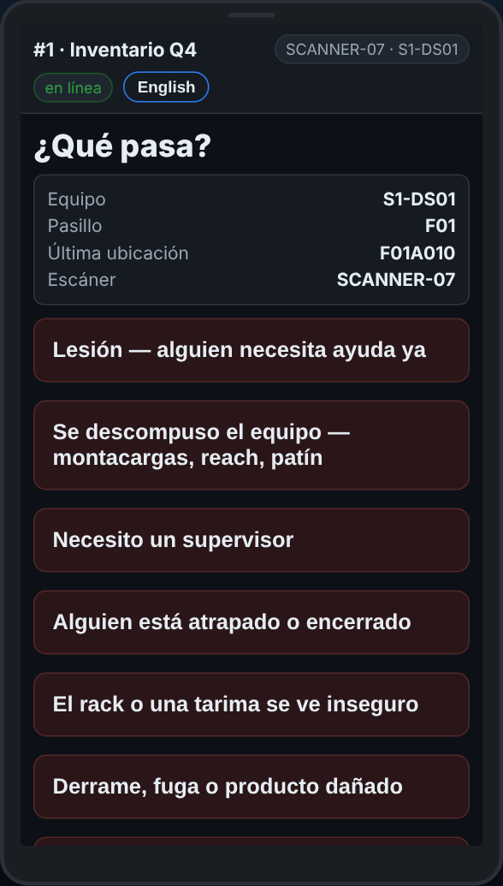
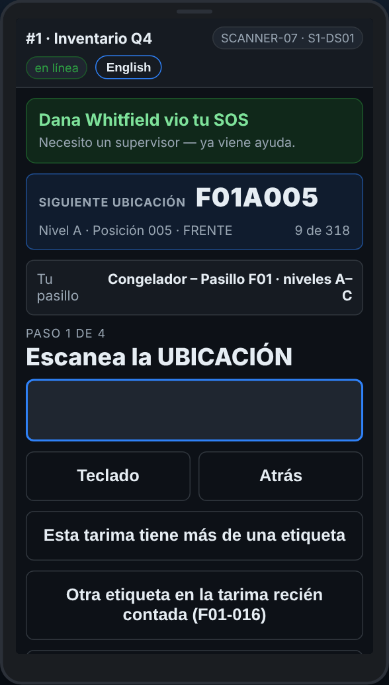

# En el escáner — SOS — cuando necesitas ayuda ya

**Rol:** Todos los que cuentan en un conteo completo  **Cuándo:** alguien está lastimado, atrapado, el equipo se rompió, o necesitas un supervisor ya

SOS le avisa a la oficina de inmediato, con tu equipo, tu pasillo y la última ubicación que escaneaste. Cuando un supervisor lo atiende, tu escáner te dice quién.

## Lo que ves

*SOS — ¿qué pasa? Escoge, y la oficina se entera de inmediato.*

*Cuando un supervisor lo atiende, el escáner dice quién lo vio.*

## Qué hacer

1. Toca el botón rojo **SOS — necesito ayuda**.
2. Escoge qué pasa. Agrega una nota si hay tiempo.
3. Quédate donde estás si es seguro. La oficina ve tu equipo, tu pasillo y tu última ubicación.
4. Cuando un supervisor lo atiende, tu escáner dice quién lo vio.
5. Sin señal: el escáner dice que el SOS **no** se mandó. Ve a buscar a alguien.

## Lo que ve la oficina

Una alerta fuerte en el Dashboard, en **Alerts**, y en el canal de Teams si el sitio tiene uno, con tu equipo, pasillo, última ubicación y lo que escogiste.

## No hagas esto

- No esperes al escáner si alguien está en peligro: grita y ve por ayuda.
- No uses SOS para una tarima dañada o un lugar bloqueado: usa Reportar un problema.
