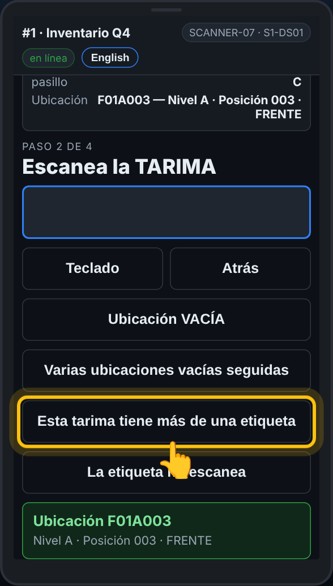
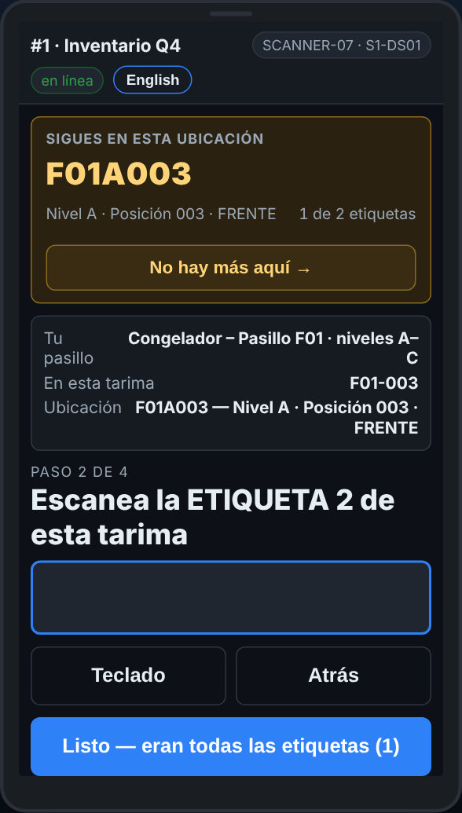
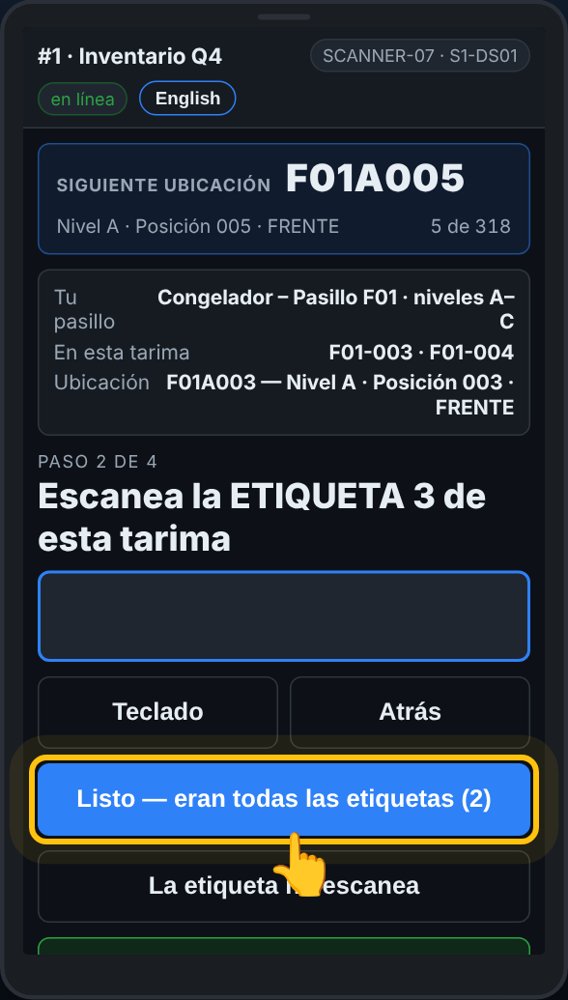

# En el escáner — Una tarima con dos o más etiquetas

**Rol:** Todos los que cuentan en un conteo completo  **Cuándo:** una tarima trae más de una etiqueta de tarima

Algunas tarimas llevan dos cargas en una sola tarima, cada una con su etiqueta. Cada etiqueta se cuenta aparte, con su propia cantidad, en la misma ubicación. La etiqueta del rack se escanea una sola vez para todas.

## Lo que ves

*Antes de escanear nada, o con solo el rack: Esta tarima tiene más de una etiqueta.*

*La etiqueta 2 de esta tarima: cada etiqueta lleva su propia cantidad.*

*Listo — eran todas las etiquetas, con el número de etiquetas.*

## Qué hacer

1. Escanea la etiqueta del rack como siempre.
2. Toca **Esta tarima tiene más de una etiqueta**. Si lo tocas antes del rack, el escáner pide primero la ubicación.
3. La pantalla pide la ETIQUETA 1 de esta tarima. Escanéala, escribe las cajas de esa etiqueta y oprime Enter.
4. Luego pide la ETIQUETA 2. Escanéala y escribe sus cajas. Sigue con cada etiqueta.
5. Toca **Listo — eran todas las etiquetas**. El botón dice cuántas etiquetas contaste.

**¿Viste la segunda etiqueta tarde?** La tarima ya se guardó. Al empezar la siguiente línea toca **Otra etiqueta en la tarima recién contada**. El escáner conserva la misma ubicación: escanea la otra etiqueta, escribe sus cajas y luego **Listo**.

**¿La segunda etiqueta dice que la tarima no está en la lista?** Toca **Es otra etiqueta de la tarima recién contada** y se cuenta junto con la primera.

## Lo que ve la oficina

Cada etiqueta es su propia fila en el reporte de tarimas, en la misma ubicación, con su propia cantidad. Las etiquetas siguientes dicen con qué etiqueta comparten tarima, así nadie cree que la tarima se contó dos veces.

## No hagas esto

- No sumes las dos cantidades en una sola etiqueta.
- No escanees dos veces la misma etiqueta, ni el rack otra vez entre etiquetas.
