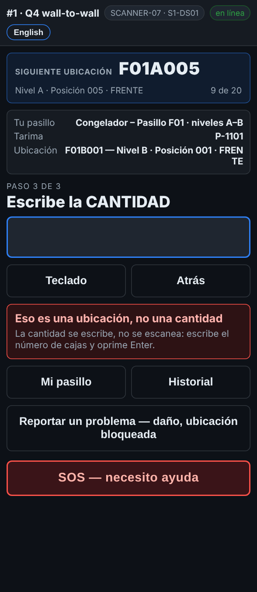

# En el escáner — La etiqueta equivocada en el lugar equivocado

**Rol:** Todos los que cuentan en un conteo completo  **Cuándo:** escaneas un rack donde va la tarima, una tarima donde va la ubicación, o una etiqueta en la cantidad

El escáner distingue una etiqueta de rack de una de tarima. Cuando entra la equivocada, te avisa y no guarda nada.

## Lo que ves

*Eso es una ubicación, no una cantidad: la cantidad se escribe, no se escanea.*

## Qué hacer

1. Lee el mensaje rojo. Dice qué escaneaste y qué quería:
   - *… es una ubicación, no una tarima*: escanea la etiqueta de la tarima.
   - *… es una etiqueta de tarima, no una ubicación*: escanea el rack del lugar donde está la tarima.
   - *Eso es una ubicación, no una cantidad*: escribe el número de cajas y oprime Enter.
2. Escanea o escribe lo correcto. El escaneo equivocado no guardó nada.

## Lo que ve la oficina

Nada. Un escaneo equivocado nunca llega a la oficina.

## No hagas esto

- No escanees una etiqueta para llenar la cantidad.
- No toques Atrás para quitar el mensaje: solo escanea la etiqueta correcta.
