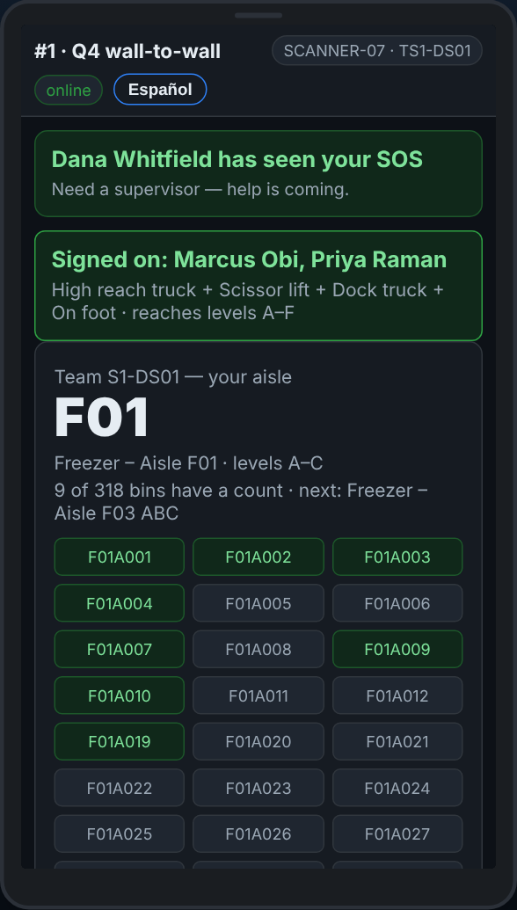
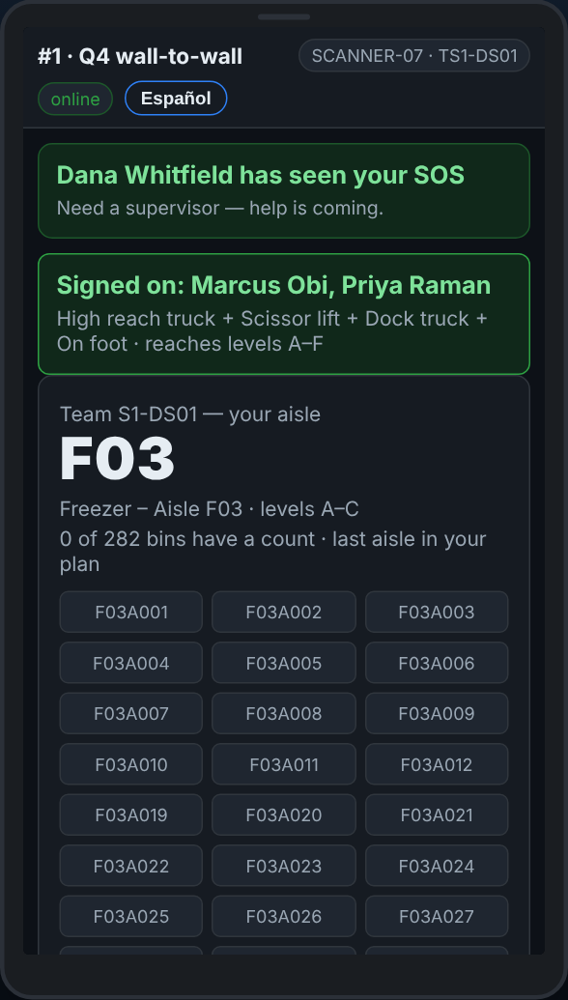

# On the scanner — Finishing the aisle, and signing off

**Role:** Everyone counting on a full count  **When:** every spot on your levels has a count, or your shift or break starts

The scanner tells you when every bin in your aisle has a count. Your supervisor marks the aisle done in the office, and your next aisle appears by itself.

## What you see

*Every bin has a count: tell your supervisor.*

*Once the supervisor marks it done, the next aisle is on My aisle.*

## What to do

1. The box at the top says *Every bin in … has a count — tell your supervisor*.
2. Tell your supervisor. There is no button for this on the scanner: they mark the aisle done on the Team plan.
3. Your next aisle shows on **My aisle**. Tap **Refresh** if it has not appeared yet.
4. Break or end of shift: tap **Sign off this scanner** on My aisle. If lines are still waiting to send, it asks first.
5. Put the scanner on its charger. The next crew signs on with their own team card and badges.

## What the office sees

The aisle as complete on the Team plan, and your team’s next aisle as counting.

## Do not

- Do not hand the scanner to the next crew still signed on as your team.
- Do not sign off with lines queued: walk to the signal first.
