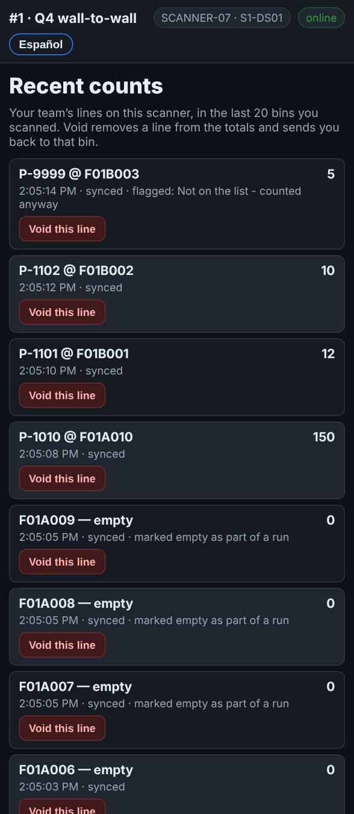
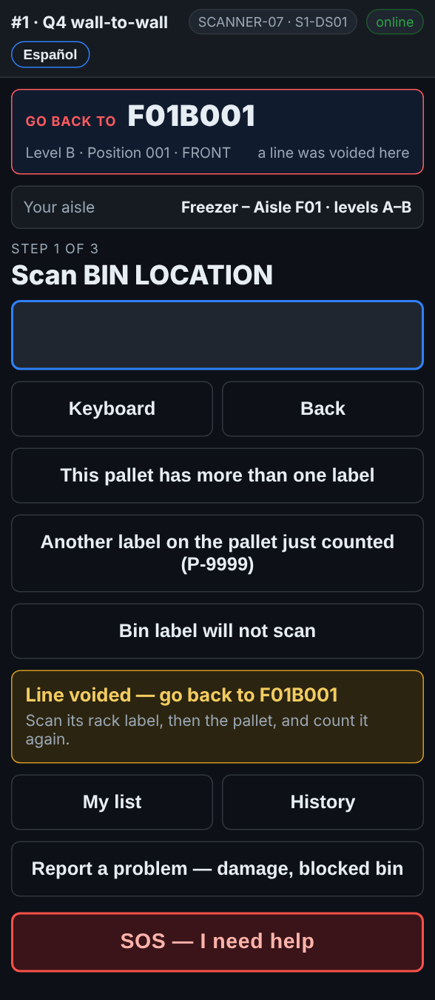

# On the scanner — Fixing a mistake

**Role:** Everyone counting on a full count  **When:** you typed or scanned something wrong

Before the line is saved, Back goes one step back. After it is saved, History lets your team take a wrong line out, and the scanner sends you back to that bin to count it again.

## What you see

*History: your team’s lines on this scanner, in the last 20 bins you scanned.*

*After a void: Go back to F01B001, scan its rack label and count it again.*

## What to do

**Not saved yet**

1. Tap **Back**. Each tap goes one step back: from the quantity to the pallet, from the pallet to the bin.

**Already saved**

1. Tap **History**. It shows your team’s own lines on this scanner, in the last 20 bins you scanned. Another crew’s lines are not there.
2. Find the wrong line and tap **Void this line**.
3. The scanner goes back to the scan screen. The box at the top says **Go back to** and the bin, in red.
4. Go to that bin. Scan its rack label, then the pallet, and count it again.
5. Once a count lands in that bin, the box goes back to **Next bin**.

## What the office sees

A voided line is taken out of the totals, but it is never deleted: the office can still see it was voided.

## Do not

- Do not void another team’s line: it is not in your History.
- Do not void a line and walk on: the scanner sends you back for a reason.
