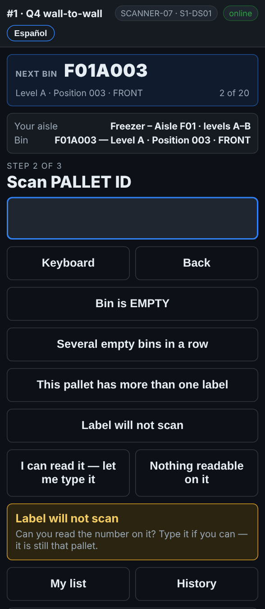
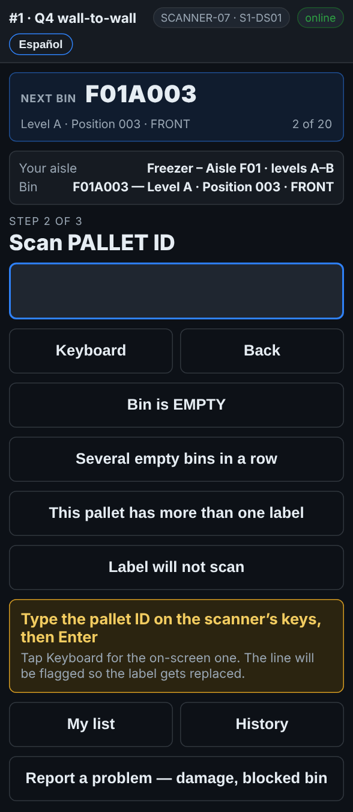

# On the scanner — A pallet label that will not scan

**Role:** Everyone counting on a full count  **When:** the pallet label is torn, iced over or faded, but you can still read the number

The pallet is still there and still has to be counted. If you can read the number on the label, you type it in and carry on. The line is marked so the office prints a new label.

## What you see

*Label will not scan opens two choices: type it, or nothing readable on it.*

*I can read it — let me type it: type the pallet ID on the scanner’s keys, then Enter.*

## What to do

1. Scan the rack label as usual. The screen asks for the pallet.
2. Try the trigger once more, from a little further back. Ice and glare often clear at a different distance.
3. Still nothing: tap **Label will not scan**.
4. Tap **I can read it — let me type it**.
5. Type the pallet ID on the scanner’s keys and press Enter. Tap **Keyboard** only if you want the on-screen keyboard.
6. Count the cases and type the quantity as usual.

## What the office sees

The pallet is counted under the number you typed. The line is marked *typed*, and the pallet goes on **Reports → Fix list** under *Labels to replace*. When a new label is printed and on the pallet, the office taps **Label printed & on the pallet**.

## Do not

- Do not skip the pallet.
- Do not guess a number you cannot read. If you cannot read it, see *A pallet with no label*.
- Do not type the number of the pallet next to it.
