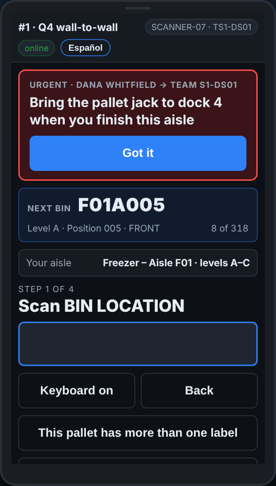

# On the scanner — A message from the office

**Role:** Everyone counting on a full count  **When:** the scanner buzzes and a message appears at the top

Your lead can send a message to your scanner: come to the dock, skip an aisle, take a break. It stays on the screen until you say you have read it.

## What you see

*A message at the top: read it, then Got it.*

## What to do

1. Read the message at the top of the screen. A red one is urgent.
2. Tap **Got it**.
3. Do what it says. You can keep scanning while it is on the screen.

## What the office sees

That your scanner has read it, and when.

## Do not

- Do not tap **Got it** without reading the message.
