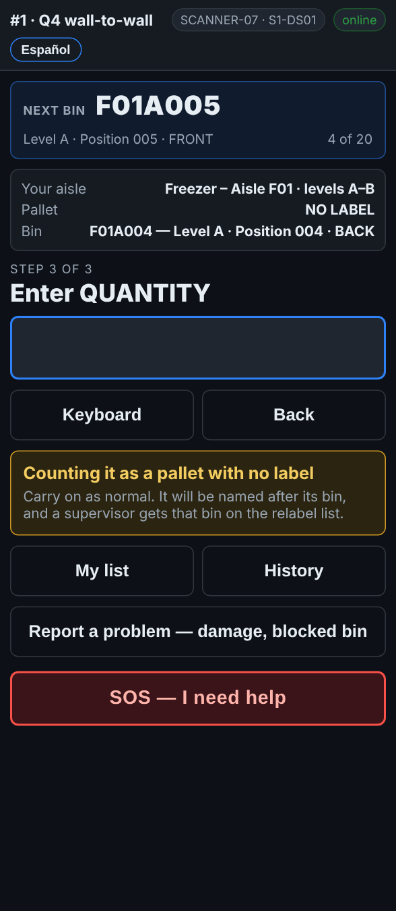

# On the scanner — A pallet with no label

**Role:** Everyone counting on a full count  **When:** there is no pallet label at all, or nothing on it can be read

A pallet with no readable label is still stock. You count it anyway, and the scanner gives it a name from the bin it is in, so somebody can walk straight to it later.

## What you see

*Nothing readable on it: the pallet is counted as NO LABEL, named after its bin when the line is saved.*

## What to do

1. Scan the rack label as usual. The screen asks for the pallet.
2. Tap **Label will not scan**.
3. Tap **Nothing readable on it**. The scanner says *Counting it as a pallet with no label*.
4. Count the cases and type the quantity as usual.
5. If something is wrong with the pallet itself, pick it on the comment step, or use **Report a problem**.

## What the office sees

The pallet is saved as **NO-LABEL-** and the bin, for example *NO-LABEL-F01A004-1*. A second unlabeled pallet in the same bin is *-2*. The bin goes on **Reports → Fix list** under *Labels to replace*, and the office matches the pallet to what the report expected in that bin. When a label is printed and on the pallet, the office taps **Label printed & on the pallet**.

## Do not

- Do not skip the pallet because it has no label.
- Do not borrow a label number from another pallet.
- Do not write on the pallet to make up a number.
