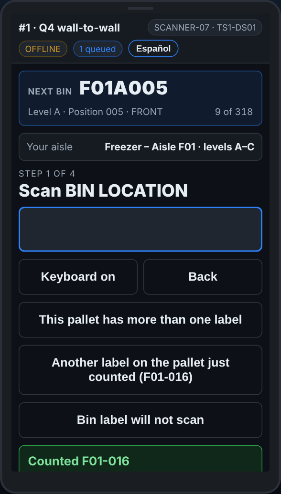

# On the scanner — No Wi-Fi

**Role:** Everyone counting on a full count  **When:** the top of the screen says OFFLINE

The Wi-Fi drops in the freezer and at the back of the dock. The scanner keeps every line and sends it when the signal is back. Keep counting.

## What you see

*OFFLINE, with the number of lines waiting to send.*

## What to do

1. Keep counting as normal. Every line is saved on the scanner.
2. The chip next to *OFFLINE* says how many lines are waiting, for example *3 queued*.
3. When the signal is back the lines send themselves. The chip says *online* and the count goes away.
4. Before you sign off, walk somewhere with signal so the queue empties. The scanner warns you if lines have not reached the office.

## What the office sees

The lines arrive when the scanner is back online, with the time they were scanned, not the time they arrived.

## Do not

- Do not count the same pallets again because the Wi-Fi dropped.
- Do not clear the browser or uninstall the app with lines queued.
- An SOS with no signal is **not** sent: the scanner says so. Go and find someone.
