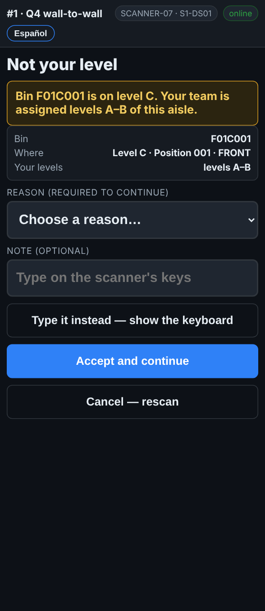
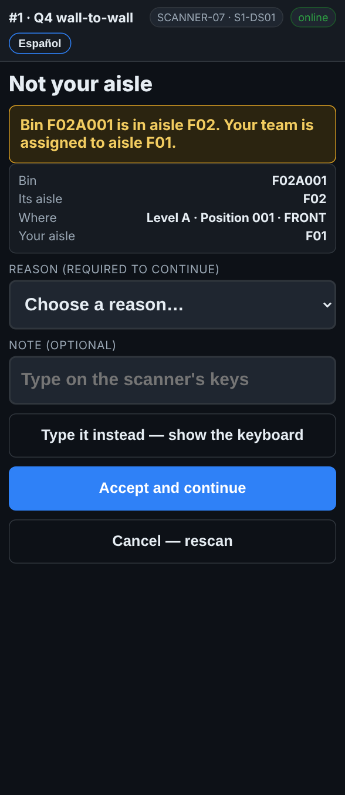

# On the scanner — Not your aisle, or not your level

**Role:** Everyone counting on a full count  **When:** you scan a rack label outside the aisle or levels your team was given

Your team counts the aisle and the levels on *My aisle*. A rack label from anywhere else is almost always the label above, below or across the aisle.

## What you see

*Not your level: the bin is on level C, your team counts A–B.*

*Not your aisle: the bin is in F02, your team is in F01.*

## What to do

1. The screen says **Not your level** or **Not your aisle**, with the bin and where you should be.
2. Check the label: did you scan the one above or below, or the aisle across?
3. Tap **Cancel — rescan** and scan the label of your spot.
4. Only if your supervisor sent you there: pick a reason and tap **Accept and continue**.

## What the office sees

An accepted line is flagged as counted outside the plan, with your reason, so it does not get counted again by the team that owns that aisle without the office knowing.

## Do not

- Do not count another team’s aisle unless your supervisor asks.
- Do not reach for a level your equipment does not reach.
