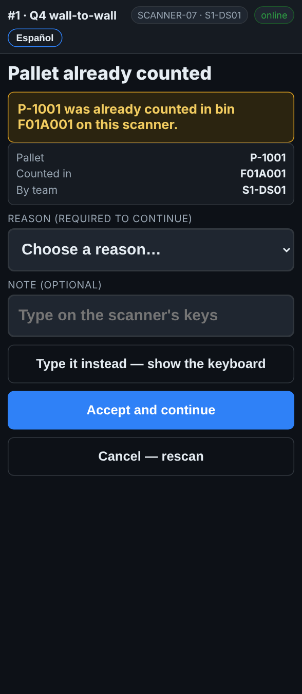

# On the scanner — A pallet that was already counted

**Role:** Everyone counting on a full count  **When:** you scan a pallet label that has already been counted on this count

The scanner tells you where the pallet was counted and by whom. Most of the time it is the same label scanned twice.

## What you see

*Pallet already counted: where, and by which team.*

## What to do

1. Read the yellow box: it says the bin it was counted in, and *on this scanner* or *by team …*.
2. You scanned the same label twice, or a pallet you just counted: tap **Cancel — rescan** and scan the next pallet.
3. It is a second label on one pallet: cancel, and use **Another label on the pallet just counted** instead. See *A pallet with two or more labels*.
4. The pallet really is here, and was counted somewhere else before it moved: pick a reason, add a note, and tap **Accept and continue**.

## What the office sees

An accepted duplicate is flagged. The office sees the pallet counted in two bins and decides which one stands, often with a second count.

## Do not

- Do not accept a duplicate because you are not sure. Cancel and ask.
- Do not count a pallet twice to be safe.
