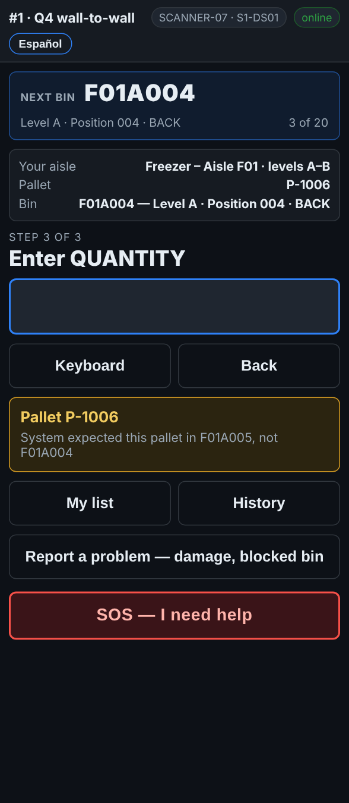

# On the scanner — A pallet in a different bin from the report

**Role:** Everyone counting on a full count  **When:** the pallet you scan is listed somewhere else on the report

Pallets move. The scanner tells you where the report expected it, and you count it where it really is. There is nothing to choose.

## What you see

*System expected this pallet in F01A005, not F01A004.*

## What to do

1. The yellow message says *System expected this pallet in …, not …*.
2. Count it here, where it is: type the quantity as usual.
3. Carry on. Do not move the pallet.

## What the office sees

The pallet shows as **WRONG BIN** on the pallet report, with the bin it was found in. If nothing was found in the bin the report expected, that bin shows its pallet as **MISSING**.

## Do not

- Do not move the pallet back during the count.
- Do not scan the rack label of the bin the report expected.
