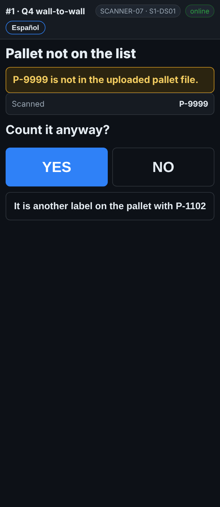

# On the scanner — A pallet that is not on the list

**Role:** Everyone counting on a full count  **When:** you scan a pallet label the inventory report does not have

A pallet the report does not know is still a pallet on the shelf. You count it, and the office adds it to the system.

## What you see

*Pallet not on the list: Count it anyway? YES or NO.*

## What to do

1. The screen says **Pallet not on the list** and asks **Count it anyway?**
2. Check the label: is it a pallet label, and is it on this pallet?
3. Tap **YES** and count it like any other pallet.
4. It was a wrong barcode, a case label or a sticker: tap **NO** and scan the right label.
5. It is a second label on the pallet you just counted: tap **It is another label on the pallet with …**.

On a count set to *strict*, the scanner does not offer YES: it says the pallet is not on the list. Ask your supervisor.

## What the office sees

The pallet shows as **NOT IN MASTER** on the pallet report. A supervisor adds it to the system as found stock.

## Do not

- Do not tap **NO** just to make the question go away. Found stock is never a problem.
- Do not scan case labels or item barcodes as the pallet label.
