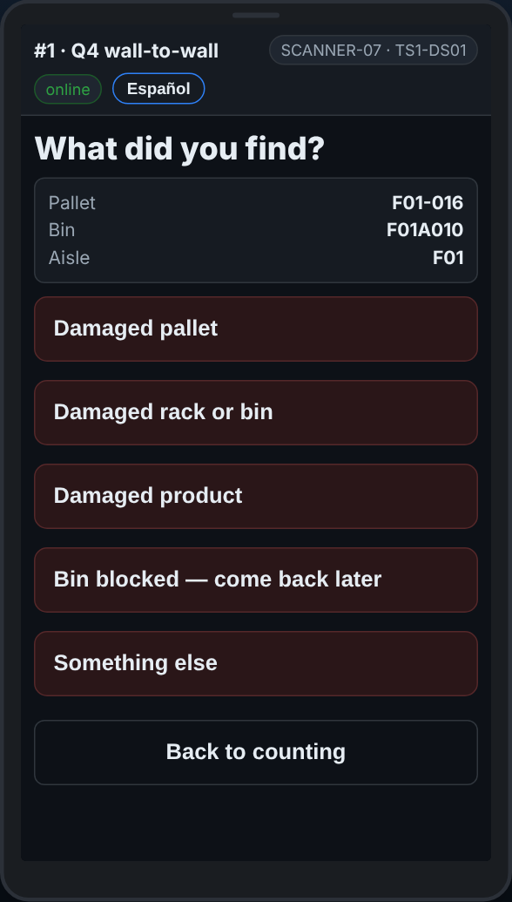

# On the scanner — Reporting a problem

**Role:** Everyone counting on a full count  **When:** something needs fixing but nobody is hurt: damage, a blocked spot, broken racking

Report a problem puts it on the office’s fix list with the exact bin or pallet. It is not an emergency button: for help now, use SOS.

## What you see

*What did you find? Pick what it is, then scan the bin or pallet to confirm.*

## What to do

1. Tap **Report a problem — damage, blocked bin**.
2. Pick what you found, then what is wrong with it.
3. Add a note if it helps. Tap **Type it instead — show the keyboard** to type it.
4. Scan the bin or the pallet the scanner asks for, so the office goes to the right one. Its label will not scan: tap **Label will not scan — type it**.
5. Tap **Back to counting** and carry on.

## What the office sees

Your report is on **Reports → Fix list**, with the bin, the pallet, your team and the time. Somebody fixes it and ticks it off.

## Do not

- Do not use Report a problem for an injury or anything dangerous. Use SOS.
