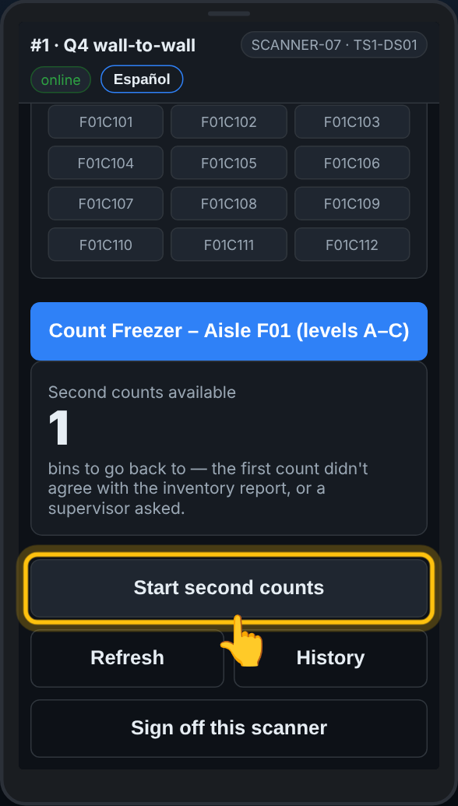
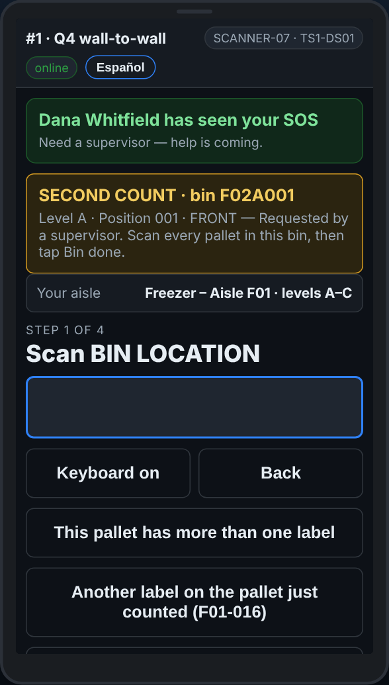

# On the scanner — Second counts

**Role:** Everyone counting on a full count  **When:** My aisle shows Start second counts

When a first count does not agree with the report, the office sends a different team back to that spot to count it again, blind. You are not told the first count.

## What you see

*My aisle: Second counts available, and Start second counts.*

*A second count: go to the bin, count everything in it, then Bin done.*

## What to do

1. On **My aisle**, tap **Start second counts**.
2. The banner at the top says which bin to go to.
3. Count everything in that spot: rack label, pallet label, quantity, for every pallet. An empty spot: **Bin is EMPTY**.
4. Tap **Bin done — nothing more here**. The next one comes up.
5. You cannot get to it right now: tap **Leave for another team**.
6. Scanned a different bin by mistake? The scanner says *This second count is for bin …*. Scan the right one.

## What the office sees

Your second count beside the first one on **Second counts**. When yours agrees with neither the first count nor the report, a third team may be sent.

## Do not

- Do not ask what the first count was.
- Do not count only the pallet that was wrong: count everything in the spot.
