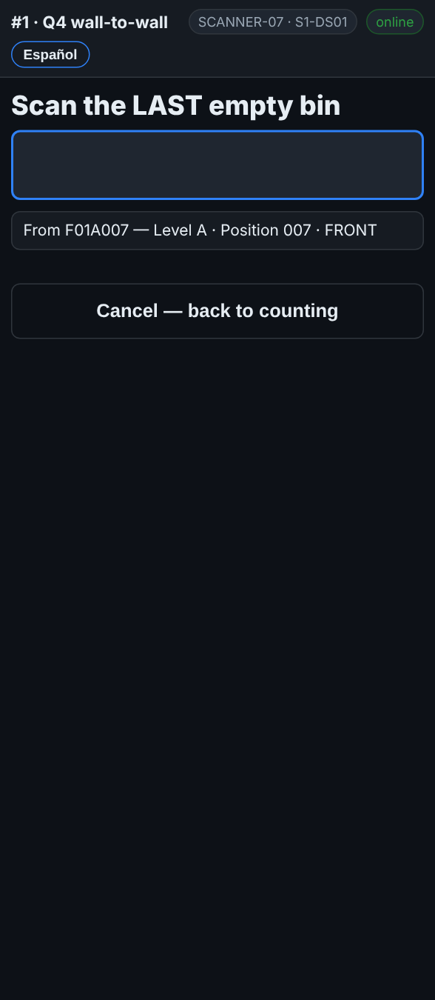

# On the scanner — Several empty bins in a row

**Role:** Everyone counting on a full count  **When:** a run of spots next to each other is empty

A row of empty spots can be recorded in one go: the first one and the last one, and the scanner lists every bin in between for you to check.

## What you see

*Scan the FIRST empty bin, then the LAST.*

*Untick any that are NOT empty, then Mark 3 bins EMPTY.*

## What to do

1. Scan the rack label of the first empty spot as usual. The screen asks for the pallet.
2. Tap **Several empty bins in a row**.
3. Scan the **first** empty bin of the run.
4. Scan the **last** empty bin of the run. Both have to be in the same aisle.
5. The scanner lists every bin in between on your levels. Bins already counted are greyed out and say *already counted*.
6. Walk the run and untick any spot that is **not** empty.
7. Tap **Mark N bins EMPTY**. **Cancel — back to counting** leaves without saving.

## What the office sees

Each bin in the run is recorded as checked and empty, the same as one at a time. A run over 60 bins asks you to check the first and last bin before you save it.

## Do not

- Do not mark a run you have not walked.
- Do not leave a spot ticked if there is a pallet in it.
