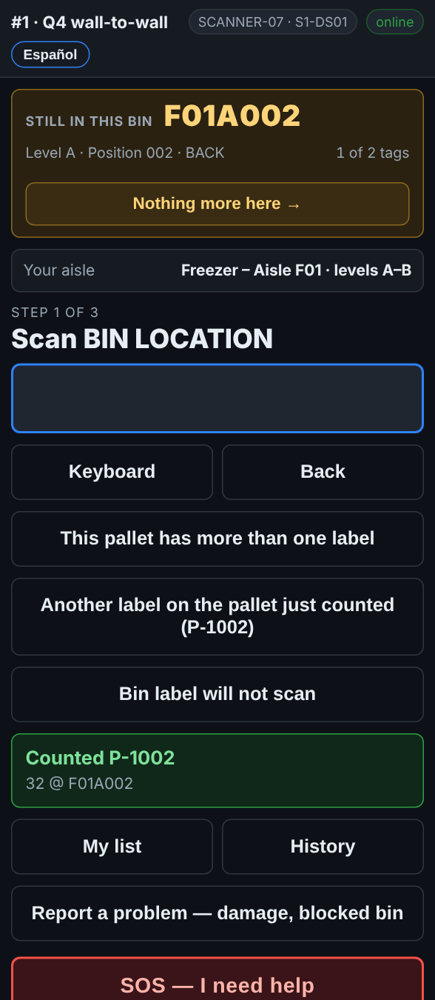

# On the scanner — Several pallets in one bin

**Role:** Everyone counting on a full count  **When:** there is more than one pallet in a spot

Two, three or four pallets in one spot is normal. The scanner keeps you at that spot until every pallet in it is counted, so none is left behind.

## What you see

*Still in this bin, 1 of 2 tags: the report expects two pallets here.*

## What to do

1. Count the first pallet as usual: rack label, pallet label, quantity.
2. The box at the top turns orange: **Still in this bin**, with a count such as *1 of 2 tags*.
3. Count the next pallet the same way: rack label, pallet label, quantity.
4. When every pallet the report expects is counted, the box goes back to **Next bin** by itself.
5. The scanner expects more but there are none: tap **Nothing more here →**.
6. A spot the report has nothing for stays open after a pallet, because there may be more. Tap **Nothing more here →** when you have counted them all.

## What the office sees

Each pallet is its own line in that bin. A pallet the report expected here and nobody counted shows as **MISSING** on the pallet report.

## Do not

- Do not leave a spot half counted.
- Do not count the pallets in the back row from memory: pull them forward or ask for a lift.
