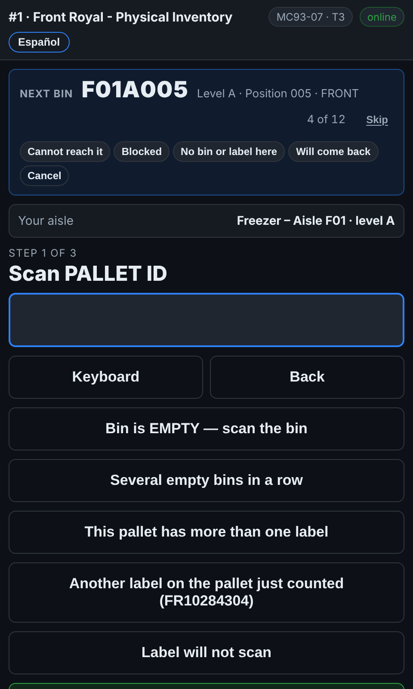

# On the scanner — Skip a bin you cannot count now

**Role:** Everyone counting on a full count  **When:** the guide points at a bin you cannot get to — out of reach, blocked, or there is no bin where the list says

The guide at the top of the counting screen walks the aisle with you. A bin you cannot count right now should not stop you, and it should not be forgotten either.

## What you see

*Skip, on the guide's progress line: pick why, and the guide moves on.*

## What to do

1. Tap the small **Skip** beside the progress count on the guide.
2. Pick why: **Cannot reach it**, **Blocked** (a trailer, a forklift, stock in the way), **No bin or label here**, or **Will come back**.
3. The guide moves on to the next bin. The scanner says *F01A005 skipped*.
4. At the end of the aisle the guide names what you skipped. Go back if you can — counting the bin takes it off the list.
5. If you walked past a bin without finishing it, the guide brings it up at the end as **Go back to**.

## What the office sees

Every skip is on the **Fix list** as a blocked bin, with your reason, your team and the time, so a supervisor can send somebody with the right equipment or clear what is in the way. Counting the bin later closes it.

## Do not

- Do not skip a bin that is simply empty: tap **Bin is EMPTY** and scan it. That is a count.
- Do not skip a bin to get past a pallet with a bad label: use **Label will not scan**.
